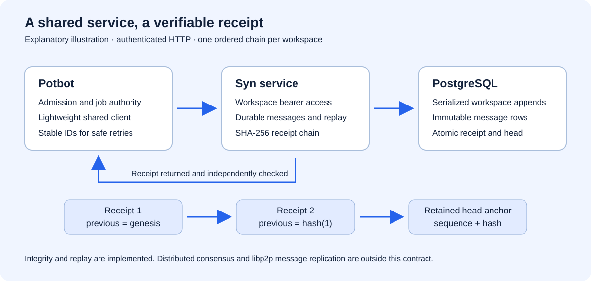

# Syn

Syn is a developing knowledge and communication system, with a uv-managed Python
application, a PostgreSQL semantic core and a portable client contract.

Start with the [current architecture and decision index](docs/architecture.md),
the [conceptual overview](docs/overview.md), and the [core-model contracts](docs/core-model.md).
The [official-release and independent-node requirements](docs/development/release-and-node-deployment.md)
define Syn's ownership boundary with Potbot. Adopted design, branch implementation
and qualified production behaviour are labelled separately in those guides.
The [SYN-R01 package and compatibility contract](docs/development/release-contracts.md)
defines exact release assets, independent authenticity pins and installed-code reporting.

## Official release

[Syn v0.3.1](https://github.com/Synsphere/syn/releases/tag/v0.3.1) is the signed,
immutable package release with Agent, operator and service profiles. See its
[release record and independent verification pins](docs/development/releases/v0.3.1.md) and
[native operator guide](docs/development/operator-node.md). Windows uses a managed
Ubuntu WSL2 installation; Linux and macOS run natively. Installed-host acceptance
and Agent deployment retain their own measured gates. The first service-only
[v0.1.0 record](docs/development/releases/v0.1.0.md) remains historical evidence.

The 0.3.1 patch bounds native credential connection lifetime without raising
sandbox resource limits. The earlier 0.2.1 patch repairs private-terminal and existing native-keystore unlock.
The persistent WSL handoff exposed that interaction gap in the historical
[0.2.0 release](docs/development/releases/v0.2.0.md).

## Setup

```sh
uv sync
```

## Usage

Copy `config.example.toml` to `config.toml` and set the real PostgreSQL connection string. `config.toml` is ignored by Git.

```python
from syn import ObjectRef, Thing, createEngine, createSessionFactory, loadConfig, sessionScope

config = loadConfig()
engine = createEngine(
    config.database.url,
    echo=config.database.echo,
    migrate=config.database.autoMigrate,
)
sessions = createSessionFactory(engine)

with sessionScope(sessions) as session:
    session.add(
        Thing(
            id=ObjectRef.local("thing", "example"),
            typeRef=ObjectRef.local("type", "thing"),
            name="Example",
        )
    )
```

Normal application startup installs the baseline schema through Alembic when
automatic migration is enabled. Direct SQL installation is the separately managed
administration route described in [the database guide](database/README.md).
Missing local references used by linking tables are silently materialized as
placeholder records containing their ObjectRef and a slug-derived name. General
external ObjectRefs are not materialized.

## Migrations

`createEngine()` automatically upgrades the database to the latest Alembic revision by default. Set `database.autoMigrate = false` in `config.toml` or pass `migrate=False` only when migrations are managed by a separate deployment process.

The initial migration packages the full domain/function/trigger schema. A complete unversioned Syn schema is validated and stamped automatically; a partial unversioned schema is rejected.

The next migration installs Syn's polyhierarchical core ontology. Types may have
multiple parents through `typeParents`, but `subTypeOf` cycles are rejected. The
`typeAncestry` and `objectTypeAncestry` views expose transitive inheritance,
and `objectHasType()` checks both direct and inherited membership. Every Thing,
Event, Ember, Cog, Credential, Enigma, Pondle, Snug, and Om has exactly one required
`typeRef` directly on its table. The former `objectTypes` linking table has been
removed. Each primitive has a root Type such as `syn://type/enigma`; missing
classifications fall back to the appropriate primitive root during migration
or placeholder materialization.

Credentials use `syn://credential/{slug}` identities and the
`syn://type/credential` root Type. Their `publicKeyHash` and `privateData` are
opaque binary fields so different key and secret formats can coexist. Public
hashes are unique when present; empty values are rejected. Placeholder
Credentials may leave both fields unset. `privateData` is deferred and raises
on accidental ORM loading, and must never be included in public API payloads.

The curated ontology is defined in `syn.ontology` and seeded idempotently during
migration. Its `question` type retains the project definition: “A proposition
which can be answered, either yes or no, or with any other kind of response.”

The feed ontology is defined in `syn.feeds`. It supports overlapping subject,
delivery, representation, catalogue, media, statistical, geospatial, and market
feed types. Imported Things receive one direct `typeRef`; when several
independent classifications apply, Syn reuses or creates a validated
intersection type and gains the parent classifications through inheritance.

Create and review a future ORM migration:

```sh
uv run alembic revision --autogenerate -m "describe change"
```

Apply migrations explicitly:

```sh
uv run alembic upgrade head
```

Alembic can autogenerate table, column, index, and ordinary constraint changes. PostgreSQL domains, functions, and triggers must be added manually to revisions and reviewed before deployment.

## Feed import

Import the global feed research CSV bundle with the project configuration:

```sh
uv run python scripts/importFeeds.py "C:\path\to\global_feed_research_csv_bundle.zip"
```

The importer reads `global_data_sources_master_2326.csv`, treats the companion
CSV files as ontology research rather than additional feed rows, and merges URL
duplicates after safe URL normalization. It preserves every master column in
the Thing's camelCase `knowledge` dictionary, adds a description and provenance,
and upserts deterministic `syn://thing/` ObjectRefs. Re-running it is safe.

Verify an installed feed dataset:

```sh
uv run python scripts/verifyFeeds.py
```

## Test

Run the complete suite. PostgreSQL integration tests read their connection URL
from `config.toml` and skip until it contains a usable URL. Set `SYN_CONFIG` to
select a different configuration file when needed:

```sh
uv run pytest
```

Run the fast, database-independent suite with Python branch coverage:

```sh
uv run pytest -m "not database" --cov=syn --cov-report=term-missing
```

Run only the PostgreSQL domain, constraint, trigger, and index tests:

```sh
uv run pytest -m database
```

## API service

Syn now also supplies authenticated durable workspace messages and verifiable
hash-chain receipts for consumers such as Potbot. The dependency-free client
lives in `packages/syn-client`; [communication setup and contracts](docs/communication.md)
describe credentials, migration, replay and the ledger's integrity limits.



*Explanatory illustration of the implemented service boundary, not a UI screenshot.*

Start the web server with the uv command installed by the package:

```sh
uv run syn-server
```

Inspect installed package capabilities without loading configuration, connecting
to PostgreSQL, migrating or starting discovery:

```sh
uv run syn-server --describe-json
```

An existing service also exposes `GET /v1/capabilities`. These report installed
code, with `agent`, `operator` and `service` modes in 0.3.1. They do not prove enabled workspaces, host
acceptance or operator/Agent node availability; see the
[compatibility contract](docs/development/release-contracts.md#declared-compatibility).

The equivalent direct script is `uv run python scripts/startServer.py`. Both
load `config.toml`, apply migrations when `database.autoMigrate` is enabled,
register the default process handlers, and serve on `http://127.0.0.1:8000`.
Use `--host`, `--port`, `--config`, and `--log-level` to override the defaults:

```sh
uv run syn-server --host 0.0.0.0 --port 8080 --log-level debug
```

Open `http://127.0.0.1:8000/` to view the Jinja-rendered Syn welcome page.
Open `http://127.0.0.1:8000/editTypes` to search for a type and load its
database-backed details into an editable form and save changes.

The FastAPI application exposes placeholder `GET` controllers for each core
database primitive while their persistence behavior is developed:

- `GET /api/cog`
- `GET /api/credential`
- `GET /api/ember`
- `GET /api/enigma`
- `GET /api/event`
- `GET /api/om`
- `GET /api/pondle`
- `GET /api/snug`
- `GET /api/thing`

Each currently returns the primitive name, a `placeholder` status, and a
temporary response message. They are included in the generated OpenAPI schema.

Types additionally expose database-backed endpoints:

- `GET /api/type/{id}` retrieves `syn://type/{id}` with its recursively nested
  parent-type branches.
- `PUT /api/type/{id}` updates the existing `syn://type/{id}` record.
- `GET /api/type?query={search}` searches type names and IDs and returns up to
  ten relevance-ranked results.

When `parents` is supplied to the PUT endpoint, it must be a list of local Type
ObjectRefs. The Type model rejects missing types, duplicates, self-parenting,
and any list in which one selected parent is an ancestor of another selected
parent at any depth. Omitting `parents` leaves the existing relationships intact.

The [Type interface contract](docs/core-model.md#type-interfaces) also documents
declared property CRUD/cardinality, recursive descendant trees (`depth=10`, range
0-100), `/exploreTypes` and the parent/property editors. Canonical Type policy
export and adoption are described in [Type policies](docs/development/type-policies.md).

### Process scheduler

Create an application with an explicit allow-list of process-safe handlers. Handler
functions must be module-level callables so Python can pickle them for a child process.

```python
from syn.api import createApp

def buildReport(reportId: str) -> dict:
    return {"reportId": reportId, "complete": True}

app = createApp(sessions, {"build-report": buildReport})
```

Run that module with Uvicorn, then use `POST /scheduler/start`, `POST /jobs`,
`GET /jobs/{jobId}`, `DELETE /jobs/{jobId}`, and
`GET /jobs/{jobId}/result`. A job submission body has the form
`{"handler": "build-report", "arguments": {"reportId": "example"}}`.

Syn also supplies `defaultJobHandlers`, including `witness-stale-feeds`. This
job selects up to 100 feed Things with the oldest stored parsed-entry updates, scores their stored
activity, and witnesses the most active 50 in descending score order:

```python
from syn import defaultJobHandlers

app = createApp(sessions, defaultJobHandlers(config.database.url))
```

Submit it with `{"handler":"witness-stale-feeds","arguments":{}}`. The database
URL is bound when the application is created and is not persisted in job arguments.
Each successful request creates a `feedWitness` Event containing the feed and
URL references, response bytes, parsed entry timestamps, HTTP headers, answering
IP address, and DNS/TCP/TLS/HTTP/data-transfer/connection-close timings. Only
publicly routed destination addresses are allowed, and responses default to a
10 MB limit. HTTP 301 and 302 redirects are followed for up to ten hops, with
destination safety checks repeated for every hop. The job prints timestamped
actions while it runs and includes those logs and per-hop timings in its result.
TLS verification uses the checksum-pinned Mozilla CA bundle packaged at
`src/syn/cacert.pem`; its upstream checksum is retained alongside it.

In persistence-enabled environments, a successful witness creates an Event
classified as `observation`, an Ember classified as `observation-result` holding
the redacted HTTP result, and a separate `network-measurement` Ember holding network
timings and transfer statistics. Event targets and object relationships connect
all three objects. Authorization, cookie, proxy-authorization, and API-key
headers are replaced with `[REDACTED]` before objects are constructed.
The network measurement records the peer certificate chain for every TLS hop,
including X.509 metadata, fingerprints, signature algorithms, and PEM-encoded
public keys.

### libp2p networking

This section describes existing peer discovery. The required account-bound,
encrypted private Syn mesh and per-Agent topology are specified in the
[current architecture](docs/architecture.md); discovery is not that acceptance.

The API starts a py-libp2p node with its application lifespan and closes it during
graceful shutdown. By default it listens on ephemeral TCP ports on every IPv4 and
IPv6 interface. Use the optional `[p2p]` configuration table to choose fixed
listening addresses or connect to bootstrap peers:

```toml
[p2p]
enabled = true
mdnsEnabled = true
upnpEnabled = true
listenAddresses = ["/ip4/0.0.0.0/tcp/4001", "/ip6/::/tcp/4001"]
bootstrapPeers = ["/dnsaddr/bootstrap.libp2p.io/p2p/<peer-id>"]
startupTimeoutSeconds = 15
```

Built-in libp2p mDNS advertisement and LAN peer discovery are enabled by default.
Discovered peers are added to the host peerstore. `GET /p2p/status` returns the
node's runtime peer ID, bound multiaddresses, configured bootstrap peers, and
discovered peer IDs. Set `mdnsEnabled = false` to disable only LAN discovery, or
`enabled = false` when the application must run without its libp2p network.

UPnP IGD discovery and TCP port forwarding are also enabled by default. When the
router supports UPnP and reports a public address, py-libp2p maps each active TCP
listener port to the host and removes those mappings during graceful shutdown.
`GET /p2p/status` reports the gateway's `upnpExternalIp` when discovery succeeds.
Set `upnpEnabled = false` to prevent the application from changing router mappings.


## Reliable Python tests on Windows

Run focused tests through `pwsh ./scripts/Invoke-Tests.ps1 <test-path> [...]`.
The wrapper probes create/read/atomic-rename/delete access before collection,
uses a unique per-run root beneath `%LOCALAPPDATA%/<project>/pytest-tmp` on
Windows, redirects Python process temporary files, pytest's `--basetemp` and cache,
then removes only that run's directory and restores the caller's environment.
This avoids stale or sandbox-altered `%TEMP%\pytest-of-*` ACLs and prevents
parallel checkouts from sharing a pytest root.

Repository text is stored and checked out as LF through `.gitattributes`;
declared binary media, archives, fonts and model formats remain byte-exact.

An omitted test selection fails closed. Use `-FullSuite` only for an explicit
release or whole-environment diagnostic; routine local work should select the
affected tests, while GitHub Actions owns the complete platform matrix.

This is a command-line environment-isolation contract, so screenshots or video
would not add reliable evidence. The probe messages, selected test output and
process exit code are the verification evidence.

## Canonical Agent deployment

The [SYN-R04 Agent node guide](docs/development/agent-nodes.md) describes the
released 0.3.1 profile: real Linux/WSL Agent processes, selected-leaf adoption, distinct
native custody and separately provisioned current-group keys. Native source-wheel
and local official-package acceptance ran two nodes through node and full-keystore
session restarts. The [dated release record](docs/development/releases/v0.3.1.md)
retains published pins and the independent qualification gates. Cog execution
remains SYN-R05 work.
