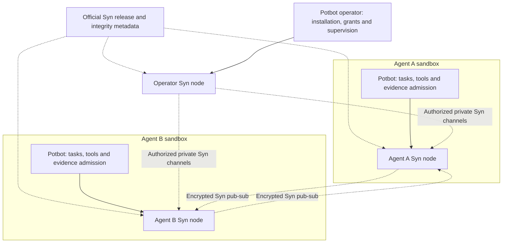
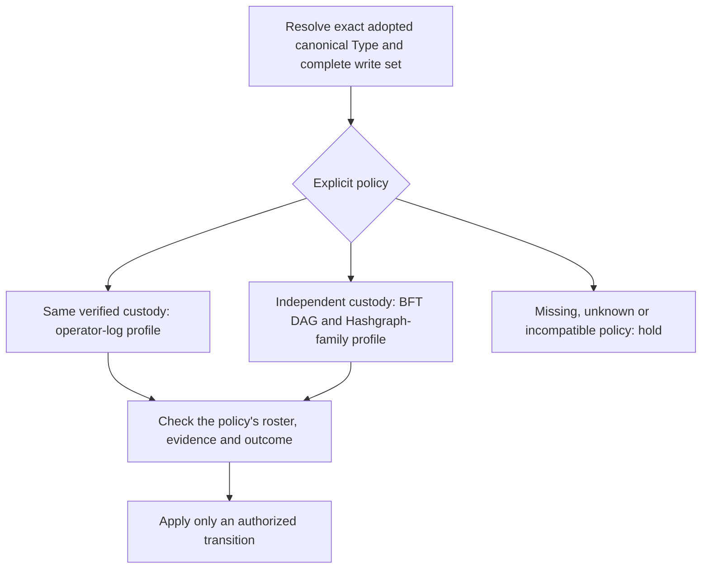

# Syn architecture and adopted design decisions

Reconciled on **1 November 2026** against the available Syn project conversations,
the later Potbot/Syn ownership clarification, and Syn source at `3042e9c`.
This is the current design index. A recorded requirement is distinct from an
implemented contract, a running service, and a qualified production deployment.

At the audit checkpoint, GitHub `master` was `9e025f1`; the implementation
foundation was on the open integration branch at `3042e9c`. References to
implemented foundations below describe that inspected branch, not a claim that
its code was merged to the default branch or deployed. Local source snapshots,
database dumps and conversation ZIPs are excluded from this documentation update.

The [conceptual overview](overview.md) explains the goals and philosophy. The
[core-model guide](core-model.md) records the database, ontology, API, observation
and execution decisions. The [release and node deployment contract](development/release-and-node-deployment.md)
defines the upstream ownership and installation requirements.

## Purpose and interpretation

Syn is intended to support shared, revisable understanding and plural communities,
with positive human experience taking priority over financial extraction.
Knowledge, inquiry, reasoning, attachment and moral value retain distinct roles.
Consensus establishes an authorized shared outcome; it does not establish a
claim's truth, a person's worth or an AI conclusion's quality.

The ten primitive families are Type, Thing, Event, Ember, Cog, Credential,
Enigma, Pondle, Snug and Om. Use the [current vocabulary](core-model.md#vocabulary)
and distinguish intended semantics from native ancestry. The Enigma trust/question
divergence is unresolved, and Cog includes a configured computation-capable
entity distinct from its invocation. Naming brainstorms and early SQL
sketches are historical design inputs, not instructions to reinstate superseded
names, UUID object keys, array-based links or the removed `objectTypes` table.

## Required topology and division of responsibility

The operator runs a real Syn node outside Agent-controlled sandboxes. Each unique
Agent runs its own real Syn instance inside its sandbox, with independent
identity, credentials, private state and lifecycle. A shared HTTP service or an
in-process worker actor is not the completed multi-node architecture. Workers
acting for one Agent do not automatically become new Agents.

*Generated target-architecture diagram. Dashed paths require release/runtime/mesh
acceptance; the local HTTP adapter is an existing foundation, not proof of this
topology running. No running multi-node interface was captured for this audit.*

Syn owns its node runtime, semantic and protocol contracts, identity/keystore/
enrollment implementation and release artifacts. Potbot installs, pins,
configures and supervises Syn, and owns Agent reasoning, scheduling, budgets,
sandboxing, tool effects, result verification and memory admission. Integration
adapters do not become a second Syn implementation. Current native custody work
in Potbot is a transitional implementation boundary; it must be reconciled with
the upstream contract before claiming release-based node deployment.

All Agent-to-Agent requests, replies, coordination, results, acknowledgements,
consensus, checkpoint and repair traffic must go through their own Syn instances
over the private group. A direct Potbot API, shared-file inbox, database, MCP
session or parallel socket must not become an alternative Agent messaging route.
Using a tool for authorized task work is a separate activity. Receiving a message
or possessing a group key does not grant execution or local database authority.

## Exchange and execution boundary

Each service retains its own tables and migrations, even on one PostgreSQL host.
Potbot's local semantic snapshot service is distinct from Syn's HTTP message
service. A remote Cog description does not register executable code. Selected
semantic imports are validated and sealed; a mutable upstream Type edit must
not silently change the release pinned by a running task.

The implemented Potbot export increment is an explicitly approved, minimized
execution metadata summary with source installation/workspace/event/run identity,
its own source cursor, causal parent references and bounded lifecycle fields.
It asserts a source report, not producer admission, semantic conformance, accepted
evidence or successful execution. Larger artifacts, unrestricted prompts, private
or deletable memory, keys and sensitive bodies stay with their owners. Even paths,
identifiers and digests can require disclosure/retention approval. Richer payloads
need separately versioned contracts, not extra fields added to the existing one.

Local service credentials are scoped to installation, workspace and configured
service origin; they are separate from node account keys and peer-group secrets.
Workspace authorization precedes token resolution or network activity. The
service token remains workspace-wide; it does not supply per-channel privacy or
Agent execution authority. See the existing [HTTP contract](communication.md).

The intended durable relay commits an approved delivery intent with the local
source event, sends after commit, and uses the existing worker fencing and exact
retry identity/content. An uncertain acknowledgement is retried without rerunning
a tool or paid model call. Source event cursors and Syn receipt sequences remain
different histories. A receiving inbox validates identity, audience, contract,
semantic version, deduplication and local grants before any execution or memory
admission. Full producer admission, outbox/inbox and encrypted peer delivery are
separate unfinished gates, not consequences of a successful manual HTTP export.

Potbot must install official, pinned Syn release packages from
[`Synsphere/syn`](https://github.com/Synsphere/syn). A development submodule can
pin source for compatibility work; it does not satisfy production installation.
The [deployment gates](development/release-and-node-deployment.md) preserve this
distinction. No GitHub releases existed when queried on 1 November 2026, so the
upstream release contract remains a concrete prerequisite.

## Identity, custody and private communication

Every Syn reference to another node uses that node's **own public-key hash**.
For the current profile this is lowercase SHA-256 of the raw 32-byte Ed25519
assigned account public key. An operator label, issuer-key hash, account number,
instance UUID, transport peer ID or engine-local numeric index is not a node
address. Transport locators remain internal and must be authenticated against
the expected node hash.

The operator retains the secret base address key and allocation register. It
derives and assigns a unique numbered account key to each Agent and is
responsible for preventing duplicate assignments. An Agent receives only its
assigned account secret and the current group key as secrets, together with the
necessary public certificates and metadata. It receives no base/root secret,
sibling keys or group-derivation secret. Group encryption uses a distinct,
versioned derivation context bound to group and epoch. Group-key rotation is
separate from account identity; replacing the account key changes the node hash.

Common custody is established through pinned issuer credentials, assigned-key
checks and fresh possession evidence. Hardened derivation is not publicly proven
by comparing two public hashes. Neither a shared issuer nor a valid credential
proves unmodified code, grants a vote by itself or proves independent human
operators. The selected roster and Type policy still apply.

## Consensus is selected per canonical Type

Each Type admitted to new shared transaction processing must carry its explicit
consensus policy in an adopted canonical Type definition/release. Pin the catalog,
release, definition and policy digests, plus stream/domain/genesis, epoch and
roster. A mutable local Type draft, application flag or peer-supplied digest
cannot select its own trust. `synny://type/` is a supported alias within the same
pinned catalog, not a new global identity or an alternative object URI scheme.

*Generated decision diagram. Policy parsing and bounded verification exist;
this is not a live consensus selector or an operating federation.*

Within one verified custody root, the target is simpler authenticated agreement
with an explicit crash/partition model. The current operator-log contract defines
a strict-majority authority. Credentials establish membership; they do not
resolve conflicting valid proposals or turn consent signatures into an operating
replicated log. No Raft engine is activated by the resolver.

Across independent custody roots, the owner-selected direction is **BFT DAG plus
Hashgraph-family agreement**. Eligible voting power, issuer concentration,
availability, virtual voting/order and recoverable proof history need a coherent
qualified composition. Issuer diversity is a structural check, not proof of real
independence. No particular production engine has been selected or qualified.
The [Hiero source review](development/hiero-boundary.md) records concrete
integration blockers rather than claiming a working adapter.

Type ancestry must not silently select a parent's backend or weaken a child's
policy. Policy-less legacy Types remain readable locally but are held from new
shared processing. The complete operation and affected-subject write set must
resolve compatibly; omitting a protected subject is not an escape route.

Genesis requires independently provisioned trust pins. A successor must be
approved under **every existing policy and the old Type-governance authority**.
New governors, rosters or weaker policies cannot approve their own installation.
For federated replacements, bounded finality under the old policy/roster and
separate old-governor approval are both required. Preserve pinned historical
profiles and explicit cutovers. See [policy resolution](development/type-policies.md),
[genesis](development/policy-genesis.md), [signed governance](development/signed-governance.md)
and [DAG finality](development/dag-finality.md).

Protected DAG signing must survive Agent restart or vault restoration without
authorizing a conflicting branch. The implemented research profile uses durable
Agent intent/commit state and an independently retained operator reservation
journal. Recovery returns the exact reserved event. Operator state must remain
outside Agent backups and write access. Rolling back both operator files, or a
malicious base-key holder, remains outside that guarantee and requires an
independent checkpoint or identity retirement. See [protected signing and recovery](development/protected-dag-signing.md).

## Status and supersession

| Layer | Current evidence | Remaining qualification |
| --- | --- | --- |
| Semantic core, Type tools, observations, jobs and peer discovery | Source and tests in the established application | A fresh deployment/host check is separate from this documentation audit. |
| Workspace HTTP messages and hash-chain receipts | Implemented service/client contracts | No implied author signatures, distributed finality or automatic execution. |
| Canonical Type policies and public-key-hash identity | Implemented portable contracts and offline resolution | Live identity/peer binding and admission remain separate gates. |
| Genesis, signed successors and old-policy DAG replay | Implemented bounded storage and verification | Not a complete live agreement engine; coin-dependent elections remain held. |
| Protected DAG event reservation/recovery | Syn verifier and existing Potbot native custody integration | Independent operator-state assumption, capacity and real runtime integration remain explicit. |
| Official release installation and real node per operator/Agent | Required deployment architecture | Release artifacts, installation lifecycle, private mesh and end-to-end fault acceptance remain outstanding. |

The old [distributed-ledger plan](distributed-ledger-plan.md) and
[consensus comparison](consensus-comparative-review.md) remain useful dated
research. Their **CometBFT-first recommendation is superseded** by the per-Type,
two-trust-profile direction above. Earlier shared-service/submodule descriptions
are development foundations, superseded as the production topology by per-Agent
nodes and official release installation. Keep the comparative research available
without treating its recommended defaults as later owner decisions.

## Decision coverage index

The private audit retains source chat/turn references. This repository index
contains only the resulting design and public-safe source/test references.

| Decisions retained | Maintained documentation and implementation evidence |
| --- | --- |
| Human experience, plural value, context, revision and accountable human/AI collaboration | [Overview](overview.md); [historical project account](../synny/reports/2026-07-30.md) |
| Current primitive meanings; original question definition; Cog Event/input/output intent | [Core vocabulary](core-model.md#vocabulary); [ontology](../src/syn/ontology.py) |
| URL-string ObjectRef, strict local typed refs, immutable identity, registry and placeholders | [Core identity](core-model.md#identity-and-integrity); [refs](../src/syn/refs.py); [database model](../src/syn/models.py) |
| camelCase schema, intelligence/provenance fields and normalized relationships | [Core identity](core-model.md#identity-and-integrity); [baseline SQL](../database/objectReferenceSchema.sql) |
| One direct primitive Type, intersection classifications, multiple independent parents and full ancestry validation | [Core classification](core-model.md#classification); [model validation](../src/syn/models.py) |
| Type read/search/update, parent editor, property cardinalities and bounded descendant explorer | [Type interfaces](core-model.md#type-interfaces); [controller](../src/syn/controllers/type.py) |
| Inherited default and instance Ember contracts, locking Cog/Credential roles and public/owner views | [Ember contracts](core-model.md#inherited-and-instance-ember-contracts); source/intent distinctions remain explicit. |
| uv/SQLAlchemy/PostgreSQL, config-only live connection and automatic versioned migrations | [Persistence](core-model.md#persistence-and-configuration); [database](../src/syn/database.py); [migrations](../src/syn/migrations.py) |
| Wikipedia Things; normalized feed deduplication, metadata and provenance | [Imports](core-model.md#data-import-and-observation); [feed importer](../src/syn/feeds.py) |
| 100-feed shortlist, activity ranking, 50 remaining; response/network Embers and complete bounded body | [Observations](core-model.md#data-import-and-observation); [witness implementation](../src/syn/feed_jobs.py) |
| Redirects, timing, detailed errors, public-destination checks, pinned TLS bundle and certificates | [Observations](core-model.md#data-import-and-observation); [HTTP tests](../tests/test_feed_http.py) |
| Durable registered process jobs, recovery/cancellation, API prefix and Jinja launcher | [Execution](core-model.md#execution-and-networking); [scheduler](../src/syn/scheduler.py); [API](../src/syn/api.py) |
| Managed IPv4/IPv6 libp2p, built-in mDNS, bootstrap/status, optional UPnP cleanup | [Networking](core-model.md#execution-and-networking); [peer implementation](../src/syn/p2p.py) |
| HTTP workspace isolation, exact retries, replay, retained anchors and acknowledgement limits | [Communication contract](communication.md); [service](../src/syn/communication.py) |
| Scoped service credentials, minimized versioned exports, separate cursors and durable relay/admission intent | [Exchange and execution boundary](#exchange-and-execution-boundary); [HTTP guarantees](communication.md) |
| Syn/Potbot ownership, separate operator/Agent nodes, Syn-only private pub-sub | This guide; [release/deployment](development/release-and-node-deployment.md) |
| Operator base custody, unique accounts, restricted Agent/group keys and public-key-hash addressing | This guide; [credential verification](../packages/syn-client/src/syn_client/custody.py) |
| Per-Type canonical policy, trust pins, explicit inheritance, complete write set and two custody profiles | This guide; [Type policy guide](development/type-policies.md); [contracts](../packages/syn-client/src/syn_client/consensus.py) |
| Old-policy plus old-Type-governor approval, immutable genesis and bounded finality | [Governance](development/signed-governance.md); [DAG finality](development/dag-finality.md) |
| Durable non-equivocating DAG signing and exact recovery with external operator state | [Protected signing](development/protected-dag-signing.md); [verifier](../packages/syn-client/src/syn_client/dag_signing.py) |
| Syn-owned application, PostgreSQL, portable client and pinned-consumer workflows | [CI ownership and limits](development/ci.md) |
| Official upstream release packages, integrity/version pins, lifecycle and independent node acceptance | [Release/deployment contract](development/release-and-node-deployment.md) |

Screenshots and video are omitted because this reconciliation changes design
documentation, not a demonstrated interface or network. The new diagrams explain
the relationships without presenting planned behaviour as implemented evidence.
