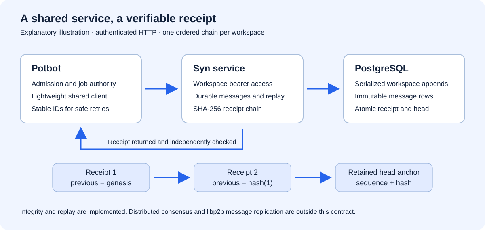

# Syn communication service

Syn supplies durable workspace messages and an append-only SHA-256 receipt chain.
Potbot uses the lightweight `syn-client` package from its pinned Syn submodule;
its existing job database, admission checks and signing broker retain their roles.

That submodule describes the current development integration. The adopted
production boundary requires [official Syn release packages and real independent
operator/Agent nodes](development/release-and-node-deployment.md). All Agent-to-Agent
traffic must use their own Syn instances and encrypted private Syn pub-sub;
the shared HTTP service documented here is not that target topology. See the
[current architecture](architecture.md) for ownership, identity and per-Type policy.



*Generated explanatory diagram of the implemented service boundary, not a screenshot.
The actual HTTP flow is exercised by `test_real_http_client_restart_replay_and_retained_anchor`.*

## Run the service

```sh
uv sync --locked
# Configure database.url in ignored config.toml.
# SYN_COMMUNICATION_TOKENS is a secret JSON mapping of workspace UUIDs to tokens.
uv run syn-server --host 127.0.0.1 --port 8000
```

Supply `SYN_COMMUNICATION_TOKENS` through your service environment/secret manager.
Each canonical workspace UUID requires a distinct, randomly generated bearer token
of at least 32 printable characters. Do not commit tokens, print them, place them
in message payloads or use them as browser API credentials. The variable is read
once at application construction; restart the service after credential rotation.
Without a nonempty mapping, the communication routes are absent. Existing Syn
Type/scheduler endpoints retain their current authentication behaviour.

The normal Alembic upgrade installs revision `20261023_0012`. It adds two tables
without changing primitive records. Use a separate application DB role without DDL
or trigger-management authority. Back up persistent deployments before upgrading.
The PostgreSQL migration serializes workspace appends by locking the head row and
blocks `UPDATE`, `DELETE` and `TRUNCATE` on message receipts. Privileged database
owners can bypass protections; retain receipt hashes outside that database.

For a colocated Potbot service, disable Syn mDNS and UPnP in `[p2p]` when they are
unneeded, or set `enabled = false`. This integration does not open peer streams or
forward messages over libp2p. Its communication transport is authenticated HTTP.
The client requires HTTPS except on loopback, refuses redirects, bypasses ambient
HTTP proxies and applies request timeouts and response-size bounds. Place remote
deployments behind an appropriately configured HTTPS service boundary.

## Message and receipt contract

All routes start with `/v1/communication/workspaces/{workspace_uuid}` and require
that workspace's `Authorization: Bearer …` credential:

| Operation | Result |
| --- | --- |
| `POST /messages` | Append a message, or return the original receipt on an identical retry. |
| `GET /messages?after=0&limit=50` | Replay every channel in workspace sequence order; maximum page 100. |
| `GET /head` | Read the workspace's current sequence and hash, or genesis for an empty workspace. |

POST accepts exactly `message_id` (canonical UUID), `channel` (bounded lower-case
identifier), `sender` (bounded printable application identity) and `payload` (JSON
object, at most 65,536 canonical bytes). Reusing a message ID with different
contents returns HTTP 409. A token authorizes a workspace; `sender` is an assertion
by that trusted client, not a cryptographic signature or separate user identity.
Every token holder can read all channels in its workspace. Channels are labels,
not private mailboxes. There is no automatic message execution.

Receipts contain those fields plus `schema_version: 1`, `workspace_id`, `sequence`,
`recorded_at`, `previous_hash` and `hash`. The hash is SHA-256 of the whole receipt
excluding `hash`, encoded with `json.dumps(sort_keys=True, separators=(',', ':'),
ensure_ascii=True, allow_nan=False)`. Genesis has sequence 0 and 64 zero hex digits.
Only committed appends advance the head. Each workspace has its own chain and
message-ID namespace. This is a tamper-evident service ledger, without consensus,
mining, distributed replication, signed authorship or global finality.

```python
import os
from uuid import uuid4
from syn_client import SynClient

client = SynClient("http://127.0.0.1:8000", os.environ["POTBOT_SYN_TOKEN"])
workspace = os.environ["POTBOT_WORKSPACE_ID"]
message_id = str(uuid4())  # Persist BEFORE sending; reuse after any uncertain result.
receipt = client.send(workspace, message_id=message_id, channel="agents.progress",
                      sender="potbot", payload={"stage": "observed"})
anchor = client.head(workspace)  # Retain independently of Syn's database.
assert client.verify(workspace, expected_head=anchor) == anchor
```

Verification reads a finite head captured at the start, checks message hashes,
scope, continuity and the final anchor. An externally retained head detects
rewrites or truncation of that prefix. Verification against a freshly fetched head
establishes internal consistency only; a compromised service could rewrite both
its history and head. A send acknowledgement proves persistence, not that another
agent received, understood or acted on the message.

## Verification

```sh
uv run pytest tests/test_communication.py -q
# Opt in with a PostgreSQL URL whose owner can create a disposable schema:
uv run pytest tests/test_communication_postgres.py -q
```

The second command requires `SYN_COMMUNICATION_TEST_URL`. It creates a unique
`syn_communication_test_<uuid>` schema, runs only this migration, tests concurrency,
idempotent retries and database immutability, then removes that schema. It never
upgrades existing Syn tables. SQLite is used only for fast HTTP/protocol fixtures;
it does not establish PostgreSQL concurrency behaviour.

This service has no new graphical interface. The diagram and real HTTP tests are
the useful documentation media; UI screenshots and a GUI video would not add
implementation evidence. No model downloads or DanceFlow media processing are
needed for this backend integration.
