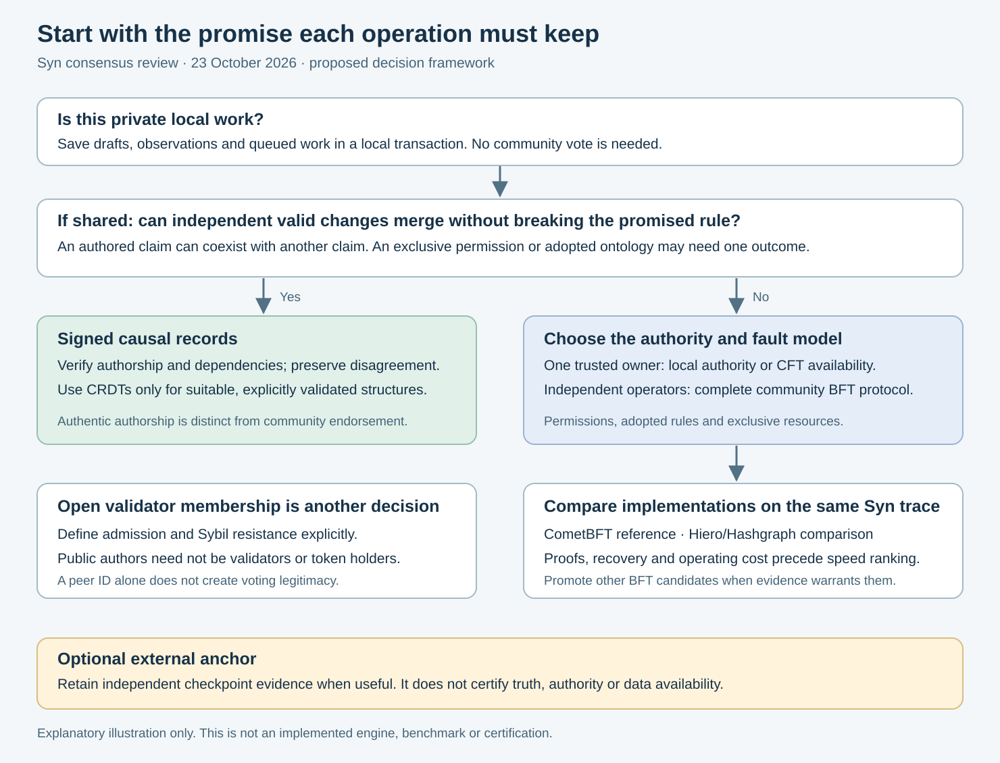
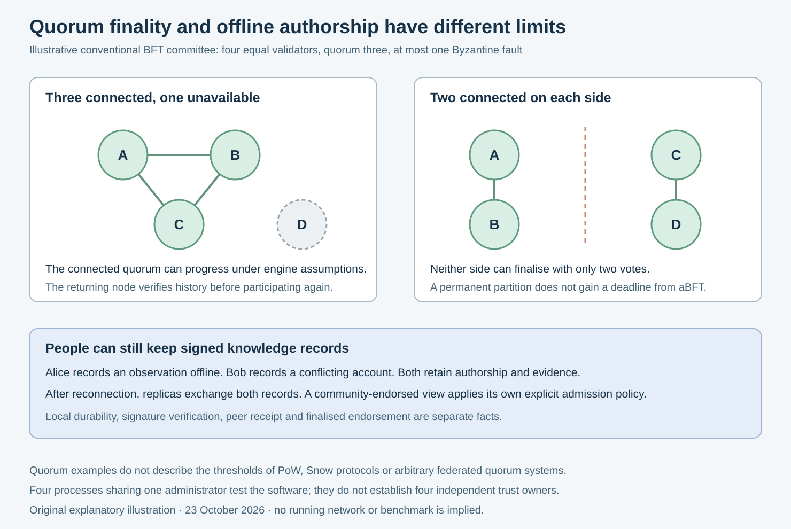

# Consensus approaches for Syn: comprehensive comparative review

> **Historical comparison; backend recommendation superseded.** The later
> owner-directed [architecture](architecture.md) selects consensus per canonical
> Type, distinguishing same-custody operator agreement from independent-custody
> BFT DAG/Hashgraph. The CometBFT-first preference below is preserved as dated
> research, not the current implementation direction. No production engine is
> selected or qualified by this comparison.

**23 October 2026, Europe/London.** Research and architectural assessment; no consensus engine was installed, benchmarked or deployed. This review expands the [distributed-ledger plan](distributed-ledger-plan.md). Protocol facts are attributed to primary research or official documentation. Fit assessments, proposed priorities and workload classifications are design judgements for Syn, rather than measured product rankings.

## 1. Findings and recommendation

Syn has several different agreement problems. They should not all be assigned to the same mechanism.

For **knowledge and provenance**, the strongest architectural fit is signed, content-addressed causal records, with explicit authorship, dependencies, amendments and retained disagreement. For **community authority**, membership, revocation, adopted ontology versions and genuinely exclusive resources, a small, independently operated Byzantine fault tolerant state machine is the leading option. For **one-owner service reliability**, PostgreSQL and potentially a crash fault tolerant coordination service remain appropriate. Public chains or notarisation services can add external evidence where there is a concrete need.

Within the BFT candidates, **CometBFT remains the preferred first integration experiment** because its application interface gives Syn a relatively direct route to testing its own deterministic state transitions. **Hiero/Hashgraph is the principal comparative challenger**, especially where leaderless ordering and its asynchronous agreement model matter. Neither has been demonstrated in Syn. Modern DAG protocols and HotStuff deserve a place in the comparison; their theoretical efficiency does not establish a lower integration cost for this project.

The largest refinement to the earlier plan is to **test which operations actually require shared finality before requiring every shared assertion to pass through a committee**. A community-endorsed collection can require finalised admission. A raw, signed statement by an author need not imply that endorsement and can have a different availability contract. That distinction should be reflected in APIs and interface labels.

*Original explanatory illustration of the assessment. It routes operations by their required guarantee; it is not an implemented selection engine.*

## 2. The project requirements used to judge the options

The current code baseline remains commit `57da1be`. The [communication service](communication.md) supplies a serialised workspace hash chain and authenticated HTTP replay. The [peer service](../src/syn/p2p.py) starts a libp2p host and discovery; it does not implement semantic replication or consensus. [ObjectRef](../src/syn/refs.py) values are locally scoped slugs. The [models](../src/syn/models.py) contain Credential and ObjectChronicle primitives but do not implement a distributed signing, revocation or governance protocol.

Syn's [recorded intentions](../synny/reports/2026-07-30.md) favour plural communities, inspectable evidence and bounded authority. Its semantic model includes observations, knowledge, questions, evaluations, attachment and moral concepts. These are not established fungible assets or validator stake. The review therefore does not assume a token economy, financial incentives, one global truth score or a single universal ontology.

| Requirement | Direct project consequence | Priority |
| --- | --- | --- |
| Independently operated communities | A malicious or compromised operator must not be able to rewrite an agreed shared state alone. | Essential for a federation claiming Byzantine resilience. |
| Offline participation | People can retain observations, drafts and signed claims when disconnected. | Essential; finalised group authority may still wait. |
| Preserved disagreement | Conflicting Embers or interpretations remain attributable and inspectable. | Essential; consensus cannot stand in for truth. |
| Explicit authority and recovery | Grants, revocations, key rotation and emergency recovery need unambiguous scope. | Essential. |
| Structural integrity | Adopted Type hierarchies must reject cycles; references and primitive rules remain coherent. | Essential. |
| Privacy and selective sharing | Private workspaces, credentials and bodies must not leak through replicas or public anchors. | Essential. |
| Incremental integration | Preserve Python/PostgreSQL, current HTTP clients, receipt hashes and local references. | High. |
| Sustainable operation | A small project must be able to deploy, recover and upgrade the actual implementation. | High. |
| Wider participation | Anyone may author permissible records without necessarily becoming a validator. | High; distinguish authorship from voting. |
| Huge transaction capacity | Useful only if real observation/admission load demands it. | Unmeasured; not the primary selection criterion. |
| External public timestamp evidence | Valuable for selected checkpoints if independently needed. | Optional. |

These priorities explain why the most impressive advertised transaction rate need not identify the best system for Syn.

## 3. Compare the same layers

### 3.1 Membership, ordering and replication are different

| Layer | Question | Examples |
| --- | --- | --- |
| Membership and Sybil resistance | Who gets influence, and how is creating many identities prevented from multiplying votes? | Named operators, stake, work, local trust choices, reviewed credentials. |
| Agreement | How do eligible participants reach a safe decision or common order? | Raft, PBFT, Tendermint, HotStuff, Hashgraph, Snow protocols, SCP. |
| Dissemination and availability | How do participants obtain the exact bytes and retain them? | Direct streams, gossip, certified DAG dissemination, archival replicas. |
| Application validation | Which state changes are permitted? | Syn capability rules, ontology validation, conservation constraints. |
| Interpretation | Which claims should a community believe or prefer? | Evidence policies, attributed evaluation and contestable community views. |

Proof of work and proof of stake are not complete descriptions of an agreement stack. For example, Ethereum's current design combines stake-based participation with fork choice and a finality gadget. A private BFT committee can use named operators without a native coin. [Ethereum's explanation of the components](https://ethereum.org/developers/docs/consensus-mechanisms/).

Similarly, a DAG is a data structure. Syn's knowledge graph, a graph of signed authorship, Narwhal's dissemination DAG and Hashgraph's communication-history graph have different meanings. Reusing the word *graph* does not supply a shared security proof. libp2p gossip distributes information; it does not select legitimate validators or make a replicated state final.

### 3.2 Guarantees that must remain separate

**Safety** means the protocol does not finalise incompatible outcomes within its model. **Liveness** means it eventually makes progress under its stated conditions. **Durability** concerns retaining an acknowledged record. **Availability** concerns answering or accepting a particular operation. **Verifiability** concerns what an independent party can establish from retained evidence. A protocol can provide one without automatically providing all the others.

The FLP result prevents a deterministic protocol from guaranteeing termination in a fully asynchronous system with even one possible crash. Practical protocols add timing assumptions, failure detectors, randomness or other conditions. Calling a system asynchronous does not promise a deadline during a permanent partition. [Fischer, Lynch and Paterson](https://groups.csail.mit.edu/tds/papers/Lynch/jacm85.pdf).

For Syn, the useful design is operation-specific: local authorship can remain available; a contested permission change waits for the authority required to resolve it. Reads of retained records can continue while fresh authoritative reads report that their view may be stale. Avoid treating CAP as a blanket label for an entire application.

### 3.3 Node counts and what they mean

For the conventional authenticated, partially synchronous BFT committees discussed here, the familiar minimal configuration is `n = 3f + 1` with a commit quorum of `2f + 1`. It tolerates up to `f` arbitrary faults. Weighted engines express the bound in voting power, not raw machine count. These are not universal formulas for every protocol in this review. [PBFT's service properties and assumptions](https://www.usenix.org/legacy/publications/library/proceedings/osdi99/full_papers/castro/castro_html/node3.html).

| Deployment example | Agreement threshold | Failure protection relevant to Syn |
| --- | --- | --- |
| One PostgreSQL authority | That authority | Transactions and receipts; no independent-operator fault tolerance. |
| Three-member Raft group | Majority: two | One crash/unreachable member; no Byzantine-member guarantee. |
| Five-member Raft group | Majority: three | Two crash/unreachable members; still no Byzantine-member guarantee. |
| Four equal-weight conventional BFT validators | Three | At most one Byzantine operator under the complete protocol. |
| Seven equal-weight conventional BFT validators | Five | At most two Byzantine operators. |
| Ten equal-weight conventional BFT validators | Seven | At most three Byzantine operators. |
| Four processes controlled by one administrator | Depends on engine | Useful fault-injection test; one compromised administrator can control all four. |

Two quorums of three drawn from four validators overlap in at least two validators. If at most one validator is Byzantine, at least one overlapping validator must be honest. The protocol's locking rules make that honest overlap useful. Signatures alone, without rounds, locks and recovery rules, do not establish the same guarantee.

## 4. Comparative overview

The fit labels below are architectural judgements for the specified role. They are not security certifications or measured throughput scores.

| Approach | Principal strength | Principal weakness for Syn | Best project role |
| --- | --- | --- | --- |
| Central PostgreSQL and hash-chain receipts | Already implemented, transactional, inexpensive | Operator remains the authority | Local and legacy baseline. |
| Multi-Paxos | Established crash-tolerant agreement | Does not address malicious operators; substantial implementation detail | Existing trusted infrastructure only. |
| Raft | Understandable replicated log and practical HA ecosystem | A trusted-member model; no Byzantine protection | One-owner service coordination. |
| PBFT family | Explicit malicious-replica model and deterministic state machine | Communication and leader-change machinery | Design baseline; use maintained engines. |
| Tendermint / CometBFT | Concrete application interface and committee finality | Proposer dependence, synchrony and sidecar integration | First community-control experiment. |
| HotStuff family | Efficient quorum-certificate organisation and leader replacement | Pipeline, pacemaker and certificate complexity | Challenger if scale/latency evidence warrants it. |
| Hashgraph / Hiero | Leaderless ordering and communication-history-based voting | Runtime and supported application/proof integration | Principal alternative BFT experiment. |
| Narwhal/Tusk/Bullshark/Mysticeti class | Parallel dissemination and DAG-based ordering designs | Family contains materially different protocols; integration/storage burden | Later high-load investigation. |
| HoneyBadger and asynchronous BFT | Progress without a fixed message-delay bound, given delivery | Cryptographic setup, batching and operational completeness | Adversarial-network specialist option. |
| Bitcoin-style Nakamoto PoW | Open competition without an approved validator list | Energy/economic bootstrap and confirmation uncertainty | Existing-chain anchoring if justified. |
| Stake plus BFT/finality | Open economic participation with accountable voting | Capital, slashing, recovery and incentive design | Existing public-network dependency, not a new Syn coin. |
| Authority/delegated committees; QBFT | Explicit operators and existing deployments | Governance capture and, for EVM stacks, application mismatch | Conditional private consortium option. |
| Stellar-style FBA | Each node selects whom it relies on | Safe overlap and blocking sets are difficult governance obligations | Later trust-topology experiment. |
| Avalanche / Snowman | Repeated subsampling for a large participant population | Parameter/sampling model and integration burden | Conditional large-open-network option. |
| Signed causal logs / BEC | Offline provenance and merge-compatible knowledge | Cannot enforce every invariant without coordination | Primary knowledge substrate. |
| CRDTs | Concurrent editing with convergence rules | Convergence can hide semantic conflicts or violate application invariants | Drafts and selected merge-safe structures. |
| Holochain-style agent-centric validation | Authorship and context without one global log | No automatic global serialisation; framework migration | Strong architectural reference; bounded prototype alternative. |
| Trusted-hardware approaches | Can shift parts of the fault/selection problem into hardware | Vendor, attestation, rollback and platform dependencies | No v1 need. |
| Public ordering / checkpoint notarisation | Independent external evidence | External policy, costs, privacy and proof scope | Optional evidence service. |

## 5. Detailed assessment by approach

### 5.1 Central database and tamper-evident receipts

**How it applies now.** Syn serialises each workspace's appends in PostgreSQL and returns linked receipts. An independently retained receipt head can expose a changed prefix. It does not prevent the privileged operator from replacing history and giving a new client a replacement head. This is the precise boundary documented in the [current communication contract](communication.md).

**Strengths for Syn:** no new distributed runtime; good local transactional behaviour; cheap replay; straightforward migration compatibility. It is sufficient for a personal installation or a service whose users deliberately trust its operator. Signed client submissions and externally retained heads can strengthen evidence without replacing the database.

**Weaknesses:** one authority controls ordering, availability and the version of history shown to new readers. Database triggers are not a defence against the owner of that database. Backups improve recovery but do not make independent operators agree.

**Assessment:** keep this mode, label it accurately and use it as the experiment's reference baseline. Do not impose a multi-validator deployment on every installation. A user's private node does not need an artificial committee to save a draft.

### 5.2 Multi-Paxos and Raft: crash fault tolerant replication

Paxos chooses values through intersecting quorums. A practical replicated log needs stable leadership or equivalent progress machinery, repeated decisions and durable protocol state. Raft organises a similar crash-tolerant task around leader election, log replication and safety rules, with explicit membership-change machinery. Neither assumes eligible replicas may arbitrarily lie. [Paxos Made Simple](https://lamport.azurewebsites.net/pubs/paxos-simple.pdf), [Raft paper](https://raft.github.io/raft.pdf).

**Strengths for Syn:** a sensible way to make infrastructure resilient when one organisation controls its members. A well-supported coordination service can manage service configuration or ownership leases without inventing a cryptocurrency. It is easier to justify this complexity for a real availability requirement than for an ideological decentralisation claim.

**Weaknesses:** signatures do not convert a CFT engine into BFT. An independently run malicious member falls outside its model. Introducing a Raft key-value store also does not automatically replicate Syn's PostgreSQL semantics: the authority boundary and transaction coupling still need to be designed.

**Direct application:** optional coordination for a single-owner deployment; conditional shared ledger only when all operators explicitly accept the same administrative trust owner. Prefer an established service over a private Paxos implementation.

**Read caveat:** even a consensus-backed product may expose deliberately stale local reads and asynchronous watches. A watch event is not a fresh linearizable authorisation check. etcd documents this distinction between its default linearizable range reads and optional member-local reads. [etcd API](https://etcd.io/docs/v3.6/learning/api/).

**Verdict:** good infrastructure option; insufficient as Syn's defence against a malicious community validator.

### 5.3 Classical PBFT and practical BFT implementations

PBFT uses a primary, replica agreement phases and view changes to order deterministic service operations despite bounded arbitrary replica faults. Its normal-case phases and recovery rules are an integrated protocol, not a generic majority-signing service. Safety does not require prompt delivery; progress requires additional timing conditions. [PBFT algorithm](https://www.usenix.org/legacy/publications/library/proceedings/osdi99/full_papers/castro/castro_html/node4.html), [system model](https://www.usenix.org/legacy/publications/library/proceedings/osdi99/full_papers/castro/castro_html/node2.html).

**Strengths for Syn:** directly matches a small group agreeing on grants, revocations, ontology adoption and exclusive operations. It makes the trust assumption visible: a bounded number of administrators can be faulty. No token is necessary.

**Weaknesses:** all-to-all voting patterns and leader changes become costly as committees grow. Shared code/configuration vulnerabilities can compromise enough replicas simultaneously. The application still needs deterministic validation, replay, proof retention and private-data boundaries. Byzantine tolerance does not make plaintext held by a malicious validator confidential.

**Implementation relevance:** Hyperledger Fabric now documents a SmartBFT ordering service introduced in v3.0, as well as its Raft alternative. This is a useful example of a maintained permissioned BFT stack; it is inaccurate to describe all Fabric ordering as CFT based on older papers. Its endorsement, channel and ordering architecture would nevertheless add a substantial second framework around Syn. [Current Fabric ordering documentation](https://hyperledger-fabric.readthedocs.io/en/latest/orderer/ordering_service.html).

**Verdict:** a strong protocol family for the control problem; select an implementation boundary that preserves Syn's ownership of its object model.

### 5.4 Tendermint / CometBFT

CometBFT orders blocks through proposer, prevote and precommit rounds. Commit requires more than two-thirds voting power; locks and round-change rules preserve safety through faulty proposals. Liveness depends on the network eventually meeting the protocol's timing conditions. [Research-pinned consensus specification](https://raw.githubusercontent.com/cometbft/cometbft/v0.38.21/spec/consensus/consensus.md).

**Strengths for Syn:** an explicit application boundary; separately testable deterministic transitions; a natural model for domain-scoped control and auditable ordered outcomes. The initial four-operator experiment can remain small. Shared voting power need not be a market asset.

**Weaknesses:** a proposer can temporarily delay or bias inclusion. Finality is not an inclusion-fairness guarantee. The sidecar has its own networking and deployment requirements. Python integration must correctly implement persistence, response semantics and protocol versions; PostgreSQL projections cannot define consensus through uncontrolled mutable SQL queries.

The ABCI contract provides proposal processing, finalised execution, commit and startup state reconciliation. An application hash returned for a height is authenticated by subsequent chain context; clients need an accurately implemented proof chain and cannot treat an immediate HTTP response as a fully certified arbitrary query. [ABCI methods](https://raw.githubusercontent.com/cometbft/cometbft/v0.38.21/spec/abci/abci%2B%2B_methods.md).

**Direct application:** finalise a credential grant, reject a stale ontology update, admit a community-endorsed observation batch or assign a fenced worker lease. Keep raw author observations available under a separate provisional/causal contract.

**Verdict:** first reference experiment, with **moderate confidence in architectural fit** and **unverified implementation/operating performance**. A convenient API alone is not final selection evidence.

### 5.5 HotStuff and related chained BFT designs

HotStuff combines leader-based BFT, quorum certificates, a pacemaker and chained decision rules. Its paper targets partial synchrony, responsiveness under a correct leader, and linear communication using its certificate/cryptographic construction and stated model. Such a claim concerns particular protocol/control costs, not an exemption from disseminating transaction bytes. A naive implementation broadcasting unaggregated signature lists does not inherit the same byte-complexity claim. [HotStuff paper](https://arxiv.org/abs/1803.05069).

**Strengths for Syn:** potentially attractive if the community control layer expands to larger committees or leader replacement becomes a measured bottleneck. Certificates offer a clear evidence object to reason about, provided the implementation's actual authentication and validator history are retained.

**Weaknesses:** pipelining can add a distinction between a proposed block, a certified block and a committed result. Low-load latency and batched throughput can favour different settings. Pacemaker correctness, persistent safety state and certificate verification are not trivial. Some implementations add threshold-signature setup or their own execution stack; that burden must be evaluated per product.

**Direct application:** challenger to CometBFT, not an extra layer above it. Run the same Syn governance/revocation trace on a maintained candidate. Do not replace an entire working engine solely because one paper reports a better asymptotic bound.

**Verdict:** credible future candidate. Elevate it if a supported application integration and measurements show a material advantage over the initial reference.

### 5.6 Hashgraph / self-hosted Hiero

Hashgraph records communication history as signed events with parent hashes. Nodes infer virtual votes from that history; witnesses and fame decisions establish an order. The original protocol supplies asynchronous Byzantine agreement under its membership, cryptographic, fault and eventual-delivery assumptions. It does not promise bounded completion when honest participants cannot communicate. [Original Hashgraph paper](https://www.swirlds.com/downloads/SWIRLDS-TR-2016-01.pdf).

**Strengths for Syn:** no single ordering leader; an attractive comparative model where sustained leader targeting or timing variation is important. Communication history is useful protocol evidence. A community can study these advantages without designing a native coin.

**Weaknesses:** the consensus event DAG differs from Syn's semantic graph; one does not provide the other. Retaining and processing protocol history still consumes resources. Protocol timestamp fairness is not proof of a physical event's time, equal publication reach, neutral moderation or truthful content. Eligibility and governance remain separate decisions.

**Integration assessment:** Hiero's platform/application structure requires a supported Java/service integration decision. An HCS-style service can give Syn ordered inputs, while a custom platform application could imply a much larger maintenance commitment. An external Python reducer's state root must not be described as a native Hiero state proof. [Hiero architecture](https://github.com/hiero-ledger/hiero-consensus-node/blob/main/hedera-node/docs/design/design.md).

Solo is a maintained test-network deployment route with Kubernetes and explicit host-resource requirements. Those requirements are evidence about that tool's documented test setup, not a measured minimum cost per production Syn validator. [Solo documentation and release requirements](https://github.com/hiero-ledger/solo).

**Direct application:** run the same control/admission operations as the CometBFT pilot, verify independently recoverable ordering evidence, measure behaviour under delay and faults, and account for all supporting services.

**Verdict:** the strongest explicit alternative in the current plan. The reason to choose it would be a demonstrated security/operation benefit at acceptable integration cost, rather than the label *graph*.

### 5.7 Modern DAG BFT: Narwhal, Tusk, Bullshark and Mysticeti

Narwhal separates reliable dissemination and causal storage from ordering; it is not, by itself, the entire agreement mechanism. Tusk adds an asynchronous ordering construction. Bullshark explores DAG ordering with variants and fast paths. Mysticeti develops another DAG design that reduces explicit certification and commit-path latency. These protocols must not be treated as interchangeable versions of one algorithm. [Narwhal/Tusk](https://arxiv.org/abs/2105.11827), [Bullshark](https://arxiv.org/abs/2201.05677), [Mysticeti](https://arxiv.org/abs/2310.14821).

**Strengths for Syn:** dissemination/order separation is a useful lesson for large observation bundles. Multiple participants can contribute data without one proposer becoming the only payload pipeline. A system handling sustained, independently verified, high-volume submissions may benefit substantially.

**Weaknesses:** a DAG does not remove committee admission, data retention, recovery or cryptographic work. Payload availability, garbage collection and backpressure may dominate. The published variants have different synchrony and commit assumptions: Mysticeti-C's liveness analysis uses partial synchrony. Do not infer asynchronous liveness from DAG topology. [Mysticeti system and liveness analysis](https://arxiv.org/html/2310.14821v6).

**Direct application:** first adopt the architectural separation—bounded data exchange, explicit availability and a small ordered control surface. Evaluate a full DAG engine only if realistic observation/admission traffic saturates the simpler candidate. A full blockchain built around such a protocol is not necessarily an embeddable Python ordering service.

**Verdict:** important comparison and future scale path; no present evidence that Syn needs the added implementation surface. Published laboratory rates are not Syn forecasts.

### 5.8 HoneyBadger-style asynchronous BFT

Asynchronous BFT constructions use mechanisms such as reliable broadcast and randomised agreement to produce common batches without assuming a known delivery deadline. HoneyBadger combines such components, including threshold cryptography in its construction. Delivery and fault assumptions still apply. The available `hbbft` library explicitly leaves message transport, signing and serialisation to its caller. [Authors' project description](https://decentralize.ece.illinois.edu/projects/), [implementation contract](https://docs.rs/hbbft/latest/hbbft/).

**Strengths for Syn:** worth considering if participants face highly variable or adversarial network delays that defeat acceptable performance of a timing-based candidate. A batched architecture may fit noninteractive publication of large endorsed datasets better than immediate UI actions.

**Weaknesses:** threshold keys, ceremonies, share replacement, randomness, batching and complete node recovery add operational obligations. An algorithm library is less complete than a managed node service. Throughput under backlog and responsiveness when a user submits the first operation after an idle period are different measurements.

**Direct application:** specialist challenger for a demonstrably hostile-network community. Test liveness with eventual delivery and repeated long delays; also measure idle-to-first-finality and key reconfiguration. It cannot make an isolated node issue a globally authoritative revocation.

**Verdict:** retain in research scope, rather than make it a v1 dependency solely to obtain the word *asynchronous*.

### 5.9 Nakamoto proof of work

Bitcoin's design uses accumulated valid work to choose among competing histories. Honest hash-power assumptions and subsequent work support probabilistic confidence in an older transaction; observers must account for forks and reorganisations. Work also gives costly influence in an otherwise open population. [Bitcoin white paper](https://bitcoin.org/bitcoin.pdf).

**Strengths for Syn:** using an existing widely observed public chain can provide evidence independent of a small Syn committee. Its membership model does not require Syn to name every eligible miner.

**Weaknesses:** creating a new small PoW chain would require a credible security budget and participating hash power; a nominally open chain is not secure simply because it has mining code. Waiting for confirmation confidence is awkward for revocation or interactive shared editing. Energy, fees, chain access and fork handling add burdens unrelated to Syn's immediate knowledge tasks.

**Direct application:** optional anchoring to an existing chain when the public-evidence value justifies the costs and delay. A later application may verify an anchor's inclusion and confirmation context while still validating all Syn claims itself.

**Verdict:** poor choice for a new Syn-native control layer; conditional use of an existing external network. Do not turn knowledge, emotion or moral contribution into mining rewards to solve an unrelated coordination problem.

### 5.10 Proof of stake, finality gadgets and delegated stake

Stake is an influence and incentive system, combined with a particular protocol. Ethereum's Gasper combines LMD-GHOST fork choice with Casper-style checkpoint finality; its security includes rules for deposits, penalties and conflicting votes. An unfinalised chain head and a finalised checkpoint are different states. [Gasper documentation](https://ethereum.org/developers/docs/consensus-mechanisms/pos/gasper/).

**Strengths for Syn:** an existing public PoS network can offer a broad external validator population and programmable verification. A future Syn application could use that network rather than bootstrap its own security economy.

**Weaknesses:** a new Syn stake asset would require a distribution policy, attack-cost model, delegation, slashing, exit and long-range/recovery treatment. Letting capital determine protocol influence would also need a substantive justification against Syn's stated priorities. A valuable community knowledge record is not automatically appropriate collateral.

**Direct application:** use a public network only for an independently required service, bridge or anchor. Do not assume consensus code can be extracted from its economic and validator lifecycle unchanged. Delegation changes who chooses operators or assigns weight; it does not, alone, supply agreement or prevent concentration.

Sui's documentation illustrates this separation: it describes delegated stake for validator influence alongside epoch membership and quorum-based transaction processing. That is evidence about a combined system, not proof that delegation must be added to Syn. [Sui consensus architecture](https://docs.sui.io/develop/sui-architecture/consensus).

**Verdict:** substantial unnecessary design burden for v1. A tokenless named-operator BFT domain is a coherent option and is not an incomplete PoS network.

### 5.11 Proof of authority, elected committees and QBFT

Proof of authority generally names an eligibility/governance model. The underlying agreement may be crash tolerant, Byzantine tolerant or something else. Besu's QBFT is a concrete private-network implementation with approved validators, rotating proposals, supermajority block signatures and validator changes. [QBFT documentation](https://besu.hyperledger.org/private-networks/how-to/configure/consensus/qbft).

**Strengths for Syn:** named operators can be accountable without financial stake. If participating organisations already run an EVM-based consortium, QBFT may offer familiar keys, infrastructure and tooling. Communities could elect their operator committee through an explicit, separately secured governance process.

**Weaknesses:** a small authority set can collude, exclude contributors or suffer correlated compromise. Calling authorities elected does not solve credential duplication, voting eligibility or capture. An EVM deployment brings account/gas/contract semantics and indexing work that Syn's current Python semantic model does not otherwise need.

**Direct application:** conditional candidate where EVM interoperability is an actual requirement. Otherwise, use named operators with a more suitable application engine rather than adopt Ethereum execution to obtain BFT ordering.

**Verdict:** reasonable membership model; backend selection still needs separate review. Proof of trust, proof of reputation and proof of personhood would likewise require their own adversary, admission and recovery specifications before being security mechanisms in Syn.

### 5.12 Federated Byzantine agreement / Stellar SCP

In FBA, nodes choose quorum slices describing which other participants they rely on; these choices determine system quorums. Safety requires suitable overlap among well-behaved participants. Overlap only through a malicious participant can fail. Liveness also depends on avoiding blocking configurations. A global raw-node fraction is therefore an inadequate summary. [SCP white paper](https://stellar.org/papers/stellar-consensus-protocol.pdf), [official quorum terminology](https://developers.stellar.org/docs/learn/fundamentals/stellar-consensus-protocol).

**Strengths for Syn:** an unusually interesting philosophical match. A household, library or research community could express whom it relies on instead of accepting one preassigned global committee. Trust can grow through actual relationships.

**Weaknesses:** local choices can introduce global problems that ordinary users cannot see. Overlapping authorities can become indispensable centres. Two internally sensible trust clusters do not automatically agree with each other. Changing trust safely, explaining failures and proving the relevant overlap are product and governance tasks as well as protocol tasks.

**Direct application:** a later federation experiment with a visible trust-topology analyser, tested quorum intersections, blocking-set analysis and explicit user-facing agreement scope. Independent community ledgers exchanging proofs are a simpler alternative when global agreement is unnecessary.

**Verdict:** credible research candidate for cross-community governance; too much untested trust-topology machinery for the first control-log implementation. Syn's use of *federation* does not commit it to FBA.

### 5.13 Avalanche / Snowman and metastable sampling

The Snow family repeatedly samples participants and reinforces a preferred decision. Its safety is probabilistic under its sampling, adversary and parameter model. A sampled majority is not an arbitrary committee's BFT commit certificate. [Original metastability paper](https://arxiv.org/abs/1906.08936).

**Strengths for Syn:** an attractive direction when a large eligible population makes full voting expensive. It demonstrates an alternative to both industrial mining and a small fixed all-to-all committee.

**Weaknesses:** random sampling must be taken from the right influence population; arbitrary peer IDs create a Sybil problem. Parameters trade confidence and progress, and a small Syn pilot does not reproduce the statistical setting of a large public network. Independent verification and recovery need the actual implementation's evidence model.

**Current-state correction:** Avalanche's Primary Network uses the linear Snowman family; the documentation marks its historical DAG engine as no longer used there. It should not be recommended today merely as another DAG example. [Current architecture](https://build.avax.network/docs/nodes/architecture/consensus).

**Direct application:** conditional if Syn later needs a large, legitimately weighted open validator population or deliberately adopts an existing Avalanche service. It offers little reason to replace a simple four-operator control pilot today.

**Verdict:** a valid comparison category with a weak immediate fit, rather than a less expensive drop-in version of Hashgraph.

### 5.14 Signed causal logs and Byzantine eventual consistency

A signed causal history preserves which records depend on which earlier records. Correct replicas can converge on merge-compatible state without one global total order. Byzantine eventual consistency research characterises a class of applications that can preserve their specified invariants despite arbitrary numbers of Byzantine peers, using suitable authenticated causal dissemination. This is not a general result for all applications, all permissions or all availability requirements. [Kleppmann and Howard](https://arxiv.org/html/2012.00472v1).

**Strengths for Syn:** this is a particularly strong match for attributable assertions and evidence. Alice and Bob can each record observations offline; receiving both need not require selecting one winner. A malicious peer's self-authored claim does not become a legitimate administrator's signature because the attacker creates more peers.

**Weaknesses:** retention and eventual communication still matter. An author may equivocate; a hostile peer can withhold evidence; resource attacks remain possible. Grant revocation with immediate global effect, unique ownership and an adopted acyclic ontology are not solved merely by merging valid local histories. Querying an incomplete replica must not pretend to enumerate all claims ever made.

**Direct application:** primary candidate for the raw knowledge/evidence layer. Separate locally verifiable authenticity from community endorsement, and display missing dependencies, equivocation and withdrawal explicitly. Use a deliberately specified authority policy instead of accepting peer-count popularity as trust.

**Verdict:** co-primary with scoped BFT in Syn's architecture. The most useful alternative to a global consensus engine is often to reduce the operations requiring a global decision.

### 5.15 CRDTs and coordination avoidance

CRDTs define data-specific merge behaviour. Convergent editing does not guarantee that arbitrary application constraints survive merging. Automerge, for example, retains concurrent values but normally displays a deterministic winner for a conflicted property. That can be useful in an editor and misleading in an evidence interface. [Automerge conflict semantics](https://automerge.org/docs/reference/documents/conflicts/).

**Strengths for Syn:** excellent candidates for shared draft text, annotations, local preferences, append-only collections and structures whose invariants have been shown to survive independent updates. Fine-grained edits can avoid making every keystroke a ledger transaction.

**Weaknesses:** merge rules can obscure disagreement, deletions and access revocation. Ordinary CRDT implementations do not automatically defend every internal operation against Byzantine authors. Generic counters do not enforce conserved resources. Two separately acyclic Type graphs can form a cycle after their edges are combined.

The relevant analytical test is whether valid independent operations, when merged, still satisfy the application's invariant. Coordination-avoidance research formalises this through invariant confluence. It provides a way to justify selective coordination instead of assuming either universal consensus or universal conflict-free merging. [Coordination Avoidance in Database Systems](https://arxiv.org/html/1402.2237v4).

**Direct application:** optional draft layer and carefully scoped data structures. Preserve signed publication boundaries: a draft edit is not a finalised community policy. Store competing claims as separate attributable records rather than letting a hidden last-writer rule choose the community's truth.

**Verdict:** complementary to the ledger, with per-operation correctness analysis; not a replacement for permissions or exclusive resource allocation.

### 5.16 Holochain-style agent-centric validation

Holochain uses author source chains and distributed validation rather than maintaining one global state order. Its validation rules are deterministic, dependency-aware and able to check signatures and chain continuity. Its own documentation highlights the difficulty of revocable privileges when an author's timestamp can be forged. [Validation documentation](https://developer.holochain.org/concepts/7_validation/).

**Strengths for Syn:** strong conceptual alignment with authored knowledge, context, peer accountability and communities. It is useful evidence that a distributed application need not start from a global financial ledger.

**Weaknesses:** adopting the framework would entail evaluating a different execution, storage and application distribution model. A shared validation rule does not establish one serial order for every concurrent action. Global exclusion and revocation need an explicit design rather than a claim that peer witnessing settles them automatically.

Countersigning can coordinate writes among involved parties, but the current documentation labels it unstable and disabled by default in Holochain 0.4 and newer; it expressly distinguishes this from double-spend prevention. It would be unsafe to treat it as a ready general-purpose atomic transaction replacement. [Countersigning contract and limitations](https://developer.holochain.org/concepts/10_countersigning/).

**Direct application:** compare a bounded agent-centric observation prototype with native signed-log replication. Borrow explicit dependency and author-history principles where appropriate; do not silently replatform Syn to acquire them.

**Verdict:** valuable architectural comparator and optional research prototype, with limited immediate justification for replacing the current PostgreSQL/Python foundation.

### 5.17 Trusted hardware and elapsed-time selection

TEE-based designs can constrain a participant's behaviour or provide an attested selection primitive. Historical Sawtooth PoET documentation distinguishes an SGX-backed mode from a simulator with only a crash-fault model. The simulator does not inherit hardware-backed assurances. [Historical PoET documentation](https://sawtooth.splinter.dev/docs/1.2/).

**Strengths for Syn:** specialist possibilities where a deployment already has trusted hardware and an independently justified requirement for confidential or constrained execution.

**Weaknesses:** hardware availability, vendor/attestation dependence, firmware changes, rollback protection and vulnerability response become security dependencies. Attestation is not proof that an application has valid community authority or produces truthful claims. Its privacy benefits depend on the actual enclave and key design, not the presence of a chip.

**Direct application:** none established for the first ledger. Evaluate only against a concrete requirement and maintained implementation; this review does not propose deploying the historical PoET stack.

**Verdict:** low present fit. Adding hardware assumptions to avoid a small tokenless committee is not a demonstrated improvement for Syn.

### 5.18 External ordering and checkpoint notarisation

Hedera Consensus Service provides ordered topic messages with sequence/running-hash information; its submission interface has bounded message chunks. Submission-key restrictions concern who can submit, not a confidential read boundary. Syn would still validate its own application semantics. [HCS submission documentation](https://docs.hedera.com/native/consensus/submit-message).

**Strengths for Syn:** a compact external checkpoint can make later replacement of a retained history harder to conceal from an independent observer. It can provide an external evidence boundary without copying all semantic records onto a public chain.

**Weaknesses:** publishing a digest does not preserve the data, prove author permission or certify the truth of a claim. Public metadata and guessable hashes can disclose information. Accounts, fee caps, service access, evidence retention and independent proof verification remain responsibilities. The external system's governance can differ from the community's.

**Direct application:** optional evidence for selected public releases or checkpoints. Keep it asynchronous to ordinary local authoring unless the user deliberately requires external finality. A service outage should produce an unanchored checkpoint state rather than mislabel an unsent anchor as confirmed.

**Verdict:** useful complement when a named reader/verifier benefits; insufficient justification for making every Syn observation depend on public infrastructure.

## 6. Apply the approaches to concrete Syn operations

| Syn operation | Invariant or promise | Appropriate mechanism | Failure to avoid |
| --- | --- | --- | --- |
| Save a private observation | This device retains the exact record | PostgreSQL transaction and local outbox | Making private authorship wait for a remote committee. |
| Publish an author's public Ember | Authentic author, unchanged bytes and explicit dependencies | Signed causal dissemination; clear receipt/verification status | Treating publication as community endorsement. |
| Add a contradictory claim | Preserve both origins and evidence | Separate signed assertions and a multi-valued view | Hash-order or CRDT tie-break presented as factual truth. |
| Correct or retract one's claim | Attribution and precise reference to what changed | New signed causal record | Pretending old public copies can be recalled. |
| Adopt a canonical ontology version | One accepted version under a community's rules; no cycles | Ordered community control transaction | Independently merging Type edges that introduce a cycle. |
| Grant or revoke shared publication authority | All finalised admissions use one policy order | BFT control state, or explicitly trusted single authority | Backdating a client timestamp to evade revocation. |
| Rotate a controller or validator | One authorised lineage and activation point | Full governance and backend membership protocol | Two competing memberships approving themselves. |
| Assert a rating, attachment or moral evaluation | Attributed judgement in a named context | Signed record; versioned view policy | Giving each judgement automatic economic or validator weight. |
| Allocate an exclusive resource | At most one effective owner or lease | Consensus plus resource-enforced fencing | Treating a local lock or replicated message as global ownership. |
| Edit draft prose together | Preserve concurrent work and expose relevant conflicts | Optional CRDT | Equating an editor's displayed winner with an adopted policy. |
| Trigger an agent job | Authorised intent and attributable attempt/result | Finalised intent where required, then idempotent local dispatch | Claiming consensus guarantees exactly-once external action. |
| Exchange records between communities | Verify origin and source policy without surrendering interpretation | Domain proofs, causal records and explicit acceptance policy | Inferring a global order or global authority from federation. |
| Transfer any future conserved asset between communities | No duplicate spend and agreed settlement outcome | Separately designed escrow/bridge protocol | Replicating a record and minting a second spendable copy. |

The current `ObjectRef` identity issue remains independent of the backend: duplicate local slugs must be scoped to a domain and mapped to stable network IDs. No consensus family automatically fixes an ambiguous object identifier.

### 6.1 The revocation test

Suppose Alice writes offline using a permission that the connected community has revoked. The system can retain Alice's authentic signed record. It cannot both guarantee that all her future offline writes are accepted and guarantee that revocation already applies everywhere.

For a **community-endorsed view**, evaluate admission against the finalised policy preceding the operation; stale authority can be rejected. For a **raw authored record**, preserve the signature and claimed context while making clear that the community has not endorsed or accepted it. Private payload disclosure follows confirmed access policy, not raw publication alone. This contract is required whichever BFT engine is selected.

### 6.2 The ontology test

Alice proposes `A is a subtype of B`; Bob proposes `B is a subtype of A`. Each proposal may be valid against an earlier acyclic graph. A union of their effective changes is not valid. Syn can retain both proposals, then serialise the operation that adopts the community's actual Type graph. This preserves intellectual openness while enforcing an explicit structural invariant.

An alternative is a deterministic conflict-resolution projection that drops an edge, but then its exclusion policy becomes part of the product's meaning. It may be acceptable for an exploratory view; it should not silently become the canonical governance rule.

## 7. Failure scenarios: what the user experiences

*Original explanatory illustration. The quorum examples concern a conventional equal-weight BFT committee; they are not a universal threshold for FBA, PoW or Snow protocols.*

| Scenario | CFT service | Conventional BFT community | Signed/causal knowledge layer |
| --- | --- | --- | --- |
| One machine crashes | Progress if a majority remains | Progress if its required quorum remains under the engine's conditions | Other authors continue; missing records await recovery/peers. |
| A member lies or signs conflicting protocol states | Outside its guarantee | Protected within the fault bound and complete protocol | Verify authorship; retain equivocation; no exclusive-outcome guarantee from merging alone. |
| Four validators split two and two | Not enough information to infer a separate CFT configuration | Neither group can commit with quorum three | Each side can retain local authored records; later exchange does not retroactively finalise control decisions. |
| Three of four BFT validators connected; fourth unavailable | Not this configuration's model | Connected quorum can progress, subject to protocol assumptions | Isolated author can write locally and later resubmit. |
| Every replica runs the same faulty reducer | Consensus can agree on the wrong application result | BFT does not repair a common application bug | Replicas can consistently reproduce the same bug. |
| Validator leaks a private body | No confidentiality from replication itself | BFT voting does not prevent the leak | Only an appropriate sharing/encryption design limits disclosure. |
| A snapshot is corrupt or an anchor is stale | Restore and revalidate within trust model | Verify proof, validator history and trust period before use | Verify signed ancestry and disclose missing coverage. |

### Read semantics matter

An immutable historical statement can be read from a verified local copy. A current question—*is this key still authorised now?*—may require a fresh authority boundary or a declared freshness policy. A verified old checkpoint is valuable evidence, but it does not establish that no revocation occurred later. Separate historical proof, replica freshness and authoritative execution decisions in the API.

### Recovery matters as much as steady-state agreement

For every candidate, the prototype must specify persistent signing state, crash replay, snapshot verification, membership history, key replacement and the point at which a recovering node may vote. An operator who loses protocol state must not reuse a key in a way that double-signs. If quorum is irretrievably lost, a new trust lineage must be explicit; an administrator editing a database is not normal consensus recovery.

For external proof consumers, a signing threshold says little without the correct domain/genesis, epoch, validator set and applicable trust anchor. A downloaded JSON head, mirror API or explorer page is not automatically a self-contained cryptographic certificate.

## 8. Operating and implementation comparison

These burden estimates are engineering judgements. No candidate was installed for this review; exact maintenance, licensing and supported-release status must be checked for the chosen build.

| Route | Syn-specific work | Additional operating burden | Main unresolved evidence |
| --- | --- | --- | --- |
| Existing local mode | Preserve current contracts; improve export/signing only when needed | Current database/service | Independent retained anchors and production recovery practice. |
| Native signed causal layer | Canonical bytes, credentials, capability semantics, dependency sync, limits and explicit views | Peer storage/outbox/archival operations | Byzantine and privacy conformance; real two-node recovery. |
| Raft-backed infrastructure | Couple authoritative configuration/leases correctly to local execution | Trusted coordination cluster | Need for HA and the boundary with PostgreSQL transactions. |
| CometBFT sidecar | Deterministic reducer, ABCI adapter, durable replay and proof client | Committee nodes and sidecar lifecycle | Pinned Python/protobuf boundary and verified root/header timing. |
| Hiero private ordering | Supported service/application adapter and ordered evidence verification | Java/service stack and selected deployment tooling | Adequate proof/recovery path without a long-lived private fork. |
| HotStuff or DAG engine | Select a maintained complete implementation; adapt its app/proof contract | Backend-specific node/certificate/storage lifecycle | Deployability as a service separate from its original chain. |
| Fabric SmartBFT / Besu QBFT | Map Syn authority and execution onto a full permissioned framework | Additional framework administration and indexing | A concrete need for those ecosystems. |
| FBA | Trust-set configuration, analyser and safe evolution | Cross-community trust monitoring | Usable explanation and verified honest quorum overlap. |
| Holochain framework | Reconcile source-chain/DHT semantics with existing objects and clients | Different application/runtime distribution | Whether a narrow prototype saves more work than native replication. |
| Public ordering/anchor | Account/service adapter, fee caps, proof retention and privacy filters | External access, costs and provider governance | A specified independent verifier/use case. |

A bare consensus library can be much smaller than a whole ledger platform and much less complete operationally. A whole platform can be easier to start and much harder to adapt to Syn. Compare complete accepted solutions, including all supporting services, rather than binary size or a single benchmark number.

No backend should require all participants to store all of Syn's raw source responses. Selective subscriptions, evidence retention, blob policies and domain boundaries remain necessary. High throughput without an archival budget can make data loss or unaffordable growth happen faster.

## 9. Decision priorities and sensitivity

### 9.1 Recommended portfolio

| Priority | Approach | Confidence and decision condition |
| --- | --- | --- |
| **Build first** | Signed causal records and explicit local/provisional/endorsed views | High conceptual fit; implementation must still pass adversarial validation and sync tests. |
| **Retain** | PostgreSQL and current receipt protocol | High compatibility value; deliberately limited trust guarantee. |
| **First BFT experiment** | CometBFT | Moderate fit confidence based on contract; no measured performance or completed binding. |
| **Comparative BFT experiment** | Self-hosted Hiero/Hashgraph | Serious alternative; integration/proof/operations evidence decides. |
| **Conditional infrastructure** | Raft-based coordination | Only a demonstrated single-owner availability requirement. |
| **Conditional later challengers** | HotStuff, modern DAG BFT, asynchronous BFT | Promote when a workload/network property or supported integration warrants them. |
| **Federation research** | FBA and agent-centric/Holochain patterns | Valuable ideas; bounded experiments before introducing a new global trust mechanism/framework. |
| **Conditional external service** | Existing public network anchor | Needs a concrete evidence benefit, authorised access and cost/privacy controls. |
| **Do not start for v1** | Syn-native PoW/PoS asset, universal reputation voting or TEE dependency | No established project need offsets their new trust, economic or platform obligations. |

This is a role-specific portfolio, not a claim that one protocol wins all workloads.

### 9.2 When the recommendation changes

- **All deployment machines remain under one owner:** prefer local operation or established CFT availability tooling. The immediate benefit of BFT may not justify its cost.
- **A few independent communities need shared authority:** scoped committee BFT becomes valuable. Operator independence is a prerequisite for the security story, not an optional branding step.
- **Knowledge exchange dominates and exclusive decisions are rare:** invest in causal sync, explicit conflict views and selective replication first.
- **High payload load is measured:** reassess DAG dissemination/ordering and batch construction before enlarging the committee.
- **Repeated adversarial timing stalls the reference engine:** compare asynchronous BFT/Hashgraph against actual failure traces and full recovery requirements.
- **A broad open validator population becomes a real goal:** revisit membership/Sybil resistance explicitly. A public-network dependency may be more credible than bootstrapping a new security asset.
- **Communities need local trust choices but not universal agreement:** independent domains with proof exchange may be sufficient; FBA is not obligatory.
- **EVM/Fabric interoperability becomes a firm requirement:** QBFT/SmartBFT stacks gain value that is absent from the present codebase.

## 10. Evidence-based selection experiment

### 10.1 Common test application

Every serious ordering candidate receives the same deterministic operation trace: domain genesis; credential registration; grant; conflicting publication; revocation; stale-authority submission; ontology adoption with an expected prior digest; a competing stale proposal; exclusive resource assignment; key rotation; membership change; snapshot/restart; and proof export to an independent verifier.

Use a separate causal-record test for raw authored observations, so a high score for batch finality does not conceal poor offline usability. Measure whether users can save, inspect, amend and reconcile actual knowledge without unnecessary committee dependence.

### 10.2 Mandatory gates before performance ranking

1. **Correct invariant:** the backend/application combination prevents the specified bad outcome, and makes its trust assumptions explicit.
2. **Deterministic execution:** separate nodes produce identical outcomes and committed roots without ambient network/model/time dependencies.
3. **Real recovery:** stop and restart processes at each persistence boundary; restore snapshots; verify membership/key transitions.
4. **Independent evidence:** an offline verifier checks operation inclusion and the actual claim being made, including any application-root timing limitations.
5. **Bounded resources and confidentiality:** hostile peers cannot trigger unbounded queues or retrieve another domain's private data.
6. **Maintainable integration:** supported versioned API, pinned dependencies/images and a plausible upgrade path. No security claim based only on a simulator or paper pseudocode.

A candidate that fails a correctness or recovery gate does not win by having lower median latency.

### 10.3 Measurements

| Dimension | Required comparison |
| --- | --- |
| User-visible delay | Local durability, first authorised replica receipt, finalised operation and projected read separately; p50/p95/p99. |
| Low and high load | Idle-to-first operation, bursty UI requests, sustained observation batches and saturation/backpressure. |
| Fault behaviour | Leader/proposer loss, one Byzantine member, replay/equivocation, missing data, delay, packet loss, two-by-two partition and healing. |
| Storage and bandwidth | Signed record, protocol history, snapshots, indexes, retained proofs, blob data and backup/archive copies separately. |
| Proof cost | Export size, verification CPU/time, validator history/trust-anchor requirements and stale-proof handling. |
| Maintenance | Time/steps to provision, rotate keys, change membership, upgrade, restore and diagnose a stalled node. |
| Human ownership | Who can censor, admit members, recover authority, exit and export evidence; independence of actual administrators. |

Use the earlier plan's 1/10/50/100 assertions-per-second load ladder as a proposed starting point, with declared body sizes, hardware, network conditions, batching and validator count. Do not compare one engine's in-memory no-signature test with another's durable end-to-end database execution. No synthetic maximum should be presented as observed Syn capacity.

### 10.4 Practical order of work

**First**, classify each intended operation by its invariant and endorsement requirement. **Second**, implement signed local records and two-node causal exchange. **Third**, implement the small deterministic governance application and CometBFT adapter. **Fourth**, run the bounded Hiero comparison. Only then select a production backend or promote another challenger based on a specific unresolved deficiency.

Before a shared production pilot, name the operators, controllers/recovery custodians, data classes, quorum model, operating budget and exit process. Keep all existing communication receipt bytes valid. No live database migration, new account, paid write, public deployment or software release is required to complete this review.

## 11. Refinements to the implementation plan

The [original plan](distributed-ledger-plan.md) remains the implementation scaffold, with these explicit refinements:

1. Treat **signed causal exchange as a first-class architectural workstream**, rather than a transport step waiting for consensus to make every record useful.
2. Distinguish **authentic authored record**, **community-endorsed admission**, **protocol-final operation** and **local query projection**. Require finality only where the declared invariant or endorsement contract needs it.
3. Make **membership choice** independent of the backend. Named accountable operators do not imply a currency; public authors do not automatically become validators.
4. Keep **CometBFT selection provisional**. Compare full Hiero proof/recovery/deployment behaviour, with HotStuff/DAG/asynchronous candidates promoted by evidence.
5. Add **low-load behaviour, trust-topology/governance, independent proof clients and admin independence** to the selection criteria alongside throughput.
6. Do not equate the term **federation** with one global FBA system. Explicit independent domains can exchange verifiable records while preserving interpretive and governance autonomy.

## 12. Completion and editorial assessment

**Completed:** compared nineteen approach categories, including alternatives to total-order consensus; assessed direct application to Syn's current code and intended semantics; defined workload, failure, operational and evidence-based selection criteria; and created two explanatory diagrams. Recommendations remain proposals. No implementation or production test is claimed.

**Verification:** local source/media links resolved, SVG XML parsed and whitespace checks passed. Both diagrams were rendered to PNG and visually inspected. Primary-source citations are placed beside the protocol claims they support; source-access failures were resolved through accessible official/author alternatives or left out. No runtime tests were rerun because only documentation changed. A screenshot/video of a working consensus network is omitted because none was created; the static diagrams explain the actual review. No browser tabs/windows were opened by the research tools used here.

**Maintained tools:** the current DanceFlow ecosystem/workflow guidance was reviewed. Potbot's existing execution/signing/admission boundary remains relevant and unchanged. This static protocol review has no useful audio, motion, timeline, face, upscaling, visual-model, website-delivery or offline-video processing requirement. No shared engine or model was installed, and no evidence justified changes or publication to those tools.

**Blogworthiness: PASS.** The distinct public-safe contribution is an evidence-led comparison showing where a knowledge system should seek one outcome and where preserving independent accounts is more useful. The source evidence is this comparative review, the original design and linked protocol literature. It is an expansion of the same planned Syn ledger article, not a reason for a duplicate article. The current authenticated WordPress inventory was attempted again during this review and failed in the existing helper's `Response`-property error handling, without an inventory receipt. Public-post and pending-draft duplicate clearance therefore remains incomplete. Article delivery is blocked on a successful current inventory; the named **project-blog-writer — Syn ledger research follow-up** continuation and media/publication requirements are recorded in the [editorial handoff](research/syn-ledger-editorial-handoff-2026-10-23.md). The requested comparative review is complete independently of that editorial delivery blocker.

## 13. Research index

Sources were inspected on 23 October 2026. A paper establishes its own model/results, not the current security or maintenance state of every product derived from it. Moving documentation requires release pinning at implementation time.

| Subject | Primary sources |
| --- | --- |
| Limits and selective coordination | [FLP](https://groups.csail.mit.edu/tds/papers/Lynch/jacm85.pdf), [invariant confluence](https://arxiv.org/abs/1402.2237), [Byzantine eventual consistency](https://arxiv.org/abs/2012.00472). |
| CFT | [Paxos](https://lamport.azurewebsites.net/pubs/paxos-simple.pdf), [Raft](https://raft.github.io/raft.pdf), [etcd API semantics](https://etcd.io/docs/v3.6/learning/api/). |
| Classical and practical BFT | [PBFT](https://www.usenix.org/legacy/publications/library/proceedings/osdi99/full_papers/castro/castro_html/castro.html), [CometBFT](https://raw.githubusercontent.com/cometbft/cometbft/v0.38.21/spec/consensus/consensus.md), [ABCI](https://raw.githubusercontent.com/cometbft/cometbft/v0.38.21/spec/abci/abci%2B%2B_methods.md), [HotStuff](https://arxiv.org/abs/1803.05069). |
| Hashgraph/Hiero | [Original algorithm](https://www.swirlds.com/downloads/SWIRLDS-TR-2016-01.pdf), [implementation architecture](https://github.com/hiero-ledger/hiero-consensus-node/blob/main/hedera-node/docs/design/design.md), [Solo](https://github.com/hiero-ledger/solo). |
| DAG and asynchronous designs | [Narwhal/Tusk](https://arxiv.org/abs/2105.11827), [Bullshark](https://arxiv.org/abs/2201.05677), [Mysticeti](https://arxiv.org/abs/2310.14821), [HoneyBadger authors' project](https://decentralize.ece.illinois.edu/projects/), [hbbft interface](https://docs.rs/hbbft/latest/hbbft/). |
| Open/economic participation | [Bitcoin](https://bitcoin.org/bitcoin.pdf), [consensus components](https://ethereum.org/developers/docs/consensus-mechanisms/), [Gasper](https://ethereum.org/developers/docs/consensus-mechanisms/pos/gasper/), [Sui architecture](https://docs.sui.io/develop/sui-architecture/consensus). |
| Consortium and federation | [Fabric orderers](https://hyperledger-fabric.readthedocs.io/en/latest/orderer/ordering_service.html), [QBFT](https://besu.hyperledger.org/private-networks/how-to/configure/consensus/qbft), [Stellar SCP](https://stellar.org/papers/stellar-consensus-protocol.pdf). |
| Sampling | [Snow-family paper](https://arxiv.org/abs/1906.08936), [current Avalanche architecture](https://build.avax.network/docs/nodes/architecture/consensus). |
| Local-first / agent-centric | [Automerge conflicts](https://automerge.org/docs/reference/documents/conflicts/), [Holochain validation](https://developer.holochain.org/concepts/7_validation/), [countersigning limits](https://developer.holochain.org/concepts/10_countersigning/). |
| Hardware and external evidence | [Historical PoET](https://sawtooth.splinter.dev/docs/1.2/), [HCS](https://docs.hedera.com/native/consensus/submit-message). |
| Syn evidence | [Communication contract](communication.md), [models](../src/syn/models.py), [references](../src/syn/refs.py), [peer service](../src/syn/p2p.py), [earlier ledger plan](distributed-ledger-plan.md). |
