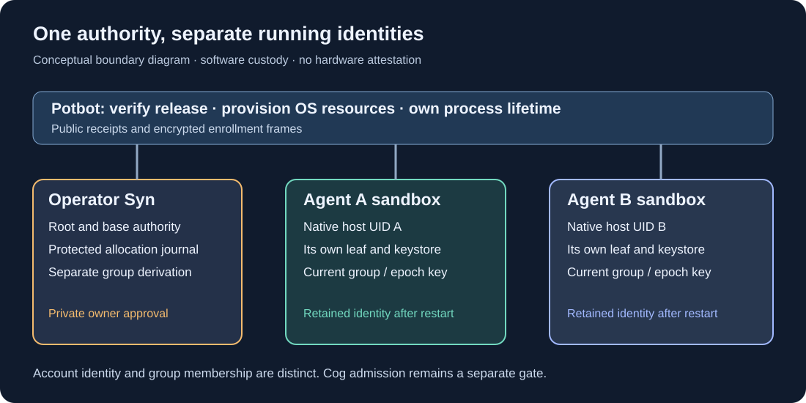

# Agent nodes, selected keys and current group custody

**Released Syn 0.3.0, 2 November 2026.** The canonical Agent runtime and
selected-key adoption passed local official-package acceptance through Potbot's
complete controller with two real WSL nodes. Native custody, isolated identities,
node/full-keystore-session restarts and locked-store fencing passed. The
[dated release record](releases/v0.3.0.md) retains immutable pins and separates
local acceptance, independent GitHub qualification and production admission.

*Generated conceptual diagram. It illustrates authority and isolation; it is not
hardware attestation or a screenshot of running nodes.*

## A node belongs to an Agent

An Agent receives one assigned Syn identity and runs its own process under a
separate restricted host account. Its node survives individual Cog invocations.
Potbot owns package verification, sandbox resources and process lifetime; Syn
owns entropy, derivation, private custody, enrollment, group keys and signatures.
Readiness does not grant Cog execution authority.

The initial Agent sandbox profile supports Linux x86-64, including Ubuntu WSL2.
Native macOS operator support continues separately. A genuine Linux Secret
Service instance and encrypted credential collection belong to each Agent's
private sandbox. The initial password is entered directly in Syn's controlling
terminal. The installer sees only public documents and encrypted transfers.

## An approved software device identity

Kieran explicitly selected **host-bound virtual-device IDs** on 2 November 2026.
Several Agents share one WSL host, and that host exposes no TPM. This is the
owner-approved `syn.host-bound-virtual-device/1` profile, with software custody
and no physical-device attestation or hardware non-exportability claim.

Syn reads the stable native machine identity and combines its domain-separated
host binding with a distinct OS-random virtual-device seed held in the Agent's
keystore. The profile also retains the native owner and canonical state path.
An independently generated temporary Ed25519 key authenticates the pledge; it
does not supply the inheritance bytes. The existing v2 formula and eight HD
candidate paths remain unchanged. Historical offers retain their original
source-policy interpretation.

The raw virtual-device ID appears only inside an authenticated encrypted pledge
directed to the independently pinned operator. Public pulses, candidate lists,
receipts and readiness proofs exclude it. A changed host binding, copied path,
wrong owner or partial credential set fences enrollment and restart. A complete
host/keystore clone is outside this software profile's guarantee.

## Two decisions precede adoption

```mermaid
flowchart LR
    P[Authenticated encrypted pledge] --> R[Operator reserves eight public choices]
    R --> S[Agent independently selects one]
    S --> H[Owner approves that exact selected identity]
    H --> G[One-use grant and fresh receiver]
    G --> E[Encrypted selected leaf]
    E --> K[Agent native-keystore import]
    K --> V[Fresh selected-key possession proof]
    V --> C[Operator adoption certificate]
    C --> Q[Separate current-group key transfer]
    Q --> N[Real node readiness and host inspection]
```

*Generated adoption sequence. The installer's bounded enrollment courier is not
an Agent-to-Agent messaging channel.*

The operator's original signed candidate reservation and the Agent's signed
independence choice are retained in Syn's canonical journal. A caller-supplied
claim that a selection is approved is insufficient. Native-keystore anchors bind
the exact state bytes and canonical path. Selection, grant, sealing, receipt and
group release are append-only transitions. Ambiguous failures remain fenced;
there is no implicit reseeding or destructive recovery.

The Agent imports only the selected leaf's extended secret, public key and leaf
chain code. It receives no root, base, sibling or parent derivation material.
The operator retains the ability to derive the assigned leaf. Separate Agent
custody therefore establishes an actual independently running holder, not
exclusive custody against the trusted operator or evidence of separate humans.

## Group membership is a separate authority

Account identity remains stable while group membership refers to a named group
and epoch. The current group key comes from a versioned HKDF domain bound to the
operator, network, group UUID and epoch, separate from HD account derivation.
After confirmed leaf adoption, owner approval authorizes a separately encrypted
current-epoch transfer and an operator-signed certificate for that node.

Syn retains the current group key in separate native credential slots and checks
its commitment against the certificate before readiness. Two Agents in the same
group and epoch receive the same group key and different account keys. This
initial custody profile does not implement group rotation, revocation, consensus
or general encrypted messaging; those keep their later acceptance gates.

## Package and process proof

The canonical `syn-agent` entry point and module interfaces live in the upstream
runtime. `syn-client` verifies the issuer's adoption certificate and a fresh
selected-key readiness signature against independent operator, configuration,
assignment, group and epoch pins. Public signatures alone do not certify OS
custody. The deployment controller independently inspects the owned process,
actual host UID, namespace mapping, empty capabilities, active syscall filter
and resource limits.

The sandbox exposes admitted runtime files read-only, one persistent Agent home,
private temporary storage, native credential IPC and the readiness endpoint.
Operator and peer homes/buses and Windows drive mounts are absent. Internet
socket creation is denied. This runtime profile does not replace Potbot's
separate Cog image, lease, monitoring, database or budget requirements.

The installer store remains private and sealed. Potbot admits a separate
root-owned execution view containing only inventory-verified runtime bytes,
with normalized read/execute permissions for the restricted native UID. It
mounts that view read-only and refuses changed or partial copies. Private
installer records and Agent state are not part of the shared runtime view.

Source acceptance uses actual candidate wheels and native encrypted stores; it
is labelled separately from published-package evidence. The native CI gate must
pin the reviewed Potbot consumer SHA. After publication, official acceptance
must install the exact signed manifest through Potbot's immutable store and run
the complete controller against those bytes. It exercises two simultaneous
nodes, node and full-keystore-session restarts, wrong/locked custody, retained
identity and process isolation. Fixtures never authorize a production Agent.

For sustained native custody, select the [0.3.1 connection-lifetime patch](releases/v0.3.1.md)
or a later qualified release using independent source, manifest and authority
pins. The initial 0.3.0 local qualification exposed a later reproducible resource
leak. Native acceptance now requires repeated real credential operations with
garbage collection disabled at the unchanged Agent descriptor limit, in addition
to the two-node official-package restart and isolation checks.

The initial journal is intentionally bounded to 64 transitions and 48 KiB.
Capacity exhaustion refuses further enrollment before mutation. General
recovery, upgrades, epoch changes and rollout remain SYN-R06/R07 work. The
[SYN-R05 integration](private-pubsub.md) now binds real node identity to separate
Cog admission and supported Syn messaging. Released native-mesh acceptance is
recorded for [0.4.0](releases/v0.4.0.md); production execution still requires its
independent qualified image, resource/audit and host gates.

There is no Agent GUI. Relevant CI captures belong in the dated release record;
passwords, keystore contents and private enrollment metadata are excluded from
screenshots and videos.
