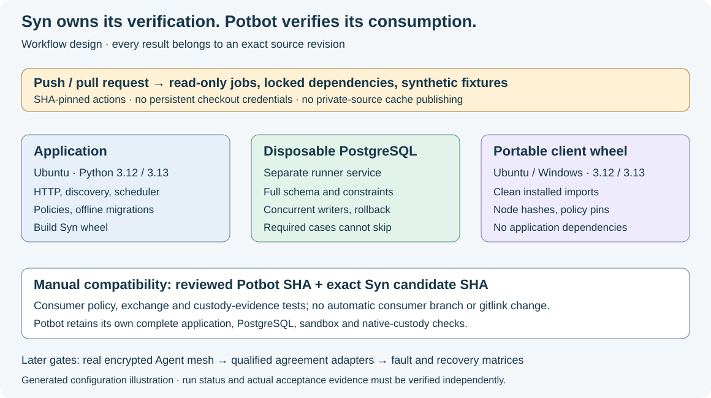
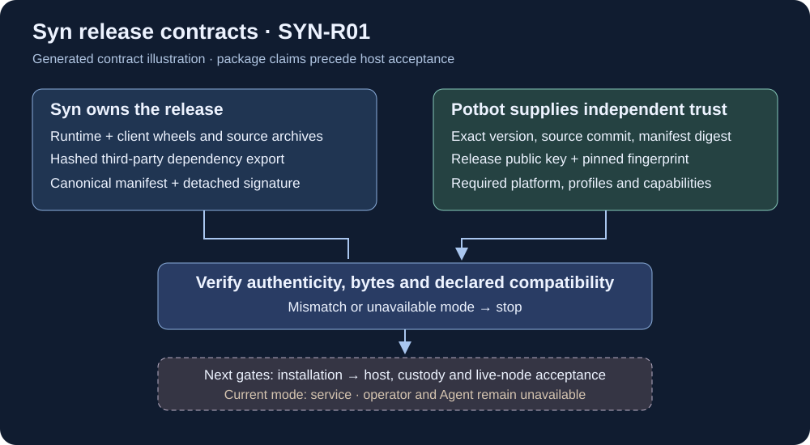

# Syn-owned verification workflows

Updated 2 November 2026. Workflows cover the Type-policy and release foundations.
Execution results must be read from the exact candidate's Actions runs; saved
YAML does not establish a passing platform or database result.

*Generated workflow illustration. This shows configured responsibilities, rather
than a screenshot of successful runs. Actual run URLs belong in the PR handoff.*

| Workflow | Trigger and environment | Checks and limits |
| --- | --- | --- |
| `ci.yml` — Syn verification | Push, PR, manual, reusable call; Ubuntu 24.04, Python 3.12/3.13 | Locked application and shared-contract tests, compilation/offline Alembic, both wheels/sdists, hashed third-party export, unsigned candidate validation and isolated installed-runtime descriptor comparison |
| `ci.yml` — postgres job | Same triggers; Ubuntu, Python 3.13, separate PostgreSQL 17.11 service | Full schema upgrade, all database tests, isolated communication/Type migration tests; fail on skipped required database cases |
| `client.yml` — Syn client portability | Push, PR, manual, reusable call; Ubuntu/Windows, Python 3.12/3.13 | Install the built dependency-free client wheel in a separate environment; isolated imports, canonical/identity/resolution contracts and minimal Python correctness lint |
| `potbot-compatibility.yml` | Manual, with a reviewed full 40-character Potbot commit | Test that exact public consumer with this exact private Syn candidate, selected policy/exchange/custody tests; no branch guessing or changing Potbot's gitlink |
| `release.yml` — Syn signed release staging | Manual on canonical `master`; protected `syn-release` environment for staging | Reuses application/database/client checks; signs the exact retained candidate bytes, creates and verifies a draft; a separate read-only operation verifies an independently pinned immutable publication |

The application matrix qualifies Linux application execution. The client matrix
qualifies the small shared wheel on Windows; it does not qualify the complete
Windows Syn host or native custody. Potbot retains its own full application,
PostgreSQL, sandbox and native-custody workflows. Compatibility is a focused
consumer test, not a substitute for either repository's complete checks.

## Execution and security boundaries

Verification jobs use `contents: read`, SHA-pinned actions, disabled checkout
credential persistence and disabled dependency caches. They need no production
operator keys or live node credentials. The dedicated release staging job alone
uses `contents: write`, Actions artifact read access and the `syn-release`
environment's release-signing secret. The independent published-byte operation
receives no signing seed and cannot write release assets.
The PostgreSQL password is an openly declared disposable fixture value. PRs
execute under `pull_request`, never `pull_request_target`. No script interpolates
the manual commit input as shell code; validate it through an environment variable
before checkout. The compatibility workflow is manual because its reviewed
consumer commit executes alongside private Syn source.

The database helper accepts only an explicit loopback database named `syn_ci`,
writes a runner-temporary test config with P2P disabled, and upgrades that service.
It refuses other database targets. Acceptance fails if its JUnit report contains
zero cases or skipped required cases. Normal jobs exclude database-marked tests
and make no PostgreSQL qualification claim. Service containers require a Linux
runner; see [GitHub's PostgreSQL service guide](https://docs.github.com/en/actions/tutorials/use-containerized-services/create-postgresql-service-containers).

Exact action/uv/test-tool pins are shared with the integration's verified tooling.
The PostgreSQL image uses a versioned upstream tag; it is not an immutable image
digest pin. Review digest locking and dependency updates together when changing
the database profile, rather than claiming that a tag cannot move. Current release
context: [PostgreSQL release notes](https://www.postgresql.org/docs/release/).
The permission/checkout rules follow [GitHub's secure-use reference](https://docs.github.com/en/actions/reference/security/secure-use).

## Running and interpreting checks

Run application checks locally with `uv sync --locked --dev` followed by
`uv run --locked python -m pytest tests packages/syn-client/tests -m 'not database'`.
Run required database checks only against an explicitly disposable database:
set `SYN_CI_DATABASE_URL` and `SYN_COMMUNICATION_TEST_URL` to the same loopback
`syn_ci` service, set `SYN_CONFIG` to a task-owned temporary file, then execute
`scripts/ci_database.py` and `scripts/ci_database.py --test`.

After the manual workflow is available on the default branch, dispatch it against
the selected Syn branch with a reviewed Potbot SHA. A newly proposed dispatch
workflow may need to land on the default branch before GitHub exposes its manual
trigger. Its absence from the run list is not a compatibility pass.

Require application jobs for both Python versions, postgres and all four client
matrix jobs when configuring branch protection. Workflow files do not alter
repository settings or make checks required automatically. Keep both integration
PRs as drafts until their exact source revisions and mandatory checks qualify.
The [release authority workflow](release-authority-and-publication.md) adds
protected signed-draft staging and independent immutable-publication verification.
The [first official package release](releases/v0.1.0.md) is now published;
installed-node acceptance remains a separate milestone.

## SYN-R01 release candidates

The application matrix builds the five payloads defined by the
[release contract](release-contracts.md), then constructs an unsigned canonical
manifest against the exact clean checkout commit. Archive checks reject unsafe
paths, private configuration, model weights and unexpected/missing package
resources. Metadata versions, runtime/client dependency, CA checksum and hashed
third-party requirements must match the contract.

*Generated trust-boundary illustration. No production signature or published
release is produced by the candidate lane.*

CI installs the hashed third-party export in a separate environment, installs
both local wheels with dependency resolution disabled, and invokes
`python -I -m syn.server --describe-json`. The installed descriptor must exactly
match the manifest and report only `service` mode. This exercises packaged
runtime resources and entry code independently of editable source imports.
The client matrix also runs release-verifier tests against the installed wheel.
None of these checks provisions release keys, accesses live node state or
qualifies the full Windows runtime, operator mode or Agent mode.

## Planned additions

Protected DAG event verification is now implemented in Syn, with native
reservation/recovery work in Potbot; see [protected signing](protected-dag-signing.md).
Its exact native-host acceptance remains owned by the corresponding Potbot
revision. Add actual encrypted two-Agent pub-sub, live admission and repair tests
when those paths exist. Add operator-log crash/partition and independent-root
BFT DAG/Hashgraph fault suites only when their adapters exist. The canonical
Type selects the protocol; an optional Raft experiment is not an adopted global
backend. Neither discovery tests nor policy parsing proves live consensus,
protected-node startup or fresh key possession. The published service package
does not complete installed operator/Agent qualification; see the separate
[release/deployment gates](release-and-node-deployment.md).
Add measured resource/retention and restore limits before a pilot. Capture actual
sanitised demonstrations then; a video of this workflow map would add no execution
evidence.
