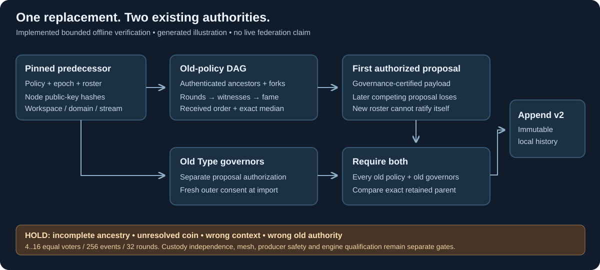

# Bounded DAG / Hashgraph governance finality

24 October 2026. `syn_client.dag_finality` independently replays signed gossip
history for a policy replacement. It verifies a finite governance decision; it
does not run a network, produce events or qualify a production consensus engine.

[Protected signing and recovery](protected-dag-signing.md) now define an explicit
v2 policy/proof profile with independent operator reservations. V1 remains frozen.



*Generated architecture illustration of implemented verification boundaries.
The replay fixture is synthetic evidence, not a screenshot of a live federation.*

## Authorization and compatibility

`syn.governed-policy-record/1` and its proposal/record digests remain unchanged.
It still refuses replacements under an existing federated policy. Record `/2`
uses `syn.policy-proposal/2` and its own record digest domain. A chain may advance
from v1 to v2; downgrade is refused. Existing operator policies still require their
old native consent quorum. Every old policy, including unchanged sibling Types,
must authorize the complete successor. All old stream epochs advance together.

For an old `syn.bft-dag-hashgraph/1` policy, the replacement's
`approvals.existing_policies[old_policy_digest]` is an object with exactly:

```json
{
  "profile": "syn.dag-hashgraph-finality/1",
  "algorithm": "syn.hashgraph-governance-replay/1",
  "context_digest": "<computed from the independently verified predecessor>",
  "events": ["<complete signed events, parents before children>"]
}
```

This is a schematic, not an importable proof. Signature lists, engine names,
asserted finalized flags and unsupported algorithm versions cannot substitute.
The context commits workspace, catalog, exact predecessor record, complete old
policy, domain, domain genesis, stream, policy epoch and roster digest. The proof
cannot choose a new roster, reset an epoch or replay another stream's decision.

Separately, **the old Type governors** sign the v2 proposal authorization. They
can authorize a new governor set or weaker/new policy, but that new authority
cannot approve its own installation. The native signing helper refuses requests
for a federated existing-policy consent signature; it can sign the distinct Type
governance role after verifying retained history and independent pins.

## Event and decision contract

An event has exactly `body` and `proof`. The body is `syn.hashgraph-event/1` and
commits `context_digest`, creator public-key hash, positive decimal `sequence`,
nullable `self_parent` and `other_parent`, integer `timestamp_ms`, and nullable
`proposal`. Parent references hash the entire public event, including its native
signature envelope. There is one self-parent and at most one other-parent; both
must already be present. A self-parent belongs to the same account, advances its
sequence by one and has an earlier timestamp; an other-parent belongs to another
account. Roots start at sequence one. Timestamps are claimed values, not trusted
wall-clock evidence.

The native account proof signs `syn.hashgraph-event-payload/1` over the exact body
using existing native v1 framing. Verification uses the account's full assignment
from the **old** roster. No Python key import or secret distribution is added.
Every vertex and ancestor is authenticated, including Byzantine branches. An
event's fork knowledge depends on its own ancestry; discovering a fork later
does not rewrite earlier visibility or virtual votes. One account cannot obtain
extra quorum weight by signing several branches.

The implementation computes rounds, witnesses, fork-aware seeing/strong seeing,
virtual fame votes, unique famous witnesses and received rounds. All known
witnesses in every preceding round must have decided fame. Claimed rounds and
votes are never inputs. It derives an exact median timestamp (stored doubled to
avoid floating point), then orders by received round, median, whitened native
signature and event digest. The final digest tie rule is explicit in this Syn
profile. It is not a Hiero wire or output compatibility claim.

An eligible event proposal contains `proposal_digest` and native
`type_governance` proofs from the old governors for that exact digest. Malformed
or unauthorized application payloads are deterministic no-ops; their signed
events remain in causal history. The verifier selects the **first** eligible
proposal in finalized order. Merely proving that a later replacement also
appears somewhere in that order cannot authorize it. This prevents two approved
proposals for the same predecessor from both claiming the policy epoch.
Governors must review valid complete proposals before signing. If they approve
an invalid or unusable proposal that wins, recovery requires a future explicit
governance protocol; silently skipping the winner would break the selection rule.

The original [Swirlds technical report, revision 18 March 2018](https://www.swirlds.com/downloads/SWIRLDS-TR-2016-01.pdf)
defines the visibility, witness and virtual-voting model used for this research
implementation, including late-witness safety (Lemma 5.18). A regular-round fame
decision needs strictly more than two thirds of distinct voters. This finite
verifier does not inherit a reviewed implementation's safety qualification.

## Bounds and limits

This version admits 4..16 equal-weight accounts, each assigned by a distinct
admitted issuer, with threshold `floor(2*n/3)+1`. Custody independence and fewer
than one-third Byzantine weight remain external admission assumptions; different
issuer keys do not prove different people or hosts. Weighted, changing-roster and
checkpoint-truncated DAGs hold. A proof contains at most 256 events and 32 rounds;
existing chain limits remain 128 records and **2 MiB total**. These limits bound
verification; they do not establish production throughput.

The coin period is frozen at three. A coin round with an already computed
supermajority carries that value without deciding. Where a coin would actually
be needed, the vote remains unknown and dependent elections cannot manufacture
a finality result. Native Ed25519 consent signatures are not assumed to supply
a qualified common coin. Thus this is a conservative verifier for histories
that resolve without such a coin, with no asynchronous termination guarantee.

Historical event and embedded governance signatures are checked without a live
clock. The separate outer old-governor approvals must still be live on first
local import, sampled after the store lock and again before commit. Historical
verification and exact retries do not claim freshness or latest global state.

Only governance selection is replayed. Protected v2 custody now reserves one event
per parent and recovers its exact bytes, while v1 remains research-only. Arbitrary
transaction execution, availability certificates, application outcome roots, mesh
transport, automatic producers and authenticated recovery checkpoints remain gated.

## Upstream boundary and verification evidence

Hiero remains the first candidate for the operational engine. This custom replay
profile must not be advertised as Hiero verification or production acceptance.
The feasibility review pins the upstream release and exact API observations in
[Hiero boundary notes](hiero-boundary.md). An engine adapter must use its actual
versioned event/proof grammar and independently qualify Syn-only encrypted
transport, protected signing, recovery and custom application outcome evidence.

`tests/test_dag_finality.py` creates signed four-issuer histories and exercises a
silent voter, a fork, independent graph-walk visibility, competing proposals,
unauthorized payloads, ancestry/signature/context tampering, authority rotation,
and SQLite admission. `tests/test_governance_postgres.py` verifies the same proof
before a real disposable PostgreSQL append. The installed client wheel and
Potbot consume the frozen public `federated-governed-chain.json` fixture. Legacy
native and v1 governance fixtures stay intact. These synthetic tests are not
upstream differential tests or a live Byzantine fault campaign.

The maintained static SVG renderer explains this code-only boundary. Audio,
movement and model tools add no useful evidence here. No live consensus interface
exists to capture; a network screenshot or video would misrepresent this slice.
