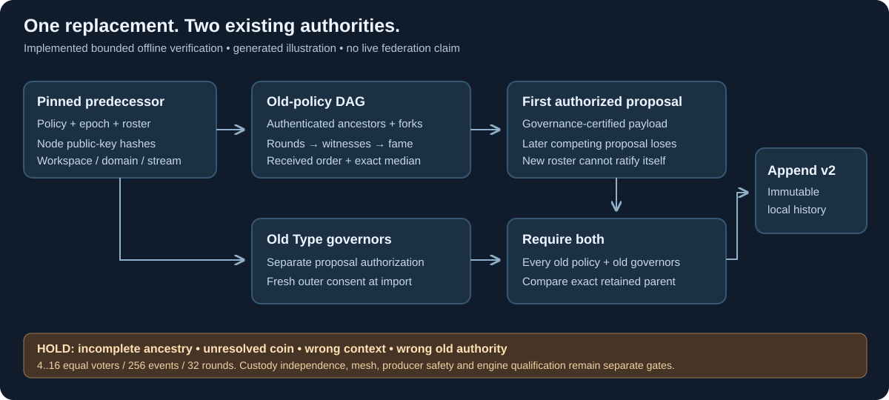

# Hiero feasibility boundary for Syn

24 October 2026 source review. Reviewed release: **v0.78.1**, published 22 October,
commit `ba7a27b6fbc0f0646bc95cb17013efecd4ec491d`. This review reads source;
it does not build, embed, operate or qualify Hiero. The current verifier is a
separate bounded Syn research profile: [DAG finality](dag-finality.md).

*Generated illustration of Syn's own implemented boundary, not a Hiero deployment.*

| Reviewed source at the pinned commit | Observation | Syn integration consequence |
| --- | --- | --- |
| [ConsensusImpl](https://github.com/hiero-ledger/hiero-consensus-node/blob/ba7a27b6fbc0f0646bc95cb17013efecd4ec491d/platform-sdk/consensus-hashgraph-impl/src/main/java/org/hiero/consensus/hashgraph/impl/consensus/ConsensusImpl.java) | Java consensus module computes fame and round decisions using platform events and roster lookup. It also documents late-witness behavior. | Its actual event, roster, coin and recovery semantics need a dedicated differential harness; Syn's native envelopes are not compatible by naming. |
| [PlatformBuilder](https://github.com/hiero-ledger/hiero-consensus-node/blob/ba7a27b6fbc0f0646bc95cb17013efecd4ec491d/platform-sdk/swirlds-platform-core/src/main/java/com/swirlds/platform/builder/PlatformBuilder.java) | Builder takes `KeysAndCerts`; its key check constructs `PlatformSigner`, signs test bytes and verifies against the signing certificate. | The reviewed path does not establish a protected native account-signer injection point. Loading Agent/base secrets into a Java service is not an approved workaround. |
| [Gossip](https://github.com/hiero-ledger/hiero-consensus-node/blob/ba7a27b6fbc0f0646bc95cb17013efecd4ec491d/platform-sdk/consensus-gossip-impl/src/main/java/org/hiero/consensus/gossip/impl/gossip/Gossip.java) | Interface binds event input/output, window, lifecycle, health, status and sync-progress wires. | This is a useful integration surface to investigate, not proof that builder construction and every recovery/control channel can already use private Syn pub-sub. |
| [License](https://github.com/hiero-ledger/hiero-consensus-node/blob/ba7a27b6fbc0f0646bc95cb17013efecd4ec491d/LICENSE) | Repository license is Apache 2.0. | No Hiero source or runtime is bundled by this slice. A future adapter must retain applicable notices and review its selected dependencies. |

The GitHub release API supplied the release/commit pins; a cached search result
still showed v0.77.5 as latest. Use immutable source pins, not search freshness, for
implementation claims. Default `main` was separately observed at
`4e62075e6ca77d2b057651b6282a9827bf380c7c` and is not this review's source baseline.

The next SBT10 feasibility deliverable is an isolated minimal Java/native adapter
experiment: map public-key-hash identities to engine-local roster references,
find or explicitly add a protected-signing capability, replace all peer channels
with Syn frames, export complete recoverable proof/event history, and verify a
custom Syn governance outcome independently. A local engine numeric index must
never become a Syn node address. Unsupported hooks remain named blockers.

No production engine is selected, and the bounded Python verifier is not a
silent substitute for those acceptance gates. Coin-dependent histories remain
unresolved until a separately versioned, reviewed coin/engine contract exists.
The current replay tests use synthetic signing keys and a graph-walk oracle;
they are not upstream differential or live network qualification.

No running Hiero interface exists in this task for screenshot/video capture.
The architecture illustration is the useful medium here; model and motion tools
would not establish any of these source-level integration capabilities.
