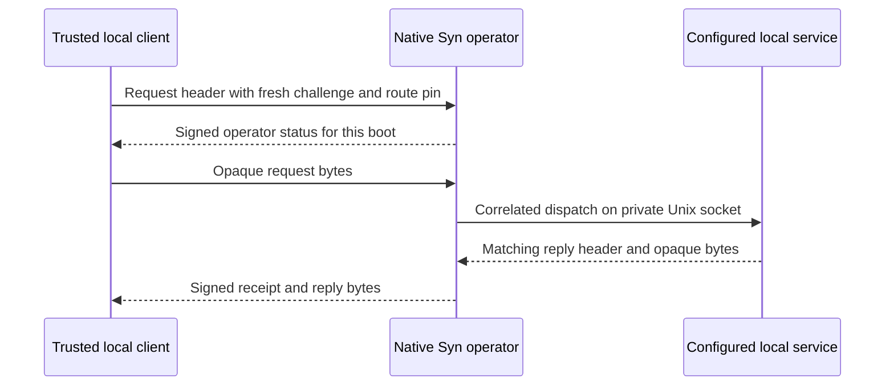

# Directed RPC through the native Syn operator

This is the first same-host request/reply transport for application RPC. The
trusted local client sends opaque bytes to the operator. Syn authenticates the
connection, dispatches only to the configured destination and returns a signed
receipt with the reply. The application service still owns authorization,
execution and outcome semantics.



*Protocol diagram. Both socket connections stay on the same host. The diagram
shows the route, not a Potbot or managed worker deployment.*

## Enable and pin a route

Pass `--rpc-config /private/operator/rpc.json` to `syn-operator serve` alongside
the normal `--config` argument. This is opt-in. An operator accepts one route
policy containing exactly the following fields. Store it as canonical JSON
(UTF-8, sorted keys, no added whitespace or trailing newline) and protect it
like the operator configuration (mode `0600` in a private directory).

```json
{"method":"context.read","profile":"syn.local-rpc-route/1","service_socket":"/private/context/service.sock","service_uid":1000,"workspace_id":"da3b9e2f-08b6-45db-a597-91acb4f84ac2"}
```

Pin the SHA-256 of those exact bytes independently. A path or digest supplied
by a caller cannot change the configured destination. The service binds its
own absolute, private Unix socket; it verifies the Syn operator's OS peer UID
on accepted connections. Syn verifies the destination's configured UID,
socket inode and path permissions. A changed route policy requires the
operator to restart with that policy and the client to receive its new pin.

## Call and reply

Use `syn_client.local_rpc.call` with the operator socket path, OS owner UID,
base public key hash, exact runtime version, operator configuration digest,
route digest, workspace, method and a caller-assigned request UUID. The client
checks the fresh signed status and `syn.operator-local-rpc/1` capability before
sending the payload. A successful result contains the reply bytes and a
receipt that binds the workspace, method, request ID, route, operator boot,
fresh challenge and both payload hashes. The client verifies the receipt
against the pinned operator identity before returning the bytes.

On the service socket, Syn sends a normal [operator wire frame](operator-node.md)
with profile `syn.local-rpc-dispatch/1`, `workspace_id`, `method`, `request_id`,
`size`, `boot_id` and `caller_uid`, then exactly `size` raw bytes. The
service responds with one frame containing profile
`syn.local-rpc-service-reply/1`, the same `request_id` and its reply `size`,
then exactly that many bytes. Both payloads are limited to 2 MiB. Syn bounds
the exchange with a deadline. The operator serves one socket exchange at a time. A missing or invalid reply does not prove that
the service did nothing; use application reconciliation or idempotency before
retrying a request. Syn does not retry it.

This route trusts the local operator account. It does not admit a Cog or
sandbox worker by UID, support remote Agents, or define an independent
application authorization rule. Potbot's Context RPC still needs admission
bound to a live worker invocation and its Agent, and qualification against
a pinned signed release before the installed stdio fixture can be retired.
