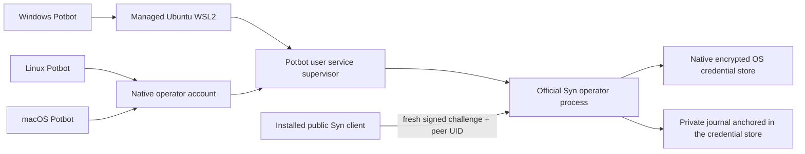

# Native operator node

SYN-R03 adds a real foreground operator process in the [immutable 0.2.0 release](releases/v0.2.0.md).
Publication and installed-release acceptance are recorded separately.
The unchanged 0.1.0 release declares only service mode.



*Conceptual ownership diagram. The native Linux process has been exercised with
a disposable Secret Service collection; this is not a production deployment
receipt or evidence of macOS acceptance.*

Windows uses a dedicated Ubuntu 24.04 WSL2 distribution in the base operating
system. Linux and macOS run natively. Potbot owns host/package preparation and
process supervision. Syn owns identity, custody, allocation and authenticated
local IPC. The public client owns verification. Agent sandboxes receive no
operator credential-store access.

## Identity and custody

An explicit first initialization draws 32 bytes from the OS CSPRNG. Syn uses
the pinned PyCardano Icarus/Ed25519-BIP32 V2 provider: root
`m/6969'/420'`, base identity `m/6969'/420'/0'/0/0`, and eight candidate
descendants `m/6969'/420'/I'/{1..8}/0`. Installation identity is SHA-256 of
the raw base public key. A live independent Rust/WASM reference compares the
base/root public keys, deterministic signature and 24 candidate public hashes.
It is a fixed public test vector, never production entropy.

Linux uses native Secret Service and macOS native Keychain. This is software
custody; it does not claim TPM/HSM non-exportability, Python memory zeroization,
or physical device attestation. There is no environment-selected fallback
backend. Background operations refuse missing or locked stores without
creating a collection or displaying a password prompt.

The explicit `python -m syn.operator unlock` command requires a private local
controlling terminal. Passwords are never command arguments, environment values,
JSON output or Potbot inputs. First-time Linux collection creation confirms a
nonempty password. Native keystore setup does not create a Syn identity.

## Creation, startup and discovery

Use only the verified installed interpreter:

```bash
python -m syn.operator unlock
python -m syn.operator init --state-dir /operator/syn-state \
  --keyring-service syn.operator --keyring-account primary \
  --network-id private-network --new-identity
python -m syn.operator preflight --config /operator/syn-state/operator.json
python -m syn.operator serve --config /operator/syn-state/operator.json
```

Paths are illustrative, absolute, private and subject to the native socket
length bound. Retain the public creation receipt independently. Configuration
binds the base identity and network; a same-account authority lock prevents a
second directory from running the same authority concurrently. Missing keys,
partial initialization, altered configuration, missing allocation anchors and
file rollback refuse startup. None authorizes automatic replacement.

An authenticated attachment checks the independently retained base hash,
configuration digest, exact runtime version, OS peer UID and fresh nonce-bound
signature. The response includes PID, random boot ID, monotonic retained boot
counter, custody profile and allocation-state digest. A successful package
installation is insufficient. Potbot stops only its owned child and fences
unexpected exits; attaching to an existing operator conveys no process ownership.

The operator uses a private Unix-domain socket and bounded canonical frames.
It does not offer arbitrary signing or private key export over IPC. A crashed
socket is removed only when its retained device/inode matches and the kernel
refuses connection. Foreign or ambiguous endpoints remain untouched.

## Protected enrollment authority

Stop the supervised operator before exclusive maintenance. Generate a fresh
`enrollment-pulse --config ...`, then pass a private canonical request file
containing `pulse` and `pledge` to:

```bash
python -m syn.operator reserve --config /operator/syn-state/operator.json \
  --request /operator/requests/pledge.json --operator-byte 23
```

Syn verifies the operator pulse, temporary-key signature, time, network and
target identity. Inheritance is exactly uint24BE(SHA-256(raw signed hardware
ID || operator octet)[:3]). A private terminal displays the commitment and
requires a specific approval phrase. No public socket call grants permission.

Before signing candidates, Syn durably appends an allocation and updates its
native-keystore anchor. The journal stores a keyed device commitment, transcript
digests and inheritance; it never stores the reusable raw hardware ID.
Device, pulse, pledge and inheritance cannot be reused. The bounded register
refuses capacity exhaustion. Interrupted sealed transitions recover only their
exact retained state; committed allocations cannot be removed or rewound.
Rewinding both the OS keystore and filesystem is outside this local guarantee.

The signed eight-candidate v2 envelope remains compatible with Potbot's public
verifier. This reserves public choices only. Encrypted Agent transport, actual
hardware provenance, selected-key adoption and activation remain SYN-R04.

## Acceptance evidence

The mandatory native workflow covers Ubuntu 24.04/Python 3.12 and 3.13 and
macOS ARM/Intel with a native disposable Keychain. It compares the independent
HD reference and runs actual operator subprocesses through graceful restart,
forced death and locked-store refusal. Synthetic fault tests separately cover
interrupted transitions, rollback, unauthorized allocation and foreign sockets.
Only completed workflow results establish platform acceptance.

The separate manual `Official Syn operator deployment` workflow accepts an exact
reviewed Potbot SHA and independently retained 0.2.0 source/manifest pins. It
installs the actual immutable signed release, invokes its installed interpreter
with a disposable native keystore, and exercises Potbot bootstrap, owned-child
supervision, independent attachment, retained restart and locked-store fencing.
Its receipts distinguish official package acceptance from source tests and a
persistent user deployment. It receives only repository read access and removes
that token before native children start; no signing environment is available.

An explicit `export_transfer` run also retains the Linux/Python 3.12 preparing
package/dependency cache and an exact reviewed Potbot wheel. The archive excludes
installed environments, admission journals and every native credential store.
Its retained SHA-256 and dependency-cache digest must be independently selected
before an offline deployment. This is a transfer of the documented installer
cache, not a new release or a node identity. Downloading it does not make a
private repository token available to the destination host.

Local development acceptance passed on the managed Ubuntu 24.04 WSL2 host:
three independent boots retained one identity, locked Secret Service refused
readiness, and ten synthetic/socket/authority regressions passed. These used
development code and disposable keys. Official installed-release acceptance is
evidenced by exact runs of the [separate workflow](https://github.com/Synsphere/syn/actions/workflows/operator-release.yml);
a persistent user deployment requires its own private host receipt.

The first official-package run
[41424371694](https://github.com/Synsphere/syn/actions/runs/41424371694)
passed Linux/Python 3.12 with reviewed Potbot
`eefd32ee42d9a9d1b55d9364d820705ca3c949d9`. Its macOS preparation correctly
refused a hosted interpreter writable by another principal. The qualification
harness now selects managed Python and protects only a byte-checked private
copy of that prefix; it never changes hosted executables or relaxes the
installer's ownership checks. Native platform acceptance still requires a
completed successful installed-package result for that platform.

There is no graphical node UI or dynamic Agent exchange in this stage.
The architecture diagram explains the interface; sanitized native test receipts
provide execution evidence. No screenshot/video of a production deployment is
claimed before it exists.
