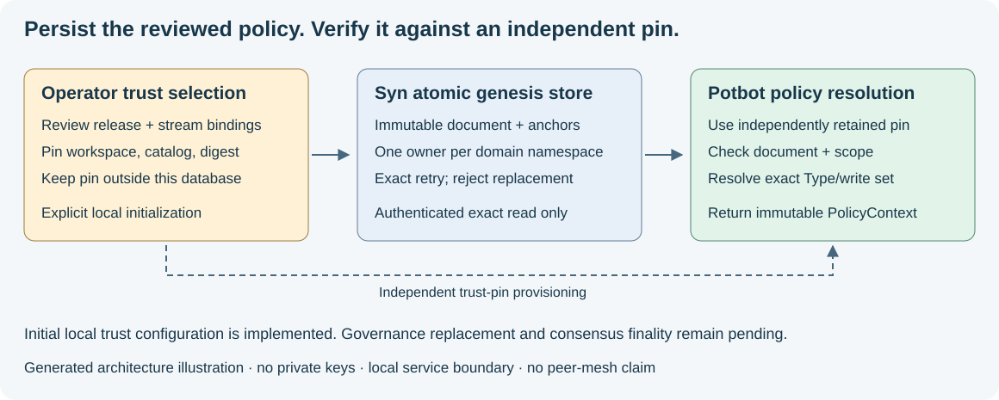

# Durable local policy genesis

24 October 2026. Implemented local initialization and authenticated, pinned reads.
This is explicit trust configuration, not a signed governance certificate or
consensus finality. Both consensus engines remain future work.



*Generated architecture illustration of the implemented boundary. The SQL store
and read path are implemented; this does not depict a running peer mesh.*

## Authority and scope

`syn_client.policy_adoption.GenesisPolicyAdoption` has profile
`syn.policy-genesis/1` and trust basis `explicit-local-genesis-pin`. It commits a
canonical workspace UUID, complete `CanonicalTypeRelease`, and nonempty,
unique, sorted `PolicyBinding` records. Only epoch `1` is accepted. Each binding
must refer to a policy in that release, match its roster anchor and agree on
one genesis digest per domain. Unbound or legacy Types remain held on resolution.

Its SHA-256 digest uses `syn.policy-genesis/1`, a NUL separator and the bounded
`syn.consensus-json/1` document bytes. It covers Type schema, policy, release,
workspace and all domain/genesis/stream/epoch/roster bindings. Whitespace and
object order are canonicalized; duplicate fields, unsupported values and
unknown profile fields are refused. The synthetic portable vector lives in
`packages/syn-client/tests/fixtures/policy-genesis.json`; it contains no real keys.

The operator reviews and distributes workspace/catalog/adoption pins through an
independently trusted provisioning channel. Keep the retained pin outside the
database being checked. A hash supplied by that same database or remote response
does not establish trust. Genesis pins contain no private signing keys. This
slice neither reads nor distributes operator base secrets or Agent account keys.

Workspace is the local authorization and registry scope. Within it, the domain
UUID has one immutable genesis anchor and each `(domain, conflict_namespace)`
has one catalog/policy/stream owner. Another catalog cannot claim that namespace,
even with identical policy bytes. Different namespaces can share the same domain
anchor. Another workspace is a separate explicit trust configuration, not an
alternate route into an already admitted transaction domain; future runtime
admission must bind that workspace/domain to the assigned Agent and verify it.

## Atomic storage and replacement rules

Migration `20261023_0014` creates four tables:

| Table | Responsibility |
| --- | --- |
| `syn_policy_workspaces` | Serialize initialization across every catalog in a workspace |
| `syn_policy_adoptions` | One immutable document and its adoption/release digests per catalog |
| `syn_policy_domains` | One immutable genesis anchor per domain |
| `syn_policy_conflict_owners` | Unique namespace ownership across catalogs |

`PolicyAdoptionStore.initialize` validates the independent pin before SQL work,
locks the workspace row, then commits anchors, document and ownership together.
Concurrent identical attempts return the same document. Changed release/binding
attempts or conflicting owners fail and roll back the entire attempt. Reads
recompute the document hash and check the stored release digest, domain anchors
and exact ownership registry against it.

PostgreSQL statement triggers reject UPDATE, DELETE and TRUNCATE on all four
tables. SQLite supports portable fixture/durability checks; its `create_all`
schema does not claim production immutability or PostgreSQL concurrency evidence.
Triggers are operational protection, not protection against a database owner who
can disable them. Independent client pins detect substitution or missing state;
they do not prove availability, freshness or validator agreement.

There is no force-replace flag or HTTP adoption mutation. A new local pin cannot
replace an adopted catalog. Governed transitions require an explicit append-only
successor format, previous adoption/epoch binding, old-policy proof and Type
governance verification, with atomic ownership transfer and replay protection.
The separate [signed-governance format](signed-governance.md) implements local
successors authorized by existing operator quorums and Type governance. It cannot
silently promote this legacy unsigned format. Federated replacement remains held.
Do not clear the tables, mint another catalog
for the same namespace, or label a new genesis as a policy upgrade.

## Explicit administrative initialization

First migrate the intended database through Syn's established deployment process.
Review the release, policy bindings and manifest; independently record the three
pins. On a machine with explicit administrative access to that database:

```powershell
python -m syn.policy_bootstrap initialize `
  --config <reviewed-local-config.toml> `
  --manifest <reviewed-genesis.json> `
  --workspace <canonical-workspace-uuid> `
  --catalog <canonical-catalog-uuid> `
  --expected-adoption-digest <independently-reviewed-64-hex-digest>
```

Replace placeholders before execution. This command uses the explicitly named
configuration, performs no implicit migration, and prints only the committed
digest or a safe hold message. An exact retry is allowed. It does not start a
service, contact peers, generate keys or enable an outbox. The task's tests ran
only on synthetic fixtures and GitHub's disposable PostgreSQL service; the
configured existing Syn database was not initialized by this development work.

## Authenticated read boundary

```text
GET /v1/communication/workspaces/{workspace}/policies/{catalog}/adoptions/{digest}
Authorization: Bearer <workspace-service-token>
```

This route is present only when workspace communication credentials are
configured. Authentication precedes store access. It accepts no query parameters
and has no `latest` fallback. Missing exact pins return 404; malformed pins or
inconsistent stored content hold with 422. The response is the genesis document,
not a server-selected expected digest. Service credentials authorize local reads;
they are distinct from node signing identities and private group keys.

`SynClient.policy_adoption(workspace, catalog_id=..., expected_adoption_digest=...)`
uses strict bounded consensus JSON and rechecks workspace/catalog/digest. Potbot's
optional `adopted_policy_resolver` verifies the returned document against its own
pins again and exposes the existing exact-Type/write-set resolver. These are
local Potbot-to-Syn calls. All future Agent-to-Agent traffic, including governance
and repair, must still use each Agent's assigned Syn instance and encrypted group.

## Evidence and remaining gates

Tests exercise disk reopen, exact retries, refused changed manifests,
cross-catalog namespace conflicts, distinct namespaces, tampered SQL rows,
authentication before lookup, strict response parsing and actual loopback HTTP.
The PostgreSQL lane runs clean upgrades, concurrent exact retries and competing
catalog/domain/namespace attempts, all twelve rewrite/truncate refusals and a
downgrade/re-upgrade in a uniquely owned disposable schema.

Remaining for this legacy format: explicitly authorized signed migration/recovery.
The new format reuses frozen native signatures; new ledger parity,
Agent/instance/peer binding, roster and independent-custody admission, encrypted
private transport, consensus adapters and independently verifiable finality.
No consensus interface exists to capture a relevant UI screenshot or video.
The diagram explains the implemented storage boundary; real mesh/fault/recovery
demonstrations remain separate acceptance work.
