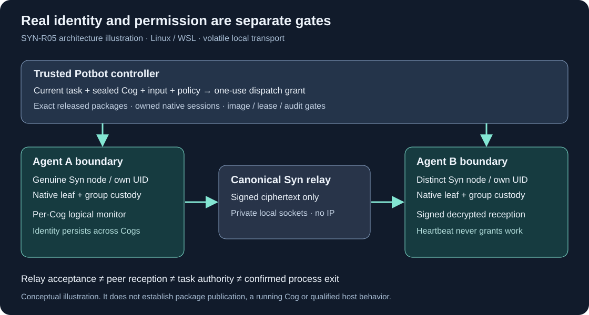
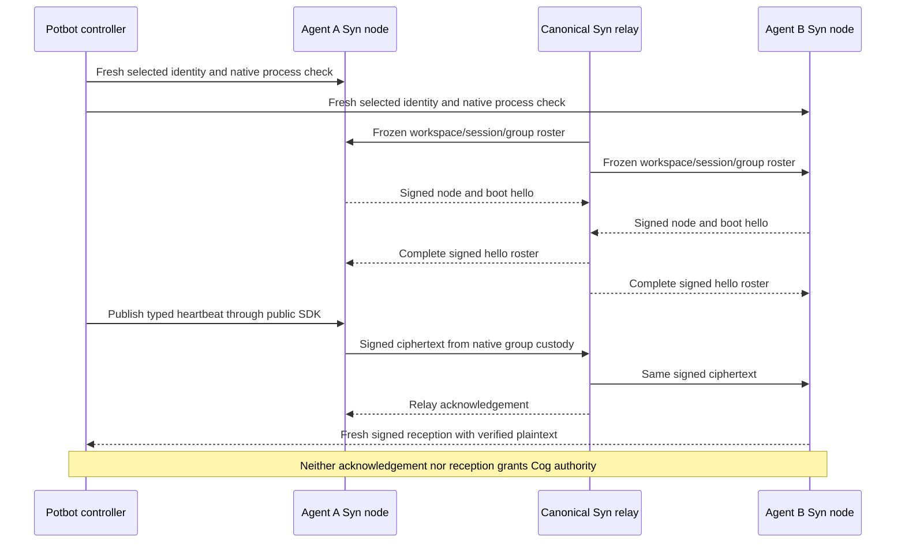
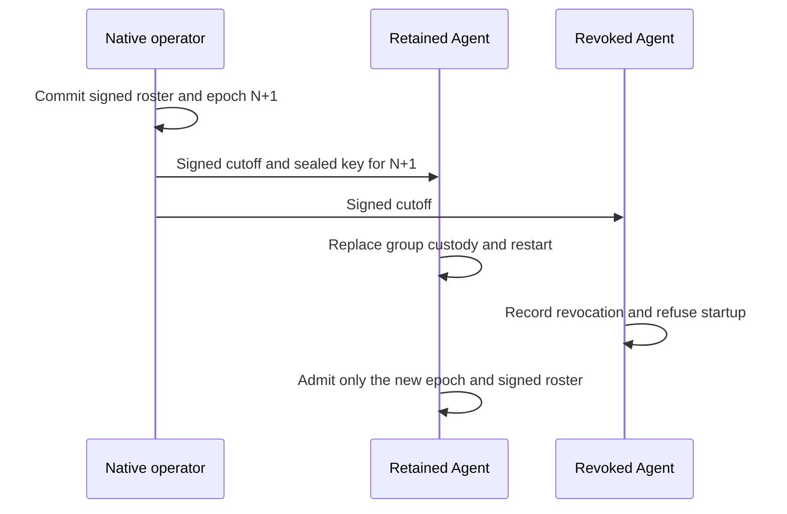

# Private Syn pub-sub and Cog admission

**Published and native-mesh qualified Syn 0.4.0, 2 November 2026.** Syn 0.4.0 adds an authenticated,
encrypted, volatile local transport between independently enrolled Agent nodes.
The source-wheel native WSL fixture passed two-node delivery, signed decrypted
reception and relay-loss fencing. The [release record](releases/v0.4.0.md)
retains verified publication and successful Python 3.12/3.13 official-package acceptance;
the existing 0.3.1 release remains unchanged.



*Generated architecture illustration, not evidence of a running node or Cog.*

## Ownership and trust

The official Syn runtime owns native credentials, group encryption, source
signatures, membership, replay checks and ciphertext routing. Potbot invokes the
installed public SDK and canonical runtime commands. It never receives a group
key, imports Syn runtime internals or substitutes an in-process heartbeat relay
for real nodes. The privileged local controller and its OS are trusted; this
profile does not protect against a compromised host administrator.

One Agent owns one long-lived Syn node. Each Cog invocation has a separate
logical heartbeat monitor associated with that Agent, not a newly fabricated
Syn identity. A native Syn UID and a Cog guest UID may differ because they are
separate restricted processes bound to the same logical Agent by the operator.



## First supported profile

The additive runtime profile is `syn.private-pubsub/1`, capability
`authenticated-private-pubsub`. Qualification targets Linux x86-64, including
managed WSL2. Existing native Agent sandbox, custody and deployment requirements
remain mandatory. macOS Agent isolation and remote IP transport are unqualified.

The controller starts the official `python -I -B -m syn.mesh --config FILE`.
Its root-private configuration has profile `syn.private-relay-config/1`, a
`scope`, and exact `endpoints` containing node hash, private socket and owner UID.
The relay opens no IP listener. It connects to each existing native Agent socket,
checks ownership and peer credentials, and relays public certificates and signed
ciphertext. No signing or group secret is held by the relay implementation.

The frozen `syn.private-pubsub-scope/1` records workspace UUID, random session ID,
operator hash, network ID, group UUID, current group epoch and signed member
certificates. Every certificate must have the same current group commitment.
Signed hellos bind each selected leaf to its live boot and this exact session.
An Agent cannot be silently rebound to another mesh while running.

The public `syn_client.pubsub_client` module exposes `request(...)` and a CLI:

```sh
python -I -B -m syn_client.pubsub_client \
  --socket /private/agent.sock --owner-uid 53102 \
  --expected-key SELECTED_NODE_HASH --configuration-sha256 CONFIG_HASH \
  --expected-boot BOOT_ID --request /private/public-request.json
```

The request file contains exactly `scope`, `operation` and `payload`.
`status` and `receive` require a null payload; `publish` requires
`{"topic":"synny://type/potbot-worker-heartbeat-v1","value":{...}}`.
Topic names are exact bounded Syn type references. The SDK creates a fresh
challenge, checks the private endpoint and verifies the selected node's signed
reply, request digest, scope and boot. It needs the client's governance extra
for cryptographic verification. It neither exports keys nor provides a general
signing RPC. Root-only controller operations are distinct from Agent readiness.

## Encryption and evidence

Each sender derives an AES-256-GCM key from its current native group key using
HKDF-SHA256. The derivation binds network, group/epoch, workspace, random session,
selected sender and boot. A monotonic per-sender sequence provides the nonce;
authenticated metadata and the member certificate bind the ciphertext. The
selected leaf signs the complete envelope. Recipients independently check the
membership, signature, boot and increasing sequence before decrypting, then
check the sender's plaintext commitment. There is no new identity derivation or
private-key export contract.

| Evidence | What it establishes |
| --- | --- |
| Signed `status` | Current native custody and complete connected roster; always `cog_execution_authorized=false` |
| Signed `publish` | A particular ciphertext was accepted by the relay; `peer_reception_proved=false` |
| Signed `receive` | The selected recipient reports verified plaintext bound to a signed source envelope |
| Potbot task grant | Separate controller authorization for one exact Cog invocation after existing task/policy checks |
| Host process/audit receipt | Separate evidence of actual effects and confirmed process-tree termination |

The initial limits are eight native peers, 8 KiB canonical JSON per publication,
64 queued messages per recipient and two messages per receive call. Messages
are fresh within a bounded clock window. Consumers must drain queues even when
their Agents have no active Cog. The transport is volatile: no durable delivery,
exactly-once execution, transaction ledger, Type consensus or cross-host claim
follows from it. PostgreSQL and existing execution journals remain authoritative.

Lost relay or native custody, malformed or replayed traffic, queue exhaustion
and uncertain publication fence the session. Native health then refuses work,
the Agent exits and removes its endpoint. Potbot propagates the fault to Cog
supervision and treats possibly dispatched effects as requiring reconciliation.
## Member revocation and epoch rollover

The `syn.agent-group-rollover/1` profile adds planned maintenance for a group
with one initial epoch and at most eight members. It removes one or more
members and keeps at least one. The operator reads the current cohort from the
native enrollment journal. With the nodes stopped, each retained member runs
`syn-agent prepare-group-rollover --config FILE` or uses the private session
operation `prepare-group-rollover` with a null payload. This signs its native
transfer public key for the current group and epoch using the enrolled leaf.



Stop the old relay and the affected Agents before rollover. Run
`syn-operator agent-group-rollover --config FILE --request FILE` through the
operator's private terminal. The request has four fields.

| Field | Value |
| --- | --- |
| `group_id` | Existing group UUID |
| `expected_epoch` | Currently committed positive epoch |
| `revoke` | Sorted selected public key hashes to remove |
| `requests` | Map from each retained selected public key hash to its signed rollover receiver |

Confirm the exact retained and revoked members in the private prompt. Syn
commits the signed transition and sealed deliveries before returning them. If
delivery is interrupted, the exact request can retrieve the current committed
result again without authorizing a second rollover.

Deliver the signed `transition` to every member of the old cohort. The Agent
request contains that transition and a `transfer` field. Use the Agent's own
entry in `transfers` for retained members and JSON null for revoked members.
Apply the request with `syn-agent apply-group-rollover --config FILE --request FILE`
in the Agent's native credential session, or send the same payload to the
`apply-group-rollover` operation in the private session before starting its
node. Confirm the result for every affected member before resuming service.
Restart retained Agents with the new deployment epoch and build a fresh
relay scope from their new certificates.

Syn keeps the adopted leaf, assignment and device identity intact. The Agent
stores the signed cutoff in its OS keystore. A revoked Agent that receives the
cutoff refuses startup even if the caller supplies the old epoch. Retained
Agents refuse old relay scopes and require the signed roster at the new epoch.
An offline Agent can still hold old keys until it receives the cutoff. Keep
retired relays closed and require verified delivery or continued isolation at
cutover. Old ciphertext may still be decryptable by someone who saved the old
key. This is a local maintenance flow with a trusted controller, not a remote
revocation broadcast. Initial assignment closes after the first rollover, so
adding or reinstating members requires a separate policy.

The headless fixture uses disposable accounts and real native custody. It
reopens both keystores after applying the cutoff, tests the revoked Agent with
both epoch pins, and checks signed status on the retained Agent's fresh relay.
CI retains signed receipts for verification. A screenshot or video would only
show the headless test output, so the diagram accompanies the receipts.

## Qualification and media

`tests/test_pubsub.py` uses real signatures/encryption with explicitly synthetic
custody for protocol/fault tests. `scripts/ci_private_pubsub.py` retains the
lower-level two-native-node delivery fixture. The source-wheel lane now runs
`scripts/ci_potbot_private_mesh.py` with actual encrypted stores and real
restricted processes, substituting only the package/assignment registry in an
explicit source-only deployment fixture. It cannot prove official installation.
The official-package lane runs the same complete adapter with the actual
installer/deployment registry, exact reviewed Potbot controller and independently
pinned signed packages; no registry is substituted there.
It exercises the complete public adapter, real heartbeat exchange, one-use task
grant rejection and relay-loss fencing. It explicitly records that no Cog
process is dispatched; qualified Cog images, cgroups, syscall/TASKSTATS evidence,
budgets and host admission retain their own mandatory tests and U16 acceptance.

There is no GUI in this profile. The diagram and sequence explain the behavior;
native signed receipts and CI logs supply evidence. No keystore/prompt footage
is captured. Browser capture is unavailable on the currently permitted external
connection, so no screenshot or demonstration video is claimed.
