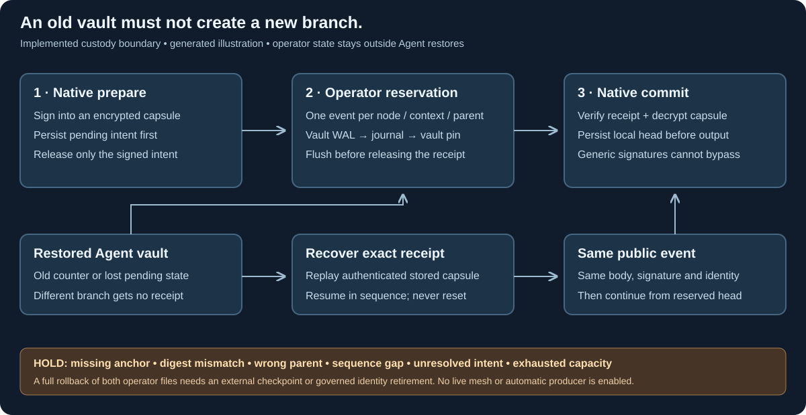

# Protected DAG signing and recovery

24 October 2026. Protected events use `syn.bft-dag-hashgraph/2`, proof profile
`syn.dag-hashgraph-finality/2`, replay algorithm `/2` and event body
`syn.hashgraph-event/2`. Version 1 remains an immutable research contract. Moving
an existing Type to version 2 requires finality under its **old** policy and
separate old Type-governance approval; the new rules cannot approve themselves.

*Generated implementation illustration. It is not a live federation screenshot.*

## The rollback boundary

A counter stored inside a backed-up vault rolls back with that vault. A second
Agent-local file alone does not fix that problem. The protected path therefore
requires an **operator-held anchor outside Agent backups** before releasing any
event signature. The operator keeps the base secret. An Agent retains only its
assigned account key and current group key; recovery encryption keys are derived
inside native memory from the assigned account and are never exported.

The anchor is a permanent compare-and-set journal keyed by account public-key
hash and exact policy context. It accepts only the next sequence, current
self-parent and a later claimed timestamp. Once reserved, that slot cannot be
cancelled, expired, overwritten or reassigned to another event. A restored or
cloned Agent vault can propose another intent, but cannot obtain the independent
receipt required to release or verify a conflicting event.

This guarantee assumes the independent operator custody state remains intact.
The operator vault pins the journal's path and exact digest. Rolling back either
file alone, losing the journal, or selecting another path stops signing. A full
rollback of **both** operator files, or a malicious operator with the base key,
requires a genuinely external checkpoint/hardware anchor or governed retirement
of the affected identity. Local software cannot distinguish a complete rollback
from its earlier legitimate state. Do not restore the operator anchor together
with Agent snapshots or initialize a replacement empty journal.
Keep one authoritative operator service per base key; a second independently
restored operator copy is outside this trust assumption.

The general need to retain signer state is also described in CometBFT's
[validator signing specification](https://github.com/cometbft/cometbft/blob/main/spec/consensus/signing.md).
Syn uses its own event/anchor protocol; it does not import CometBFT consensus.

## Three protected operations

1. **Prepare.** The native Agent validates the body against its durable local head.
   It creates a dedicated `syn-dag-event-proof-v1` signature, encrypts the body and
   proof into a recovery capsule with AES-256-GCM and an account-derived HKDF key,
   and seals the pending intent into the Agent vault. Only after a durable vault
   write does the process release `syn-dag-reservation-intent-v1`. Its separate
   account signature authenticates the context, sequence, parent, timestamp, body
   digest, exact event digest, reservation UUID and ciphertext. The event signature
   itself remains inside the capsule. An exact prepare retry returns the same
   intent; another body for that pending context is refused.
2. **Reserve.** The operator's native process verifies the assigned account and
   current credential allocation, serializes access to the anchor, and checks the
   permanent sequence/parent constraint. It signs `syn-dag-anchor-receipt-v1` for
   that exact intent. A write-ahead copy is sealed in the operator vault first,
   then the signed journal is atomically flushed, then the completed journal digest
   is sealed in the operator vault. The receipt is emitted only after those writes.
   A retry returns the original receipt. A different intent cannot take its slot.
3. **Commit or recover.** The native Agent verifies the receipt against its issuer,
   authenticates/decrypts the capsule, checks the full event and account binding,
   advances its local head, and durably writes its vault before emitting the event.
   A restored vault can replay the original receipt and recover the exact same
   public event without its former pending state. Gaps require earlier receipts
   first. A current-head retry preserves a pending next event rather than deleting
   it. There is no cancel/reset command. Credential rotation holds while an intent
   remains unresolved; recover and commit it before rotating.

The signed recovery capsule contains only an event and its public proof. It never
contains account/base/group secrets, a password, or a vault master key. Python
handles public bodies, opaque capsules, receipts and released events only. Native
locking, protected heap/stack, zeroization and filesystem checks remain mandatory;
there is no weaker fallback.

## Crash recovery

| Failure point | Recovery |
| --- | --- |
| Before Agent vault flush | No intent was released; retry from the durable head. |
| After prepare flush, before delivery | Exact prepare returns the stored intent. |
| After operator write-ahead flush, before journal replacement | Reconcile the exact sealed pending receipt into the old journal. |
| After journal replacement, before operator completion flush | Verify the pending transition and finish it without appending twice. |
| After reservation, before Agent commit/output | Export the exact stored receipt and commit its capsule. |
| Agent vault restored to before prepare | Reject any alternate reservation; recover original receipts in sequence. |
| Missing, altered or singly rolled-back operator state | Hold. No empty journal is recreated. |

The native library exposes the ordering primitives; the production CLI owns their
file locks and durable write-before-output sequence. Ordinary library tests alone
do not qualify the production custody boundary. Linux acceptance runs the real
protected binary, restores an Agent vault, rejects the fork, exports the stored
receipt and recovers byte-identical public output. The public Rust-generated
fixture is independently verified by Python's pinned Ed25519 implementation.

## Public verification and bounded storage

A protected event contains `body`, `proof` and `reservation`. The event's content
digest covers body plus account proof; the independent receipt signs that digest.
Excluding the receipt from this content digest avoids a circular reference. The
complete governance record still commits every proof/receipt byte.

Syn verifies both signature domains, the exact old roster credential, the issuer
reservation, context/sequence/parent/time/body hash, reservation UUID and event
content hash before DAG replay. Generic `syn-agent-proof-v1` signatures cannot
substitute, even for the same payload hash. Re-labelling v1 proof history does not
upgrade it. Hashgraph replay/fame/first-authorized-proposal semantics remain the
same bounded subset; ambiguous coin votes still hold.
Protected proposal payloads also include sequence, predecessor digest and state
digest, allowing the verifier to recompute the proposal hash. An earlier epoch's
otherwise valid governor certificate becomes a no-op rather than capturing the
new epoch. This context strengthening belongs to the new v2 contract.

Protected bodies use the native ASCII, nonnegative safe-integer subset of
`syn.consensus-json/1`, at most 16 KiB. Capsules are at most 32 KiB. Each operator
journal is bounded to 128 receipts and 1 MiB; Agent state holds at most 64 contexts
and 16 unresolved intents. Capacity holds instead of pruning safety state. The
existing DAG bounds (256 events, 32 rounds) and chain bound (128 records, 2 MiB)
also apply. A qualified checkpoint/retirement protocol is needed before these
limits are exhausted.

These are protected local custody commands, not an automatic Agent producer or
network service. Operator control-plane handoffs are explicit. Any future delivery
of intents, receipts, peer events or repair traffic must use each Agent's Syn
instance and encrypted private Syn channels. No direct Agent transport or automatic
outbox sender is enabled. Operator availability is required for every new event;
that availability cost is deliberate rather than bypassing restore protection.

See Potbot's native broker commands and the integration guide for exact local
invocation. The maintained static renderer supplies useful explanatory media;
there is no live consensus interface to capture in a screenshot/video. Existing
rendering tools met this need without audio, motion or model processing.
