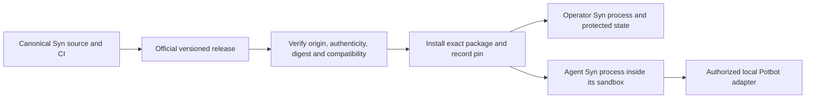

# Official Syn releases and independent node deployment

**Adopted requirement, updated 2 November 2026; node implementation gates remain.**
Potbot installs released Syn packages from the canonical
[`Synsphere/syn`](https://github.com/Synsphere/syn) repository. Syn implements
Syn; Potbot manages its installations. A copied runtime, floating source branch,
vendored implementation or development submodule is not a production release.

The [architecture](../architecture.md) defines the private per-Agent mesh and
per-Type consensus requirements. Installation does not weaken those contracts.
The 1 November audit found no releases. The subsequent [v0.1.0 release](releases/v0.1.0.md)
is now published with signed, immutable assets and declares only `service` mode.
Package publication does not establish installed operator or Agent qualification.

## Ownership and topology

| Responsibility | Owner and boundary |
| --- | --- |
| Syn runtime, CLI, P2P, semantic/identity contracts, enrollment and keystore implementation | Canonical Syn project. Reconcile any existing Potbot implementation upstream before removing a working integration. |
| Syn release builds, platform artifacts, integrity/authenticity metadata and versioned API/protocol contracts | Syn owns the [SYN-R01 package/compatibility contract](release-contracts.md); the [first signed package release](releases/v0.1.0.md) is published; installed-node qualification remains. |
| Version selection, verified installation, local configuration and compatibility records | Potbot package/deployment integration through supported public contracts. |
| Operator/Agent node lifecycle, sandbox isolation, resource monitoring and authorized upgrades | Potbot operator. |
| Agent tasks, reasoning, budgets, tools, evidence acceptance and memory | Potbot; a Syn message or valid identity does not supply these permissions. |

One real operator-mode Syn node runs outside Agent-controlled sandboxes, with
protected custody and allocation state. Every unique Agent has a real Syn process
inside its own sandbox and its own identity, configuration, credentials and state.
An Agent identity persists across its Cog invocations and ordinary restarts.
Immutable verified package bytes may be shared read-only; mutable state, keys,
authorization and lifecycle remain independent. An in-operator asynchronous
worker mesh is interim infrastructure, not proof of independent Syn processes.

*Generated required deployment sequence. It is a contract, not a screenshot of an
available installer or running Agent node. Package publication is evidenced
separately in the release record.*

## Required implementation and acceptance sequence

| Gate | Required result before production acceptance |
| --- | --- |
| **SYN-R01: upstream contract** | Foundation implemented: [official package set, canonical manifest/signature verification, compatibility descriptor and candidate-build checks](release-contracts.md). Linux application and Linux/Windows client are the declared matrix; current mode is `service` only. [v0.1.0](releases/v0.1.0.md) now supplies protected signing and immutable publication; this does not admit an installed node. Signer roots stay independent of downloaded metadata. |
| **SYN-R02: release installation** | Potbot owns the [verified package installer and official-release acceptance lane](release-installation.md): independently pinned signature/payload checks, private cache, permanent environments with atomic admission, installed-code compatibility and retained provenance. Require actual official-package online/offline acceptance; public synthetic fixtures alone do not close this gate. Operator and Agent modes remain unavailable. |
| **SYN-R03: operator node** | Install/discover and authenticate a real operator-mode Syn, with protected custody, enrollment authority, supervised lifecycle and retained identity/state. |
| **SYN-R04: Agent nodes** | Provision a distinct account and Syn instance inside each Agent sandbox; qualify the hardware/keystore and selected-key adoption requirements on the actual host. Preserve base-key secrecy, unique allocation and group-epoch separation. |
| **SYN-R05: Cog integration** | Require live Syn identity and authorized execution context for Agent Cog dispatch; preserve discovery/read-only defaults and operator grants. Route Agent traffic exclusively through Syn, including monitoring/heartbeat messages between participants. |
| **SYN-R06: lifecycle and recovery** | Operator-controlled upgrades, compatibility checks, migration, backup, restart, rollback/recovery and revocation. Agents cannot independently replace their executables. Rollback must not rewind protected signing/reservation state or silently downgrade a protocol; restore trusted state or explicitly retire the identity. |
| **SYN-R07: remove duplication and qualify** | Reconcile transitional runtime/custody work upstream; remove duplicate runtime only after the released replacement passes compatibility. Run several genuine nodes concurrently through enrollment, isolation, encrypted exchange, restart, revocation, fault and recovery tests. |

Syn's [existing workflows](ci.md) own application, PostgreSQL, portable-client,
release-candidate validation, installed-wheel verification, protected signing and
independent published-byte verification. Installed-node qualification remains
open. Potbot should test its adapters against published
interfaces and exact release artifacts, rather than rely on Syn internals.

Until these gates qualify, retain the explicit development integration and its
limited guarantees. Do not activate shared execution by substituting a mock,
copied service or unverified package. Do not delete transitional source, migrate
live keys, rotate credentials or publish a software release as part of a
documentation reconciliation.

There is no qualified installed-node UI or multi-node runtime demonstration to
capture for these outstanding gates. The diagram explains the intended flow;
actual host and network evidence belongs with implementation acceptance.
