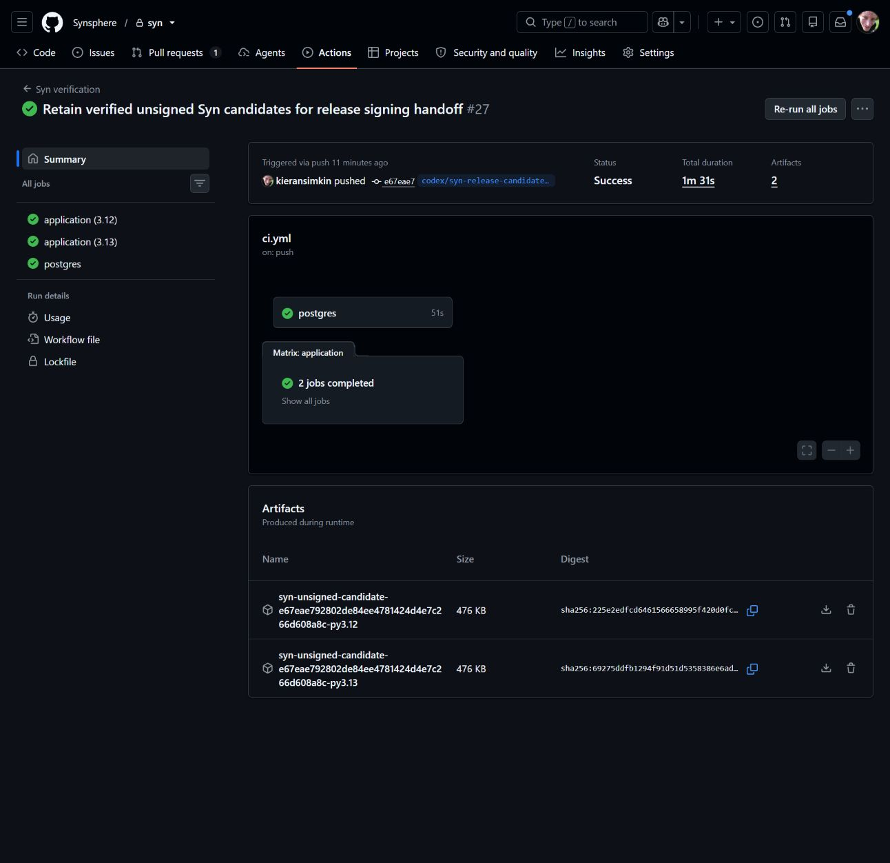
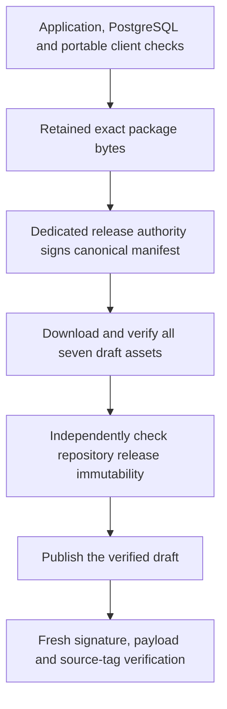

# Release authority and signed publication

The release package format is defined by [SYN-R01](release-contracts.md). This
workflow adds a dedicated authority, signed draft staging and independent
published-byte verification. Exact-source CI and actual workflow results determine
acceptance; it does not add operator or Agent node modes.

## Authority and custody

The public identity is [release/authority.json](../../release/authority.json),
profile `syn.release-authority/1`, key ID `syn-release-2026-11-02`. Its SHA-256
fingerprint is:

```text
a47f15e010613c0a839a48f2035b8f71d6f9e46ee3df07ed58487079d56ae216
```

This is a dedicated Ed25519 release authority. It is separate from Syn operator,
Agent, group and service credentials. The policy contains only public material;
consumers must select this identity independently of downloaded release metadata.
It is not an automatic trust root for the client library.

The private seed belongs in the `SYN_RELEASE_SIGNING_KEY_BASE64` secret in the
`syn-release` GitHub environment. It is exactly the canonical base64 encoding of
32 raw Ed25519 seed bytes. Restrict deployments to the `master` branch. The
workflow itself also requires the canonical repository and an explicit dispatch
from `refs/heads/master`. Test, build and portability jobs receive no signing
secret. The signing step removes the seed from child-process environments; no
private key file is written by the runner.

Protected local recovery material stays outside the repository and packages.
The authority has a Windows DPAPI CurrentUser backup with restricted owner/SYSTEM
access and a tested recovery signature. That backup depends on the Windows user
profile. The separately requested paper backup encodes the same raw seed as hex
and QR; keep it under private operator custody. Neither recovery media nor key
pixels belong in source, CI artifacts, ordinary screenshots or public posts.

## Exact-byte handoff



*Actual GitHub Actions evidence from source `e67eae792802de84ee4781424d4e7c266d608a8c`,
run 41379854417. It shows retained unsigned candidates, not signatures, an official
release or installed-node qualification.*



*Contract illustration. Passing checks, a staged draft and a published immutable
release are different states. A production node or encrypted Agent mesh is a
separate acceptance gate. No private signing material is pictured.*

Dispatch **Syn signed release staging**, operation `stage`, from `master`, with
an exact tag matching both package versions. The workflow reuses the application,
PostgreSQL and Linux/Windows portable-client checks. After those gates pass, the
signing job retrieves this same run's Python 3.12 candidate artifact. It validates
its closed six-file set, package contents and canonical manifest against the
selected clean source. It never rebuilds after signing.

The private seed must derive the public key in the checked-out authority policy.
The existing `syn.release-manifest/1` signature domain and canonical detached
envelope remain unchanged. Missing or mismatched keys stop before any remote
write. Existing tags, published releases and drafts also stop; there is no
replacement, clobber or automatic deletion path.

The job creates a **draft** with exactly the five payloads, manifest and detached
signature. It then downloads each admitted asset by its fixed name and verifies
signature, sizes and digests against the independently selected pin. Its public
receipt records the source, manifest digest, authority fingerprint and draft URL;
it contains no private seed. A failed upload or readback may leave a draft for
inspection. Do not infer publication or repair it by replacing an existing version.

## Publication and independent verification

Before publishing, check that repository release immutability is enabled. GitHub
[documents this repository control](https://docs.github.com/en/code-security/how-tos/secure-your-supply-chain/establish-provenance-and-integrity/prevent-release-changes).
The staging implementation creates and verifies drafts; it implements no publish,
edit or delete operation. Its repository contents-write token is confined to the
staging job, so source and branch admission remain required.
Publish the complete verified draft only after the source, seven assets and
immutability setting have been checked under the existing software-release
authority. An authorized software release needs no additional human confirmation.

Then dispatch the same workflow with operation `verify-published`, the same tag
and the manifest digest from the retained staging receipt. Keep the source
revision fixed for this initial release. This read-only job receives no signing
seed. It downloads all seven assets afresh, verifies the independent digest/key
pin and payload hashes, requires a non-draft immutable release, and checks that
the tag resolves directly to the selected source commit. It retains a separate
published-release receipt. The public client verifier still requires callers to
supply their own version, source, manifest and key pins.

The current package descriptor advertises `service` mode only. Official package
publication does not qualify a Windows runtime, an operator/Agent process,
hardware custody, encrypted peer exchange or rollback of protected state. Keep
SYN-R02 through SYN-R07 and Potbot's release dependency gate open until their
actual acceptance evidence exists. Key rotation, revocation and recovery must
update independently trusted consumer policy explicitly; they never reuse an
operator or Agent identity as a replacement release root.
