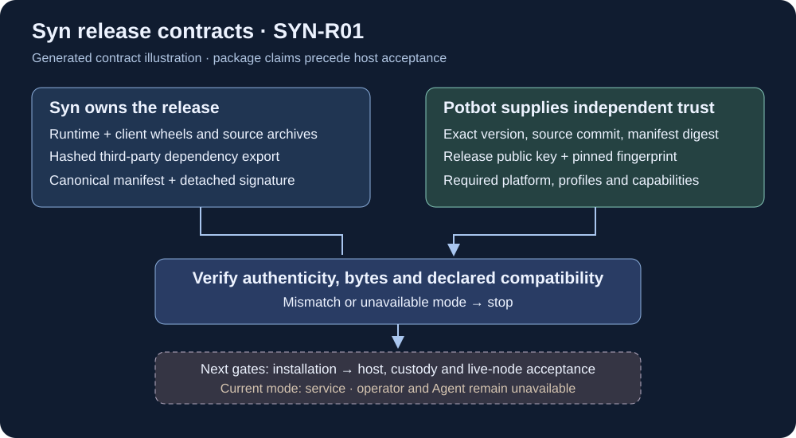
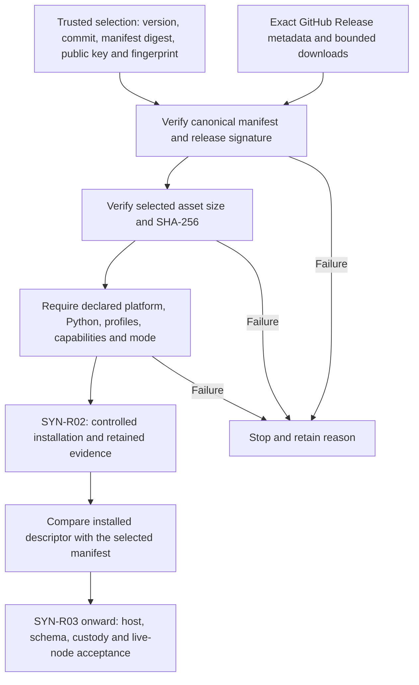
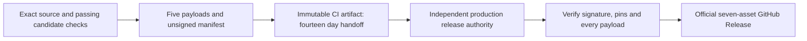

# Official packages and compatibility contracts

**SYN-R01 implementation, 1 November 2026.** Syn owns the packages and contracts;
Potbot selects, verifies, installs and supervises them. This increment defines
and checks release candidates. The subsequent [v0.1.0 publication on 2 November
2026](releases/v0.1.0.md) supplies the first signed, immutable package release.
This contract does not supply an installer, operator node or Agent node. The
remaining [deployment gates](release-and-node-deployment.md) still apply.



*Generated contract illustration. The boxes describe trust and ownership, not
evidence of a published release or a running multi-node deployment. Source-native
diagrams suit this machine-readable contract; no node UI or runtime demonstration
exists to screenshot or record for SYN-R01.*

## Package set and ownership

The canonical repository is [`Synsphere/syn`](https://github.com/Synsphere/syn).
An official release uses an exact tag `v{version}` and immutable assets attached
to that repository's GitHub Release. Neither the tag alone nor GitHub's generated
source ZIP/tarball supplies the verified package set. `0.1.0` remains the current
source metadata version; its presence does not establish an official release.

| Manifest role | Exact asset filename | Contents and consumer |
| --- | --- | --- |
| `runtime-wheel` | `syn-{version}-py3-none-any.whl` | Syn application, `syn-server`, `syn-operator`, API, discovery, scheduler, schema, Alembic migrations, templates and checksum-pinned CA bundle. Service and native operator implementations belong here; Agent mode remains unavailable. |
| `client-wheel` | `syn_client-{version}-py3-none-any.whl` | Portable HTTP/receipt, identity, policy, DAG and release contracts. Base imports remain dependency-free; `governance` adds public Ed25519 verification through cryptography. It supplies no Syn process or private signing service. |
| `dependency-lock` | `syn-runtime-requirements-{version}.txt` | Exact hashed third-party runtime requirements exported from `uv.lock`, with environment markers. Excludes Syn, syn-client, development tools and local editable sources. |
| `runtime-sdist` | `syn-{version}.tar.gz` | Auditable source distribution built from the same source commit. Production installation uses the verified wheel. |
| `client-sdist` | `syn_client-{version}.tar.gz` | Auditable client source distribution. It is not a fallback installer. |

Two more assets complete the release envelope: `syn-release-{version}.json`
(manifest) and `syn-release-{version}.sig.json` (detached signature). The manifest
lists exactly the five payload roles above in role order. Each entry has exactly
`role`, `filename`, lowercase `sha256` and integer `size` in bytes. Filenames are
flat and fixed by the version; URLs and arbitrary installation paths are absent.
The signature authenticates the manifest, which authenticates the payloads.

Both distribution versions must match the manifest. Runtime metadata requires
`syn-client[governance]=={version}`. Update both pyprojects, this exact dependency,
and `uv.lock` together. Accepted versions have three normalized integer parts,
optionally followed by `aN`, `bN` or `rcN` with positive N. No `latest`, ranges,
development/local versions or silent substitutions enter a release pin.
There is no promise that a matching major version alone implies compatibility.

The wheels use the PyPA `py3-none-any` tag. That describes their packaged Python
payload; it does not qualify native dependencies, a whole Windows host, keystore
behaviour or protected node startup. See the [wheel specification](https://packaging.python.org/en/latest/specifications/binary-distribution-format/)
and [platform tags](https://packaging.python.org/en/latest/specifications/platform-compatibility-tags/).

## Declared compatibility

`syn.release.runtimeContract()` returns a closed `syn.runtime-contract/1` object.
The same object is embedded in every manifest and exposed by:

```sh
syn-server --describe-json
# Equivalent, after installing the verified runtime:
python -I -m syn.server --describe-json
```

The CLI exits before configuration loading, engine creation, migration, network
discovery or server startup. An already running service also exposes
`GET /v1/capabilities`, without opening a database session for that request.
The endpoint reports installed code and carries no credentials or configuration.
It is not peer authentication, runtime attestation or a health/admission check.

| Descriptor field | Current value or meaning |
| --- | --- |
| `runtime_version`, `client_version` | Equal installed package versions, currently `0.2.0`. |
| `python_versions` | `3.12`, `3.13`; runtime metadata remains `>=3.12,<3.14`. Client metadata permits `>=3.12`, but the declared qualified matrix is narrower. |
| `runtime_platforms` | `darwin-arm64`, `darwin-x86_64`, `linux-x86_64`. Native source acceptance covers Ubuntu/macOS; actual installed-host acceptance is separate. Windows deploys the Linux runtime inside managed WSL2. |
| `client_platforms` | `darwin-arm64`, `darwin-x86_64`, `linux-x86_64`, `windows-x86_64`. |
| `node_modes` | `operator`, `service`. `agent` remains unavailable. The immutable 0.1.0 manifest retains its original service-only descriptor. |
| `api_profiles` | Explicit versioned protocol families listed below; sorted and unique. |
| `capabilities` | `authenticated-operator-ipc`, `http-workspace-messages`, `native-os-operator-custody`, `offline-governance-verification`, `offline-protected-dag-verification`, `offline-type-policy-resolution`, `retained-operator-identity`. |
| `database_revision` | Packaged Alembic head, currently `20261024_0015`. This is the expected schema revision, not an observed live database state or rollback permission. |

`syn.communication/1` names the existing `/v1/communication` contract family,
including its schema-1 message/receipt formats. It is a release-facing label;
existing on-wire bytes and signature domains do not change. The other declared
families are `syn.consensus-policy/1`, `syn.governed-policy-record/1` and `/2`,
and `syn.dag-hashgraph-finality/1` and `/2`. Their existing verification rules
remain authoritative. A listed offline verifier does not establish live consensus.
The 0.2.0 `syn.operator-local/1` profile adds the [native operator boundary](operator-node.md).

Installed capabilities can be disabled by configuration: for example, workspace
messaging still requires configured credentials and routes. The list does not
advertise enabled workspaces, grant execution or prove a private encrypted mesh.
The client is a library, so no node mode can be requested for a client component.

Consumers specify required profiles, capabilities, mode, component, platform and
Python version. `syn_client.releases.check_compatibility()` checks them against
the manifest and an exactly matching descriptor. Missing capabilities, Windows
runtime requests, Python 3.14, Agent requests, operator requests against 0.1.0, unknown modes and changed
descriptors fail with `ReleaseError`. Empty requirement tuples deliberately ask
for no profile/capability; Potbot must retain its own explicit acceptance policy.
No negotiation downgrades a requirement to make a package fit.

## Manifest bytes and independent trust

The manifest has exactly `profile`, `repository`, `version`, `tag`,
`source_commit`, `runtime` and `artifacts`. Its profile is
`syn.release-manifest/1`, repository is `Synsphere/syn`, and source commit is a
full lowercase 40-character Git commit. It reuses `syn.consensus-json/1`:
UTF-8, sorted object keys, compact separators, no trailing newline, duplicate
keys, floats or noncanonical representations. Arrays have defined order.
Both manifest and signature envelope are bounded to 65,536 bytes; each artifact
is nonempty and at most 512 MiB. Unknown fields and profiles fail closed.

`manifest_sha256` is SHA-256 of those exact canonical file bytes. A dedicated
release-authority Ed25519 key signs:

```text
ASCII("syn.release-manifest/1") || 0x00 || canonical_manifest_bytes
```

The canonical detached envelope has exactly:

```json
{
  "profile": "syn.release-signature/1",
  "manifest_sha256": "<64 lowercase hexadecimal characters>",
  "release_key_sha256": "<SHA-256 of the raw 32-byte public key>",
  "signature": "<128 lowercase hexadecimal characters>"
}
```

This is an explanatory layout; actual files use compact canonical bytes. The
envelope carries no trust key. `verify_release()` requires a caller-supplied
raw public key and a `ReleasePin(version, source_commit, manifest_sha256,
release_key_sha256)`, obtained through an independently trusted operator policy.
Do not copy those pins from the download and then describe them as independent.
Operator base keys, Agent account keys, group keys, service tokens and the
release authority have different roles and must not be substituted for one another.

The [authority and publication process](release-authority-and-publication.md)
now provisions protected signing and a public authority policy. Operators must
independently adopt that trust policy; rotation/revocation and emergency response
remain explicit release-process responsibilities. No production secret is added
to this contract or repository. A valid signature does not establish freshness, non-revocation or permission to downgrade;
Potbot's installation/upgrade policy must decide those from trusted state.
GitHub build attestations can supplement provenance later; they are not assumed
available for this private repository. [GitHub documents account requirements](https://docs.github.com/en/actions/how-tos/secure-your-work/use-artifact-attestations/use-artifact-attestations).

The [public synthetic interoperability vector](../../packages/syn-client/tests/fixtures/release-v1.json)
fixes canonical manifest bytes, digest, signature and pins using the RFC 8032
test key. Its fake package bytes and public test key must never become production
release trust or installation inputs.

## Potbot consumption sequence



The pure verifier writes, installs, executes and fetches nothing. Potbot owns
authenticated GitHub retrieval for this private repository, bounded streaming,
its independently trusted pins, version selection and installation records.
An official release is eligible only after exact-revision mandatory CI, protected
signing and publication checks pass. Download parsing alone does not prove that
GitHub published it or that its CI succeeded.

The installer must use both verified Syn wheels with dependencies disabled for
that step, and separately install the verified hashed third-party export. It must
not resolve either Syn distribution from a package index, git branch, editable
checkout, sdist or local development submodule. Third-party hashes and markers
constrain dependency bytes; the export is not an offline wheelhouse or a complete
host image. SYN-R02 must enforce its own build/network/platform policy and retain
the actual installed dependency inventory.

Retain repository, tag, version, commit, manifest digest, authority fingerprint,
artifact roles/digests/sizes, selected platform/Python, required compatibility,
observed installed descriptor and acceptance result per installation. These
records do not authorize schema migration or rewind protected signing state.

## Building and checking candidates

From the exact clean source revision, with locked development dependencies:

```sh
uv sync --locked --dev
uv build --out-dir dist
uv build packages/syn-client --out-dir dist
uv export --locked --no-dev --no-emit-project --no-emit-package syn-client --no-header --output-file dist/syn-runtime-requirements-0.1.0.txt
uv run --locked python scripts/build_release_contract.py --dist-dir dist --source-commit <full-HEAD-commit>
```

Use the selected release version in the requirements filename. The builder checks
archive paths without extracting them, rejects private/model/configuration
payloads and links, validates package metadata and required runtime resources,
checks the CA checksum, and requires exact hashed third-party dependencies.
It refuses a dirty/mismatched source revision, changed artifacts, or overwriting
an existing manifest. The result is explicitly **unsigned** and cannot pass
`verify_release()` as an official release.

[Syn CI](ci.md) builds all five payloads, validates that candidate manifest, then
installs hashed dependencies and both wheels in a separate environment. The
installed runtime reports its descriptor through an isolated Python invocation;
CI requires equality with the manifest. Portable-client tests run against the
built wheel on Linux and Windows. Exact run results still determine qualification.
Signature/tamper, canonical-byte, dependency-confusion and unavailable-mode tests
exercise refusal behaviour; none starts an operator or Agent node.

## Candidate handoff before official publication

After the application tests, candidate validation and isolated installed-wheel
comparison pass, each Linux Python job retains an immutable Actions artifact
named `syn-unsigned-candidate-{source_commit}-py{python}` for 14 days. It contains
only the five payloads and their canonical unsigned manifest. The temporary
installed environment and descriptor scratch files are excluded. Failed jobs do
not produce this signing handoff.



*Contract illustration. Only the candidate handoff is implemented by this CI
step; production signing and official publication remain separate gates. A CI
archive is not an official release, and its digest is not a release trust root.*

Use the exact repository, source commit, workflow run, job/Python identity and
Actions artifact ID when retrieving candidates. Select a passing trusted run;
a name match or uploaded archive alone is insufficient. Recompute the canonical
manifest and payload hashes, then sign those exact retained manifest bytes under
the independently provisioned production authority. Rebuilding after signing
can change artifact bytes and invalidates the handoff. The independently pinned
release key and version/commit/manifest selection policy still apply.

No release key is generated by this workflow, and the public interoperability
test key is never a production substitute. The subsequent
[v0.1.0 release record](releases/v0.1.0.md) documents the provisioned authority
and first official publication; operators still select their own trusted pins.
Actual candidate-download evidence belongs to the exact successful CI run; there is no installed-node UI to record.

The [release authority and signed-publication workflow](release-authority-and-publication.md)
defines protected custody, exact-byte draft staging and independent immutable
publication verification. A signed draft remains a separate state from an
official published release.
