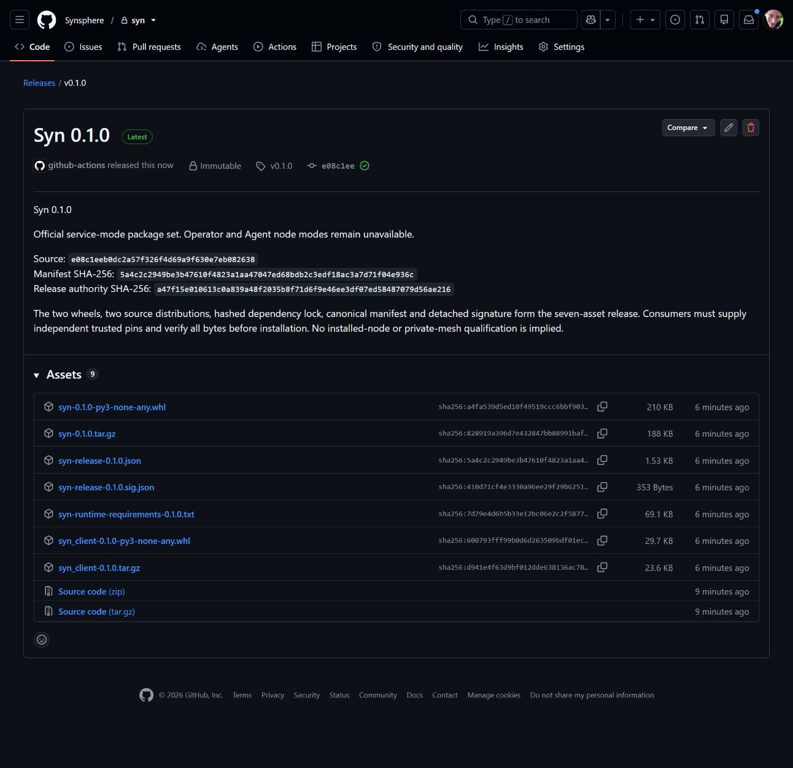
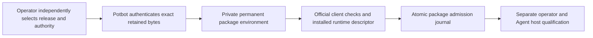
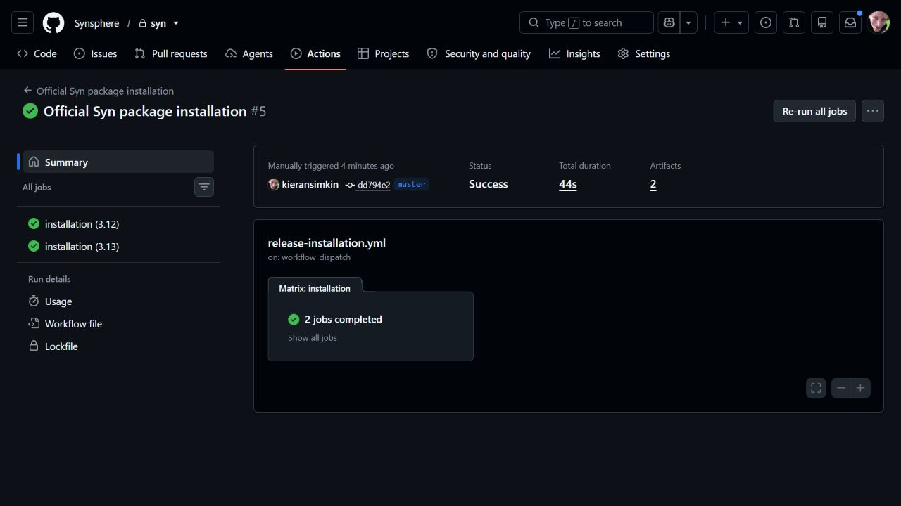

# Verified package installation for Potbot

SYN-R02's installer belongs to Potbot. Syn owns the official package envelope,
release authority and stable installed-code contract. The [first official
release](releases/v0.1.0.md) is immutable and declares service mode only.
This page retains that first package-installation milestone. The current
[0.2.1 operator/service selection](releases/v0.2.1.md) and
[native operator guide](operator-node.md) add macOS and managed Windows WSL2
deployment with independent installed-node qualification.
Installing it supplies no operator or Agent identity, enrollment authority,
protected custody or node admission.

*Actual publication capture from the v0.1.0 release milestone. Automatically
generated GitHub source archives and release attestations are separate from the
seven manifest/signature/payload assets used for installation. The image proves
publication, not successful installation or a running node.*

*Conceptual admission boundary. A virtual environment stays at its permanent
path; a durable atomic journal entry admits it only after successful verification
and file sealing. An interrupted directory is never a qualified installation.*

The [example policy](../../release/install-policies/v0.1.0-service.json) combines
the independently retained v0.1.0 release pins and selected public authority with
explicit service requirements. Operators must approve and provision it through
their trusted configuration channel, supply current revocations and retain a
version floor. Copying a policy from the same untrusted download as the packages
does not establish independent trust. No private signing key is an installer input.

The operator provisions a private Linux x86-64 store outside Agent homes and a
private policy file, then invokes Potbot's explicit `syn-release fetch`, `install`
and `verify` commands. Potbot verifies the canonical signature and all five
payloads before installation. It consumes only official wheels, retains the
source distributions as verified inputs and uses the signed hashed third-party lock. Binary-only preparation is Potbot's default.
The selected v0.1.0 policy explicitly approves third-party source builds because
its signed lock pins `fastecdsa 2.3.2`, which has no Linux wheel. These dependencies
build on the trusted preparation host after their signed source hashes match;
Syn itself still installs only from its authenticated official wheel. Missing
build prerequisites or unapproved source builds must fail, without changing the
selected version or dependency policy.

The installed official client repeats the closed contract and compatibility
checks. The runtime also repeats signature verification and must expose an exact
matching descriptor through `python -I -B -m syn.server --describe-json`. This
existing interface loads no configuration, opens no database and starts no node.
A client-only environment is a library and makes no runtime descriptor claim.

The [manual official-package acceptance workflow](../../.github/workflows/release-installation.yml)
executes only on canonical `master` with an explicitly reviewed full Potbot SHA.
It checks both Python 3.12 and 3.13 against the exact official release. Its narrow
read token accesses the private release API and is removed before child processes;
no signing environment, authority seed or production node state is available.

Required results are online installation, complete descriptor/installed-file
verification, a fresh environment installed from retained bytes and dependency
cache in a network-disabled namespace, a client-only offline install, and refusal
of tampered cache data, revoked authority and unsupported operator/Agent modes.
The public Potbot suite separately tests archive/redirect failures, interruption,
concurrency, retained history and installed-file tampering with disposable keys
and synthetic packages. Neither a saved workflow nor its synthetic fixtures
establish actual official-package acceptance: retain the exact successful run
and consumer SHA in the delivery handoff.

A fresh offline runtime also requires an explicit dependency-cache digest retained
from the trusted preparing installation receipt, including prepared source-built
third-party dependencies when explicitly approved. Potbot checks every cache file
against its retained inventory before uv can consume it; the official local
wheels bypass unpacked wheel caches.

Offline verification authenticates retained bytes against the current operator
policy. It does not claim fresh network metadata or discover external revocation.
Version floors and retained package history are not protected identity-state
rollback resistance. Upgrade, migration, recovery and revocation refresh remain
SYN-R06 responsibilities; operator/Agent host acceptance remains SYN-R03 onward.

There is no installed-node UI or live mesh to record for this package boundary.
The publication screenshot, conceptual flow and actual CI receipts supply relevant
media. A multi-node demonstration belongs with implementation of the supported
node modes and host gates.

## Executed package acceptance, 2 November 2026

[Official-package run 41396634946](https://github.com/Synsphere/syn/actions/runs/41396634946)
passed on Linux x86-64 for Python 3.12 and 3.13, using reviewed Potbot source
`5c740b4cf73105a28d308863c06340a7aba75eb3` and verifier workflow source
`dd794e2e08c58183fb4f04a35f027ecffb2fb6fd`. The installed package selection remains
immutable Syn v0.1.0 from `e08c1eeb0dc2a57f326f4d69a9f630e7eb082638`, with manifest
SHA-256 `5a4c2c2949be3b47610f4823a1aa47047ed68bdb2c3edf18ac3a7d71f04e936c`.

*Actual private upstream CI result for that reviewed consumer. Each job installed
and verified the runtime online, installed a fresh environment with networking
disabled from retained payloads and an independently selected dependency-cache
inventory, and installed the client library offline. It also refused cache
changes, revoked authority and unsupported node modes. Full installation and
verification records are retained as narrow Actions artifacts; environments,
caches, tokens and private keys are excluded.*

This result establishes package installation and verification. Potbot's complete
application/database/source-inventory/native/browser checks are separately
required at its exact merged consumer revision. It does not qualify an operator
or Agent node, hardware custody, live mesh, enrollment, migration or protected
state recovery. SYN-R03 through SYN-R07 remain separate implementation and host
acceptance gates; no installed process or identity is created by this result.
