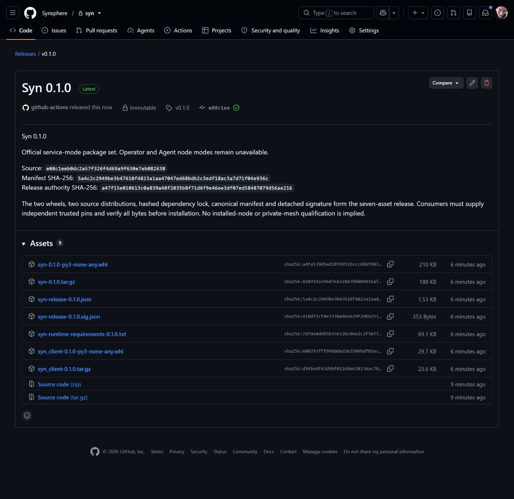
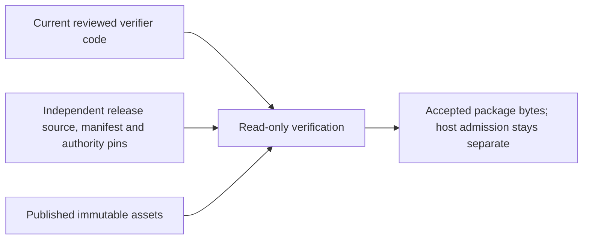

# Syn v0.1.0: first official package release

**Published 2 November 2026.** The canonical
[GitHub Release](https://github.com/Synsphere/syn/releases/tag/v0.1.0) is immutable.
It contains the five official payloads, canonical manifest and detached release
signature defined by [SYN-R01](../release-contracts.md). GitHub also supplies automatically generated source archives and release
attestation links; those are outside the verified package set and are not
installation substitutes.

*Actual GitHub release page captured after publication. This is package publication
evidence, not a screenshot of an installed operator, Agent node or private mesh.*

The [selected pin record](../../../release/pins/v0.1.0.json) was assembled from
the retained staging receipt and independently selected release authority:

| Selection | Value |
| --- | --- |
| Version | `0.1.0` |
| Source commit | `e08c1eeb0dc2a57f326f4d69a9f630e7eb082638` |
| Manifest SHA-256 | `5a4c2c2949be3b47610f4823a1aa47047ed68bdb2c3edf18ac3a7d71f04e936c` |
| Release-key SHA-256 | `a47f15e010613c0a839a48f2035b8f71d6f9e46ee3df07ed58487079d56ae216` |

Operators must explicitly adopt independently trusted selection and public-key
policy. Downloading this record or the public key alongside an untrusted release
does not establish that trust. The signed manifest authenticates payload bytes;
release titles and notes remain editable and are not the signature's subject.

The [staging run](https://github.com/Synsphere/syn/actions/runs/41386565344)
qualified the exact source through application, PostgreSQL and Linux/Windows
client checks, then signed, uploaded, downloaded and verified all seven draft
assets before publication. Independent post-publication checks use operation
`verify-published`, this released source commit and this manifest digest in the
[signed-release workflow](https://github.com/Synsphere/syn/actions/workflows/release.yml).
Each successful job establishes its own fresh published-byte result; the pin
record alone is not an executed verification.

*Conceptual separation of code execution from the selected historical release.
A later documentation or tooling commit must not replace the release's source
pin with the verifier checkout SHA. Regression coverage preserves this boundary.*

The runtime is declared for Linux x86-64 on Python 3.12/3.13; the portable client
also has Windows x86-64 qualification. The only node mode is `service`.
Operator and Agent modes, hardware/keystore custody,
multiple independent nodes, encrypted exchange and protected-state recovery
remain SYN-R03 through SYN-R07 work. [SYN-R02 package installation](../release-installation.md)
is qualified separately against these exact release bytes. Potbot must continue to reject unsupported
mode requests and must not activate a copied or floating-source fallback.

There is no installed-node demonstration to record for this release. The actual
release screenshot and workflow evidence establish the narrower package boundary.
