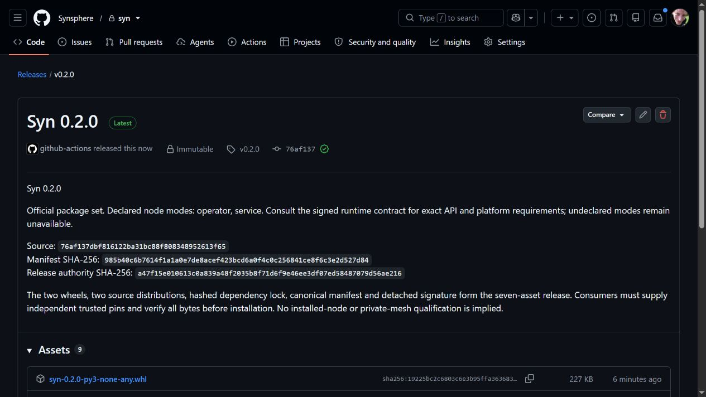

# Syn 0.2.0 operator/service release

[Syn v0.2.0](https://github.com/Synsphere/syn/releases/tag/v0.2.0) was published
as an immutable release on 2 November 2026. It adds the native operator contract
while preserving the historical service-only 0.1.0 release.

The later persistent-host handoff identified an interactive-terminal opening
failure before password entry. See the [operator acceptance record](../operator-node.md#acceptance-evidence).
Use the qualified 0.2.1 patch for a new host requiring interactive unlock;
the immutable 0.2.0 assets remain historical.

*Actual GitHub publication capture. It proves publication and the retained source
and manifest pins; installed-node qualification is separate. A video of this
static publication page adds no further execution evidence.*

| Selection | Retained value |
| --- | --- |
| Source | `76af137dbf816122ba31bc88f808348952613f65` |
| Manifest SHA-256 | `985b40c6b7614f1a1a0e7de8acef423bcd6a0f4c0c256841ce8f6c3e2d527d84` |
| Authority SHA-256 | `a47f15e010613c0a839a48f2035b8f71d6f9e46ee3df07ed58487079d56ae216` |
| Authority ID | `syn-release-2026-11-02` |
| Node modes | `operator`, `service`; Agent mode remains unavailable |
| Runtime platforms | Linux x86-64, macOS ARM64/x86-64; Windows deploys the Linux package in managed WSL2 |
| Python | 3.12 and 3.13 |

The seven declared assets are the two wheels, two source distributions, signed
hashed runtime requirements, canonical manifest and detached signature.
GitHub-generated source archives and release attestations are separate.

[Protected staging run 41420651145](https://github.com/Synsphere/syn/actions/runs/41420651145)
reran application/PostgreSQL, portable-client and all four native operator gates
at the exact merged source, signed the package envelope, created the draft and
independently downloaded every signed asset. Publication retained that exact tag,
source and seven-asset set. The signing authority and its private custody were
not changed by this release.

[Independent published-byte run 41422493139](https://github.com/Synsphere/syn/actions/runs/41422493139)
subsequently passed immutable-release metadata, exact tag/source, signature and
every declared asset check using the independently retained staging pins.

Use the independently retained [release pin](../../../release/pins/v0.2.0.json)
and [operator policy](../../../release/install-policies/v0.2.0-operator.json).
The downloaded package cannot supply its own trust root.

The [operator guide](../operator-node.md) describes protected software custody,
HD identity, anchored append-only allocations, private enrollment permission,
authenticated local attachment and retained restart state. Potbot deploys and
supervises the official process in the native OS boundary.

The manual [official operator deployment workflow](https://github.com/Synsphere/syn/actions/workflows/operator-release.yml)
uses an exact reviewed Potbot SHA and these independent release pins to test the
published bytes with real disposable native credential stores. Its retained
receipts cover installer provenance, owned-child supervision, signed attach,
restart and locked-store refusal. Source tests, published-package acceptance
and a persistent user installation are distinct claims.

No Agent activation, hardware attestation, private P2P mesh, selected-key
adoption, Cog execution or production recovery qualification follows from
publishing this release. Those remain the subsequent release/deployment gates.
