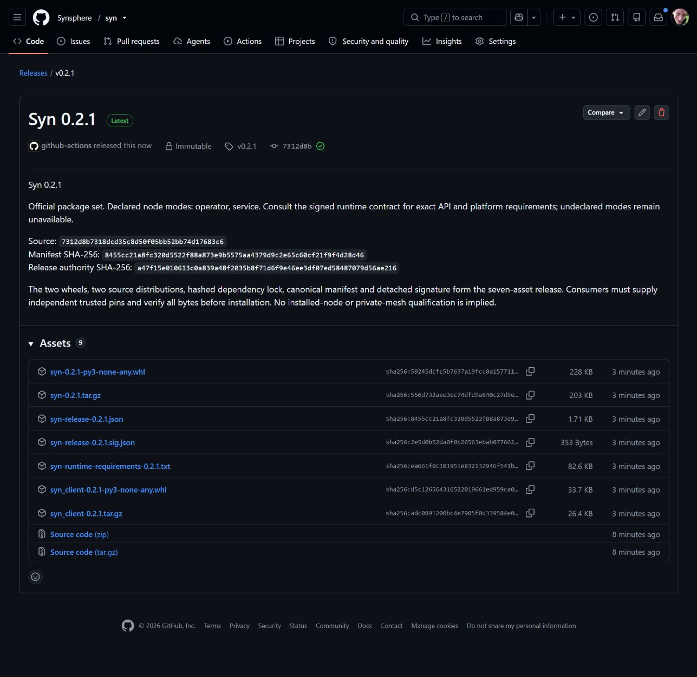
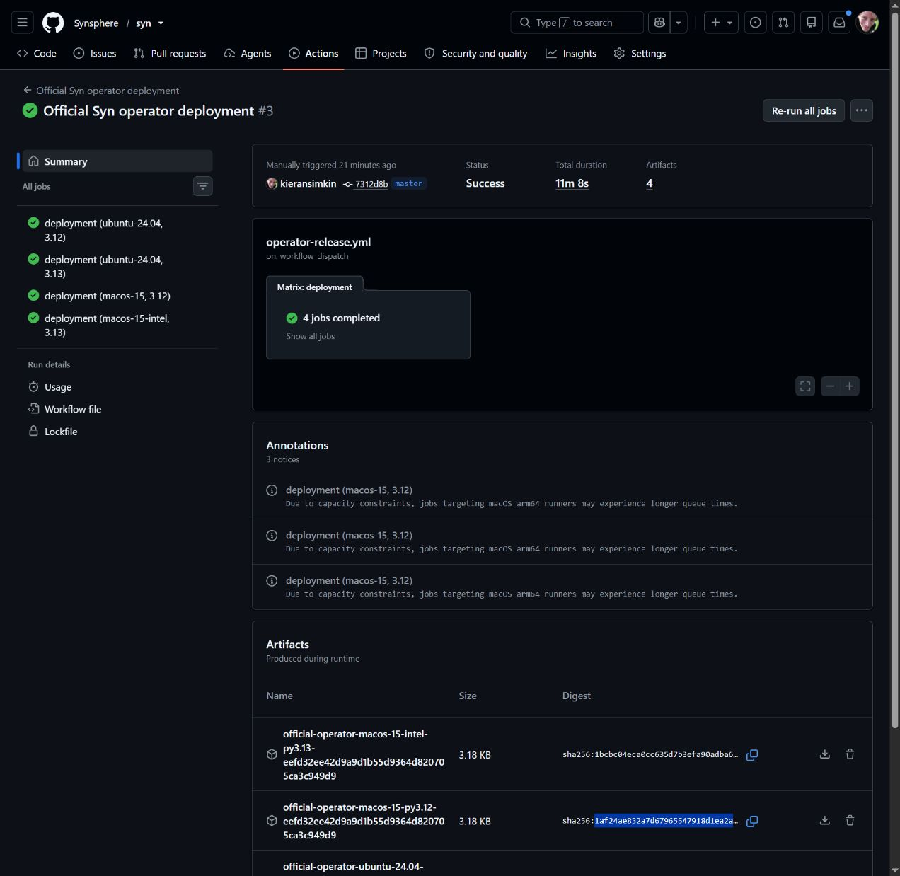

# Syn 0.2.1 private-terminal patch release

[Syn v0.2.1](https://github.com/Synsphere/syn/releases/tag/v0.2.1) was published
as an immutable release on 2 November 2026.

*Actual GitHub publication capture, with the exact source and manifest pins.
It proves publication; installed-node and persistent-host acceptance are
separate. A video of this static release page adds no execution evidence.*

| Selection | Independently retained value |
| --- | --- |
| Source | `7312d8b7318dcd35c8d50f05bb52bb74d17683c6` |
| Manifest SHA-256 | `8455cc21a8fc320d5522f88a873e9b5575aa4379d9c2e65c60cf21f9f4d28d46` |
| Authority SHA-256 | `a47f15e010613c0a839a48f2035b8f71d6f9e46ee3df07ed58487079d56ae216` |
| Authority ID | `syn-release-2026-11-02` |
| Node modes | `operator`, `service`; no Agent mode |

[Protected staging 41432391002](https://github.com/Synsphere/syn/actions/runs/41432391002)
passed the application, PostgreSQL, portable-client and four native operator
gates at this exact source, signed the seven-asset package set and independently
downloaded every signed asset. The signing authority was unchanged.

[Published-byte verification 41433428578](https://github.com/Synsphere/syn/actions/runs/41433428578)
subsequently passed immutable metadata, exact tag/source, signature and all
seven declared assets against the independently retained staging pins.
GitHub-generated source archives are separate from those seven assets.

Use the retained [release pin](../../../release/pins/v0.2.1.json) and
[operator policy](../../../release/install-policies/v0.2.1-operator.json).
An offline host additionally selects the dependency-cache digest from its
trusted preparing receipt; downloaded assets cannot supply their own trust root.

This patch fixes the interactive native-keystore unlock and enrollment approval
terminal. Version 0.2.0 opened `/dev/tty` with a buffered read/write stream,
which requires seeking and raises `UnsupportedOperation` on an actual terminal
before a password prompt appears.

The replacement keeps the native duplex descriptor unbuffered and wraps it
as text. The controlling-terminal and foreground-process-group checks remain
mandatory. Password input still disables echo and never enters arguments,
environment values, receipts or Potbot. No identity is created by unlocking.

On Linux, Syn now authenticates and contacts the existing GNOME credential
daemon's private control socket. Invoking its `--unlock` startup command did
not unlock the already running service. The bounded native protocol checks
socket ownership/type, the connected peer UID, endpoint continuity and the
exact result before confirming readiness. It follows the
[GNOME control client](https://github.com/GNOME/gnome-keyring/blob/master/daemon/control/gkd-control-client.c)
and [operation/result definitions](https://github.com/GNOME/gnome-keyring/blob/master/daemon/control/gkd-control-codes.h).

Three real pseudo-terminal regressions exercise successful private input with
no echo, background-group refusal and missing-terminal refusal. The mandatory
native matrix runs them on Linux and macOS alongside custody, restart and
independent HD-vector checks. The earlier
[0.2.0 official-package result](../operator-node.md#acceptance-evidence)
proves the custody/supervision boundary; the new terminal tests close its
human-interaction coverage gap.

The native Linux acceptance fixture additionally runs the actual CLI through
first-time confirmation, wrong-password refusal and repeated unlock against
one isolated encrypted Secret Service. It checks that fixture passwords never
echo and that a refused password leaves the collection locked. Production
credentials and identities are never used by these tests.

Syn and syn-client advance together to 0.2.1 with unchanged API profiles and
node modes. Existing 0.2.0 assets are never replaced. The separate
[official operator acceptance run](https://github.com/Synsphere/syn/actions/runs/41433430363)
passed all four Linux/macOS cases with exact reviewed Potbot
`eefd32ee42d9a9d1b55d9364d820705ca3c949d9`. These installed-package tests
include actual first-time/repeated private native unlock on Linux,
owned-child supervision, fresh authenticated attachment, retained restart and
locked-store refusal. A persistent user installation
requires its own private receipt. Agent deployment and live private-mesh
acceptance remain later gates.

*Actual completed workflow result for these release and consumer pins.
Disposable credential stores and real operator processes were used; no user
key or password appears in this evidence.*
