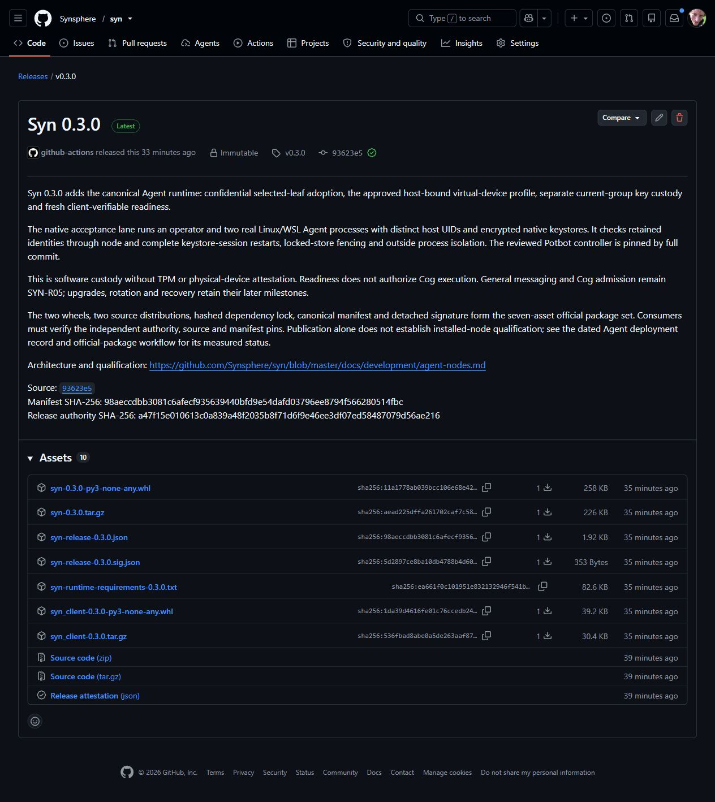

# Syn 0.3.0: native Agent custody

[Syn v0.3.0](https://github.com/Synsphere/syn/releases/tag/v0.3.0) was published
as an immutable release on 2 November 2026. It adds the canonical Agent runtime,
selected-leaf adoption, the owner-approved host-bound virtual-device profile,
separate current-group custody and fresh client-verifiable readiness.

*Actual GitHub publication capture. Seven declared signed-package assets are
shown alongside GitHub's generated source archives and release attestation.
Publication proves no installed-node outcome. A video of this static page adds
no execution evidence; private password prompts are excluded from captures.*

| Selection | Independently retained value |
| --- | --- |
| Source | `93623e52b0d782673365f3090a53dded0cef2f46` |
| Manifest SHA-256 | `98aeccdbb3081c6afecf935639440bfd9e54dafd03796ee8794f566280514fbc` |
| Authority SHA-256 | `a47f15e010613c0a839a48f2035b8f71d6f9e46ee3df07ed58487079d56ae216` |
| Authority ID | `syn-release-2026-11-02` |
| Node modes | `agent`, `operator`, `service` |
| Agent platforms | Linux x86-64, including the managed Ubuntu WSL2 host |
| Native consumer | `33bdf4d21f575adf48d99fcb01ee43a943c6398e` |

[Protected staging 41467984650](https://github.com/Synsphere/syn/actions/runs/41467984650)
passed application, PostgreSQL, portable-client, four native operator and two
native Agent gates at the exact merged source. Only then did the protected
authority sign the seven-asset package set. The staging script independently
downloaded and verified every draft asset before publication.

[Published-byte verification 41469010338](https://github.com/Synsphere/syn/actions/runs/41469010338)
subsequently passed immutable metadata, exact tag/source, signature and all
seven declared assets against the retained staging pins. The authority was
unchanged. Earlier released assets were never replaced.

Use the retained [release pin](../../../release/pins/v0.3.0.json) and
[Agent installation policy](../../../release/install-policies/v0.3.0-agent.json).
The public policy selects Python 3.12; an independently selected Python 3.13
policy uses the same source, authority, manifest and required contracts. An
offline host also pins its trusted preparing receipt's dependency-cache digest.

## Actual local official-package acceptance

The signed published package passed complete-controller qualification in a
disposable native Ubuntu WSL2 fixture. Potbot installed and reverified the exact
manifest through its immutable store. A real operator and two simultaneous Syn
Agents then exercised owner-approved selected-leaf adoption, separate encrypted
native stores, different host UIDs and matching current-group key commitments.

Each Agent retained its identity through a node restart and a complete native
keystore-session restart. Outside process observations checked actual host
UID/GID and namespace mappings, zero capabilities, no-new-privileges, syscall
filtering and resource limits. Peer/operator homes and buses were absent.
Locking each store fenced its process and removed its readiness endpoint.
Fixtures and their credentials were removed after the run.

Two acceptance fixes preserve the trust boundary. The qualification metadata
probe now explicitly disables bytecode writes so root cannot accidentally add
cache files to a frozen installation. Potbot creates a separate, root-owned
read-only execution view from the admitted file inventory so restricted UIDs
can read public runtime bytes without changing private installer permissions.
Changed or partial views and external links fence launch. File inventories keep
their existing bounded file-inventory contract; the 64 KiB wire-message bound
is unchanged.

The [official Agent deployment workflow](https://github.com/Synsphere/syn/actions/workflows/agent-release.yml)
repeats the exact published-package path on Python 3.12 and 3.13. Its result and
full consumer CI are separate gates from this local acceptance; successful
publication and source-wheel qualification cannot substitute for them.

This qualifies software custody under the approved virtual-device policy,
without TPM or physical-device attestation. The operator retains derivation
authority. No production Agent, independent human identity, Cog execution,
general messaging, group rotation or recovery is admitted by these fixtures.
Those retain SYN-R05/R06/R07 acceptance gates. See the
[Agent architecture guide](../agent-nodes.md) for the boundaries and sequence.
