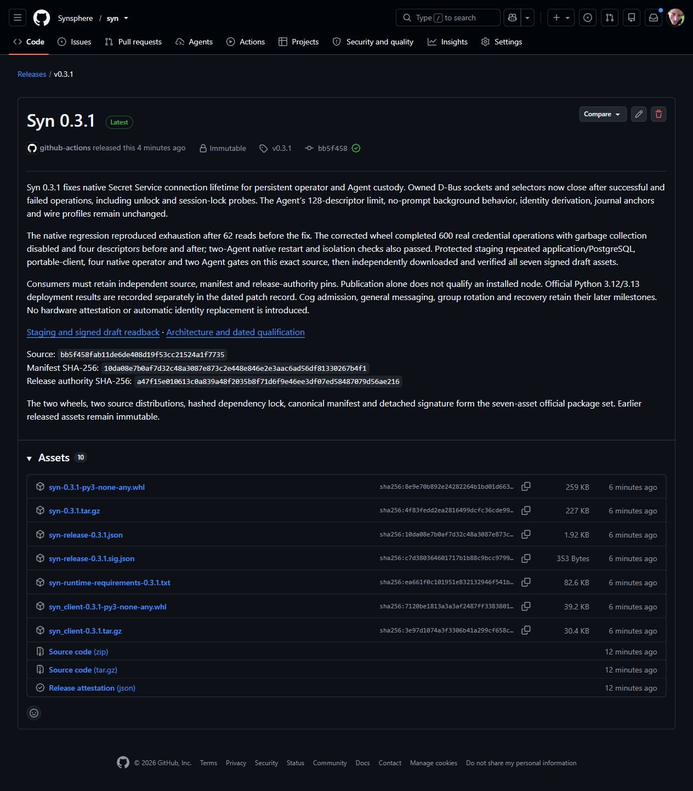
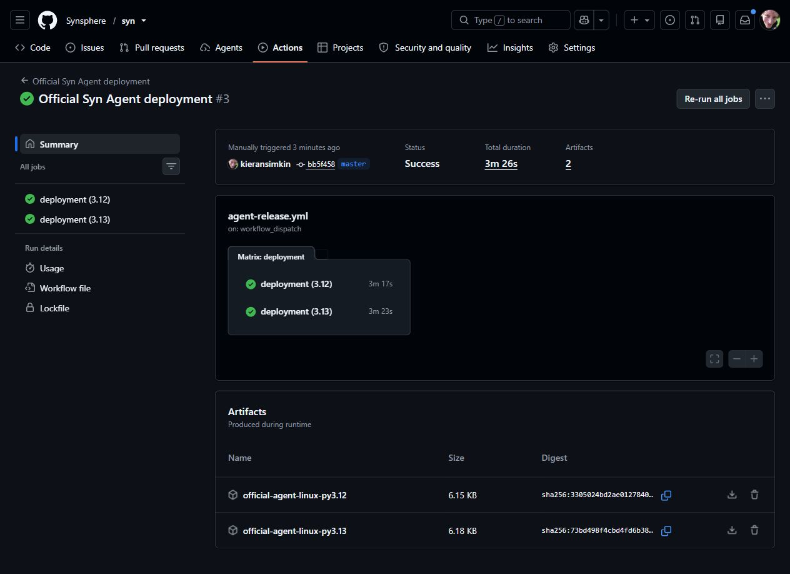
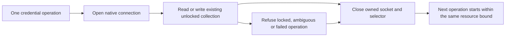

# Syn 0.3.1: bounded native credential connections

[Syn 0.3.1](https://github.com/Synsphere/syn/releases/tag/v0.3.1) was published
immutably on 2 November 2026. It preserves the Syn 0.3 Agent contracts and corrects
native Secret Service connection ownership. Publication and installed-node
qualification retain separate evidence.

*Actual GitHub release capture, visually inspected. Seven declared assets appear
beside GitHub's generated archives and attestation. This static page proves
publication, not a running node; filming it adds no runtime evidence.*

| Selection | Independently retained value |
| --- | --- |
| Source | `bb5f458fab11de6de408d19f53cc21524a1f7735` |
| Manifest SHA-256 | `10da08e7b0af7d32c48a3087e873c2e448e846e2e3aac6ad56df81330267b4f1` |
| Authority SHA-256 | `a47f15e010613c0a839a48f2035b8f71d6f9e46ee3df07ed58487079d56ae216` |
| Authority ID | `syn-release-2026-11-02` |
| Official native consumer | `a20cc62205cb34d778e0c99ce54dd0686fc7170d` |

[Protected staging 41485254811](https://github.com/Synsphere/syn/actions/runs/41485254811)
passed application/PostgreSQL, portable-client, four native operator and both
Agent Python gates on the exact merged source before signing. It independently
downloaded and verified all seven signed draft assets.
[Published-byte verification 41486700420](https://github.com/Synsphere/syn/actions/runs/41486700420)
then passed exact tag/source, immutable metadata, signature, sizes and all asset
hashes using the retained staging pins. The existing authority is unchanged.

Use the [retained release pin](../../../release/pins/v0.3.1.json) and
[Agent installation policy](../../../release/install-policies/v0.3.1-agent.json).
The public policy selects Python 3.12; an independently selected Python 3.13
policy retains the same source, manifest, authority and required contracts.

## Official-package Agent qualification

[Official deployment 41486842550](https://github.com/Synsphere/syn/actions/runs/41486842550)
passed **both Python 3.12 and Python 3.13** against the exact signed 0.3.1 package
and reviewed Potbot consumer above. Each job independently installed and
reverified the release through Potbot's immutable store, then ran one real
operator and two simultaneous Agents with separate native encrypted keystores,
selected account identities and host UIDs. Their current-group commitments
matched while account keys remained distinct.

*Actual public GitHub Actions capture. The linked run retains installed-package
and native-node receipts. It proves the disposable qualification tier and does
not show a user's production keystore or authorize a Cog.*

Node restarts and complete keystore-session restarts retained the selected
identities. Fresh client proofs and outside-process observations checked actual
UID/GID and namespace mapping, empty capabilities, no-new-privileges, active
syscall filtering, unchanged limits and absent peer/operator homes and buses.
Locking native stores fenced their nodes and removed readiness endpoints.
The private temporary-filesystem and inventory-verified read-only execution view
preserved their boundaries; the sealed installer store was not relaxed.

These results complete the upstream released Agent-package gate of SYN-R04.
Potbot's full consumer CI and source-preview publication remain separately
recorded delivery gates. A persistent host keeps its own admission, private
unlock and service receipt; these disposable runs neither activate a production
Agent nor establish that an existing operator is currently unlocked.

## Failure and correction

The [official 0.3.0 deployment run](https://github.com/Synsphere/syn/actions/runs/41480765912)
passed Python 3.12. Python 3.13 completed both Agents' adoption and restart
checks, then failed a fresh status request with a truncated local wire frame.
An isolated native-store experiment reproduced an upstream resource leak:
62 absent-credential reads exhausted the unchanged 128-descriptor limit with
garbage collection disabled. Each unclosed D-Bus connection retained its socket
and selector. This establishes the leak; it does not establish the cause of
every historical service exit.

*Generated connection-lifetime illustration. No password or key material is
included. A video of a private password prompt would expose sensitive input;
the native regression retains public descriptor counts instead.*

Every credential read and write now closes its connection on success, absence
and exceptions. The explicit unlock probe and session-lock operation follow the
same ownership rule. Background operations retain their no-prompt behavior.
The existing keyring availability probe already closes its own connection.

The mandatory Linux native fixture performs 600 real credential operations in
a separate process with garbage collection disabled and the same descriptor
limit of 128. The patched wheel retained four descriptors before and after.
Fault-path tests separately check deterministic cleanup when the collection is
missing, locked or ambiguous, or a native operation raises an exception. The
full two-Agent official-package restart and isolation gate also passed on both
supported Python versions in the run above.

Syn and syn-client are co-versioned at 0.3.1. Existing 0.3.0 assets remain
immutable. Wire profiles, virtual-device policy, grants, journal anchors,
identity derivation and process limits are unchanged. No automatic identity
replacement, keystore unlock, Cog authorization or recovery is introduced.
