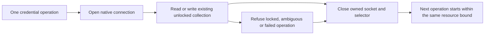

# Syn 0.3.1: bounded native credential connections

This patch candidate preserves the Syn 0.3 Agent contracts and corrects native
Secret Service connection ownership. Release and official-package acceptance
remain separate gates; this record does not claim publication or qualification.

## Failure and correction

The [official 0.3.0 deployment run](https://github.com/Synsphere/syn/actions/runs/41480765912)
passed Python 3.12. Python 3.13 completed both Agents' adoption and restart
checks, then failed a fresh status request with a truncated local wire frame.
An isolated native-store experiment reproduced an upstream resource leak:
62 absent-credential reads exhausted the unchanged 128-descriptor limit with
garbage collection disabled. Each unclosed D-Bus connection retained its socket
and selector. This establishes the leak; it does not establish the cause of
every historical service exit.

*Generated connection-lifetime illustration. No password or key material is
included. A video of a private password prompt would expose sensitive input;
the native regression retains public descriptor counts instead.*

Every credential read and write now closes its connection on success, absence
and exceptions. The explicit unlock probe and session-lock operation follow the
same ownership rule. Background operations retain their no-prompt behavior.
The existing keyring availability probe already closes its own connection.

The mandatory Linux native fixture performs 600 real credential operations in
a separate process with garbage collection disabled and the same descriptor
limit of 128. The patched wheel retained four descriptors before and after.
Fault-path tests separately check deterministic cleanup when the collection is
missing, locked or ambiguous, or a native operation raises an exception. The
full two-Agent official-package restart and isolation gate must also pass on
both supported Python versions before milestone completion.

Syn and syn-client are co-versioned at 0.3.1. Existing 0.3.0 assets remain
immutable. Wire profiles, virtual-device policy, grants, journal anchors,
identity derivation and process limits are unchanged. No automatic identity
replacement, keystore unlock, Cog authorization or recovery is introduced.
