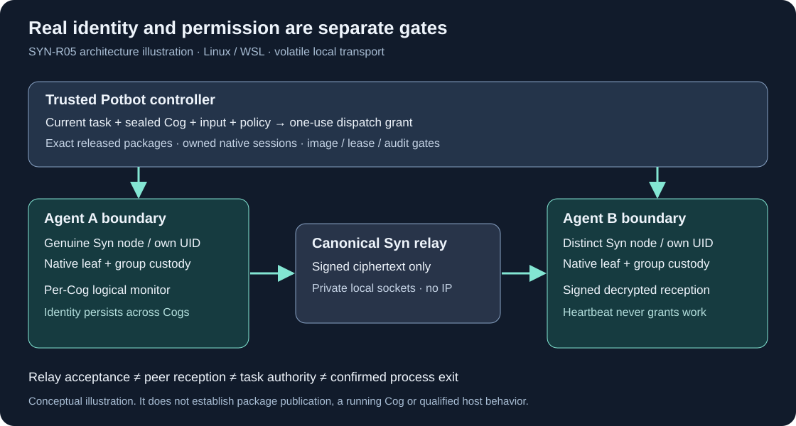

# Syn 0.4.0: native private Agent messaging

[Syn 0.4.0](https://github.com/Synsphere/syn/releases/tag/v0.4.0) was published
immutably on 2 November 2026. It adds the bounded `syn.private-pubsub/1` profile
and public SDK for real Agent nodes. Native identity, message reception and
Potbot task authorization remain separate gates.

*Generated architecture illustration, not a running-node capture. The profile
is headless; private password/keystore footage is excluded. External browser
capture was unavailable, so no release-page screenshot or video is claimed.*

| Selection | Independently retained value |
| --- | --- |
| Source | `6205baf95b87193133d45c749a0fe5d5b577581f` |
| Manifest SHA-256 | `a406356fba844a28c04870e45299ccd83e406b5dbe8b7a55741db6d5a6cd1088` |
| Authority SHA-256 | `a47f15e010613c0a839a48f2035b8f71d6f9e46ee3df07ed58487079d56ae216` |
| Authority ID | `syn-release-2026-11-02` |
| Reviewed native consumer | `2d30849f3f13fee295e7a065b4be83c9965d07a3` |

Use the [release pin](../../../release/pins/v0.4.0.json) and
[Agent installation policy](../../../release/install-policies/v0.4.0-agent.json).
The public policy selects Python 3.12 and the private pub-sub profile; Python
3.13 retains the same source, manifest, authority and required contracts.

[Protected staging 41522031743](https://github.com/Synsphere/syn/actions/runs/41522031743)
passed the exact merged source's application/PostgreSQL checks, four portable
client jobs, four native operator jobs and both native Agent Python jobs before
signing. It downloaded and verified the complete signed seven-asset draft.
Independent local draft verification also passed using the retained authority
and staging pins. No private release seed was read locally.

[Published-byte verification 41523721163](https://github.com/Synsphere/syn/actions/runs/41523721163)
passed fresh source/tag, immutable metadata, signature, size and payload-hash
checks after publication. Existing 0.3.1 assets and the release authority remain
unchanged. Installed-host and Cog acceptance do not follow from publication.

## Native transport and admission

The [protocol guide](../private-pubsub.md) defines the frozen local cohort,
native group encryption, source signatures, boot/sequence checks and distinct
publication/reception receipts. Two actual source-wheel nodes with separate
native UIDs, encrypted stores and namespaces passed the complete Potbot public
adapter, signed heartbeats, one-use/changed-task grant rejection and relay-loss
fencing on WSL. The source lane explicitly substitutes package/assignment
registry records; it cannot establish official installation.

The [paired Potbot implementation](https://github.com/kieransimkin/potbot/pull/23)
merged after all 34 successful checks and two explicitly optional live-host
skips. Its native binding is retained in existing execution telemetry. A valid
identity or heartbeat never enables write/execute effects. The in-process mesh
requires an explicit development fixture; there is no production fallback.

## Official-package qualification

[Official acceptance 41526414147](https://github.com/Synsphere/syn/actions/runs/41526414147)
passed **Python 3.12 and Python 3.13** with the exact release/consumer pins above.
Each job installed and reverified the actual signed packages through Potbot's
immutable store, then exercised one real operator and two isolated native Agent
nodes with distinct UIDs, selected identities and encrypted keystores. No
package or retained-assignment registry was substituted in this lane.

Both jobs exercised the complete public Potbot mesh adapter: signed heartbeat
publication and decrypted reception, one-use and changed-task grant rejection,
missing-grant rejection at the real executor entry point, and relay-loss fencing
of both native nodes and logical Cog monitors. Node and full native-session
restarts retained their assigned identities; locked stores fenced their nodes.
The retained installation, native and pub-sub receipts were independently
inspected, including historical signature, membership, boot, request commitment
and plaintext-commitment checks on both versions' signed reception evidence.

This completes the released native transport/admission boundary of SYN-R05.
The fixture explicitly records **no positive Cog process dispatch**. Image,
cgroup, syscall/TASKSTATS, budget, lease and U16 host acceptance remain independent
mandatory gates before production execution. A message, valid identity or
passing disposable native fixture cannot supply those permissions.

### Qualification-tool correction

The first [official run 41523853220](https://github.com/Synsphere/syn/actions/runs/41523853220)
was rejected **before package installation** by Potbot's strict policy parser.
The qualification script appended the new capability after an already sorted
list. The corrected script sorts both required-contract lists before parsing;
the policy's sorted/unique requirement remains intact. This changes the
qualification tooling, not the immutable published package.

The corrected run linked above passed both versions without changing the
published runtime or weakening the policy parser. The qualification tooling was
corrected on the default branch; the immutable release source remains the pin
above.

The initial profile is Linux x86-64/WSL2, at most eight peers and bounded volatile
queues. It adds no remote IP listener, durable-delivery, consensus, hardware
attestation or general rollout guarantee. Existing persistent installations keep
their selected version and identity; upgrades/recovery remain SYN-R06.
