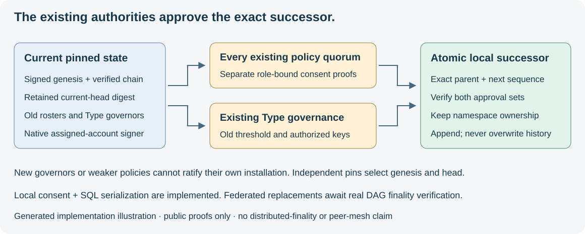

# Signed genesis and governed local policy transitions

24 October 2026. Implemented signed configuration approval and serialized local
adoption. These approvals are not Raft commits or DAG/Hashgraph finality proofs.
Record v2 now requires [bounded old-epoch DAG replay](dag-finality.md) for
federated replacements, plus separate old Type-governance approval. This does not
activate a network engine or qualify a production federation.



*Generated implementation illustration. It shows local authorization and storage;
the encrypted peer mesh and distributed agreement engines remain pending.*

## Public credentials and trust

`syn-client[governance]` adds pinned `cryptography==50.0.2` for Ed25519 verification.
Production code imports no private key or signing primitive. It verifies the
frozen native `syn-agent-account-v1` membership and `syn-agent-proof-v1` envelopes
already produced by Potbot's protected Agent broker. Their ASCII canonical bytes
and prefixes remain unchanged. Tests use a public native-produced fixture and an
RFC 8032 vector. Sources: [verification API](https://cryptography.io/en/50.0.2/hazmat/primitives/asymmetric/ed25519/)
and [Ed25519 specification/vectors](https://www.rfc-editor.org/rfc/rfc8032).

An authority contains a sorted roster of at most 128 signed membership credentials
and an explicit threshold. Nodes use account public-key hashes. Issuer hashes
verify custody assignment; they are not node addresses. Duplicate nodes, account
allocations under an issuer and instance identities are refused. Credentials
prove assignment and possession, not public hardened-HD lineage, unmodified code
or real-world independence between operators.

For an operator-log policy, the authority digest must match the Type's membership
anchor, all credentials have one verified issuer, and the threshold is exactly a
strict majority. A federated roster requires distinct issuer keys, one account per
issuer and greater than two-thirds consent. This conservative structural cap does
not prove independent human custody. Selecting a future federated policy is
allowed under the old authority. Subsequent replacements require v2 replay under
that old federated roster; signature counts cannot substitute for finality.

## Signed records and existing authority

`syn.governed-policy-state/1` commits workspace, complete canonical Type release,
all policy bindings, Type-governance authority and policy authorities. Every
policy-bearing Type has an exact binding and roster. Policy-less legacy Types
remain readable and held. Authorities/bindings are unique and sorted; domain
anchors are unambiguous.

`syn.governed-policy-record/1` commits state, positive sequence, exact predecessor
digest and separate approval sets. A proposal digest commits sequence, predecessor
and state before proofs are collected. The authorization payload additionally
commits its role (`type-governance` or `existing-policy`), selected authority digest
and old policy digest for policy votes. A governance proof cannot double as a
policy vote. The record digest includes all proof bytes; exact retries preserve
the full document. New hashes have distinct NUL-terminated domains under
`syn.consensus-json/1`; legacy native signature bytes are not redefined.

At genesis, the operator reviews the proposal and independently retains the
completed record digest, workspace and catalog. The selected Type governors sign
the genesis proposal; there is no existing policy to approve it. Self-signatures
alone establish no initial trust: the external pin selects the root. Governors
are assigned accounts in restricted native vaults, including operator-controlled
accounts. The operator base key remains in operator custody.

Every successor requires **every existing Type policy's authorization and the
previous Type-governance threshold**, including unchanged sibling policies.
Operator policies use their local consent quorum; federated policies require the
old epoch's first finalized authorized proposal in bounded DAG replay. A new governor,
new roster or weaker policy cannot approve its own installation. Old authorities
may authorize a legitimate authority change; later records use the adopted result.

Type deletion, removing policy protection, renaming its conflict namespace,
forking domain/genesis/stream, and skipped release/Type/policy revisions or epochs
are refused. New Types and streams begin at revision/epoch one; existing streams
advance exactly one epoch per successor. Even unanimous signatures do not permit
replacement under an existing BFT policy without its finality verifier.

## Time, ordering and durable history

On first admission the local Syn clock must fall within each outer consent proof's
validity window, bounded to 300 seconds. Time is sampled after acquiring the
workspace lock and rechecked before leaving the transaction. Historical checks validate signatures,
scope and window shape without pretending old proofs are currently live. An exact
retry after expiry returns the original record and cannot advance a head. Neither
the record nor its claimed issue time is a trusted timestamp. Offline checks do
not establish when initial admission occurred or that a head is globally latest.
Historical DAG events and embedded governance certifications are replayed without
a live clock; outer Type-governance consent remains fresh on first import.

Migration `20261024_0015` adds immutable catalog roots, sequenced records and
namespace reservations. PostgreSQL refuses UPDATE/DELETE/TRUNCATE. The workspace
lock shared with legacy initialization checks the expected head, verifies old
authorities, reserves namespaces and appends the successor in one transaction.
One competing successor can win locally; another must be reconsidered against
the new head. This is SQL serialization, not distributed consensus. Native request
reservations do not yet provide permanent one-vote-per-parent enforcement across
restored signer state; no global non-equivocation claim is made.

Legacy `syn.policy-genesis/1` records retain their bytes and refusal to replace.
They cannot be silently promoted: no previously adopted Type authority authorized
that change. Both registries refuse the other's namespace claims. Do not clear
legacy tables or create another catalog to bypass protection. An explicitly
authorized legacy migration/recovery remains future work.

Verification follows every record from independently retained genesis to an
independently selected head, refusing truncation, forks and altered registry state.
History is bounded to 128 records and a 2 MiB chain; a future authenticated
checkpoint is required before either bound is exceeded. There is no unqualified
`latest` adoption or freshness claim for a caller-selected older head.

## Signing, importing and reading

Potbot's optional `security.governance.sign_governance_approval` verifies retained
history/genesis/head pins for a transition and an independently reviewed proposal
digest. It selects the assigned signer from the old authority, then calls the
existing `NativeIdentityBroker.sign_agent`. Passwords and account secrets stay
inside the protected process; public proof bytes return after durable native
reservation. Genesis signing uses an explicitly reviewed proposal digest before
the completed record exists. The helper produces consent only; it does not admit
a replacement or deliver an Agent message.

After review and the established explicit database migration process:

```powershell
python -m syn.governance_import `
  --config <reviewed-local-config.toml> --record <completed-record.json> `
  --workspace <workspace-uuid> --catalog <catalog-uuid> `
  --genesis-digest <independently-retained-signed-genesis-digest> `
  --predecessor-digest <independently-retained-current-head-digest>
```

Genesis uses 64 zeroes as predecessor. Replace placeholders before execution.
The command performs no implicit migration, handles no keys/passwords and uses
the actual local clock. Development tests use synthetic credentials and disposable
databases; no existing Syn database was migrated or initialized by this task.

The workspace-authenticated read-only route is:

```text
GET /v1/communication/workspaces/{workspace}/policies/{catalog}/governance/{genesis}/chains/{head}
```

Authentication precedes lookup; query parameters and HTTP mutation are refused.
`SynClient.governed_policy_chain` verifies every link and both independent pins.
Potbot's `governed_policy_resolver` verifies again before returning an immutable
Type resolver. A server-selected digest cannot establish its own trust.

These are local review/sign/import paths. All approval delivery, consensus and
repair between Agents must use their assigned Syn instances and encrypted private
group once that transport is qualified. No alternate Agent transport or automatic
sender activation is introduced here.

The diagram explains the boundary. No operational consensus UI or mesh exists for
an honest screenshot/video; real multi-Agent, fault and recovery demonstrations
remain later acceptance work.
