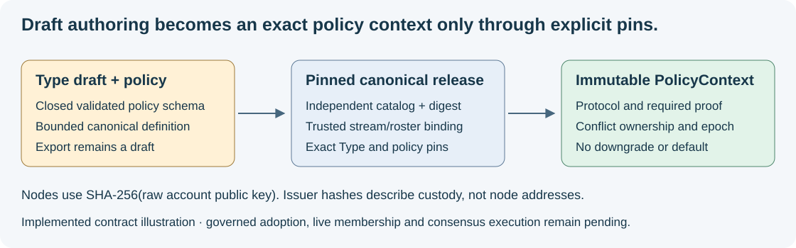

# Canonical Type policy foundation

23 October 2026. Implemented: first-class local Type policy authoring, public-key
hash validation, immutable canonical Type/release contracts and offline pinned
policy resolution. Durable explicit local genesis is described in
[policy-genesis.md](policy-genesis.md). [Signed governance](signed-governance.md)
adds locally authorized successors and [bounded federated governance replay](dag-finality.md).
Operational consensus engines and mesh admission remain pending.

*Generated contract illustration of this foundation. Returning a PolicyContext
does not commit a transaction or establish that a consensus backend is running.*

## Type authoring and export

Migration `20261023_0013` adds nullable `types.consensusPolicy` JSONB. Existing
Types remain readable without a policy; the resolver holds them. The Type PUT
API validates the closed `syn.consensus-policy/1` schema and exact protocol/trust/
proof combinations. Omitting the field preserves it for old clients; explicit
null clears only the local draft. A draft edit does not change an adopted release.

`GET /api/type/{slug}/consensus-definition?revision=1` freezes the selected positive
revision, name, parents, property definitions and first-class policy. It returns
`status: draft`, canonical definition and digest. Statistics, arbitrary knowledge,
credential bodies and private state are excluded from this structural projection.
The author must explicitly revise and adopt semantic schema contents; this endpoint
does not export every local annotation as canonical meaning. It has no adoption,
governance or consensus side effect.

The shared `syn_client.consensus` module owns the contract. Type URIs are scoped
by catalog UUID and release digest. Canonical definitions use `syn://type/`;
resolution accepts its `synny://type/` alias within that same pinned catalog.
Aliases do not establish cross-catalog identity. Releases require unique sorted
Types; each definition and policy has its own domain-separated digest.

## Canonical bytes and immutable release

`syn.consensus-json/1` uses UTF-8, Unicode-codepoint-sorted object keys, compact
JSON, no Unicode normalization, no duplicate keys/surrogates/floating numbers,
bounded exact integers, maximum depth 16 and maximum document size 2 MiB.
Revision/epoch values are bounded positive decimal strings. This is an explicit
new profile, not RFC 8785/JCS. Legacy message receipts, account certificates and
short-lived proof bytes retain their existing profiles. Rust parity vectors for
new ledger signing remain an SBT02/SBT03 gate.

Construct `CanonicalTypeDefinition` with canonical JSON and an explicit typed
`ConsensusPolicy` (or null for readable legacy data). Group definitions into an
immutable `CanonicalTypeRelease`. Loading a release validates its shape; it does
not make it trusted. The resolver requires an independently selected catalog UUID
and release digest plus immutable `PolicyBinding` values from trusted local
configuration. Never copy those trust pins from the document being checked.

## Identity and resolution

`NodeKeyHash` accepts exactly 64 lowercase SHA-256 hex characters.
`NodeKeyHash.from_public_key` hashes raw 32-byte Ed25519 account public keys.
`NodeIdentity` checks the full key against the independently expected hash.
It does not verify issuer credentials, live possession or the curve key's use in
a signature. Those checks belong to credential/session admission. Issuer hashes
remain custody constraints, never node addresses; transport peer IDs remain
internal connection diagnostics until SBT04 binds them to account identity.

`CanonicalTypePolicyResolver.resolve(TypePolicyPin(...))` requires the exact
definition and policy digests. Its immutable PolicyContext binds catalog/release,
canonical Type, protocol/proof profile, conflict namespace and domain/genesis/
stream/epoch/roster. Unknown Types, missing policies, changed pins, unsupported
profiles, absent bindings and mismatched rosters hold without fallback.
Construction rejects two bound policies claiming one conflict namespace.
`resolve_write_set` rejects incompatible atomic policy contexts; admission must
provide the complete operation/subject write set rather than omitting a protected
subject. Resolved contexts are indexed once; resolution does not rehash the
entire release for every operation.

Both operator-log and federated DAG/Hashgraph schemas are recognised. No Raft
or Hashgraph adapter is activated by this foundation. Full roster credential/
weight/independence checks, live challenges, governed policy transitions,
Syn runtime startup binding and private peer transport remain separate
gates. Caller-supplied pins are trust configuration, not governance proof.

The durable genesis store adds cross-catalog namespace ownership, immutable
domain anchors and authenticated exact reads. It accepts only initial local
trust configuration and exact retries. Potbot can resolve that stored document
against an independently provisioned adoption digest; a database-returned digest
cannot select its own trust. See the linked guide for administrative initialization,
PostgreSQL protection and the distinction from signed Type governance.

See [Syn's workflow design](ci.md) for the owned test lanes, and Potbot's
[integration architecture](https://github.com/kieransimkin/potbot/blob/codex/syn-service-integration/docs/implementation/14-type-consensus-and-node-identity.md)
for the intended two-profile implementation. The new API/contract tests use
synthetic records. A running consensus screenshot/video would misrepresent this
slice; real mesh and finality demonstrations remain later acceptance work.
