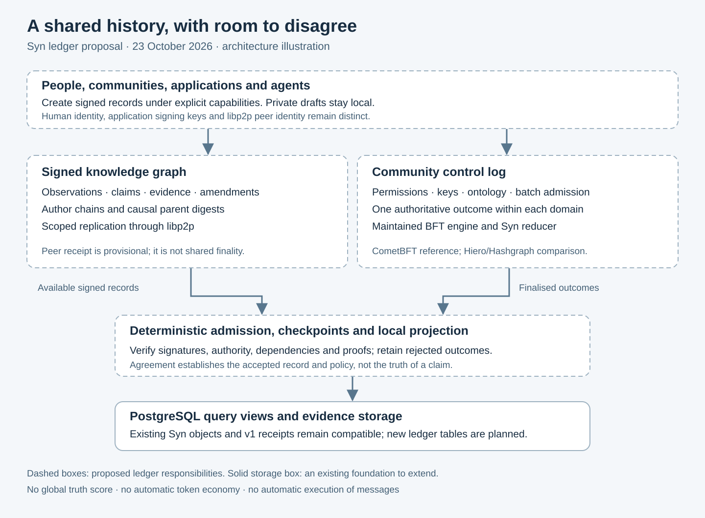
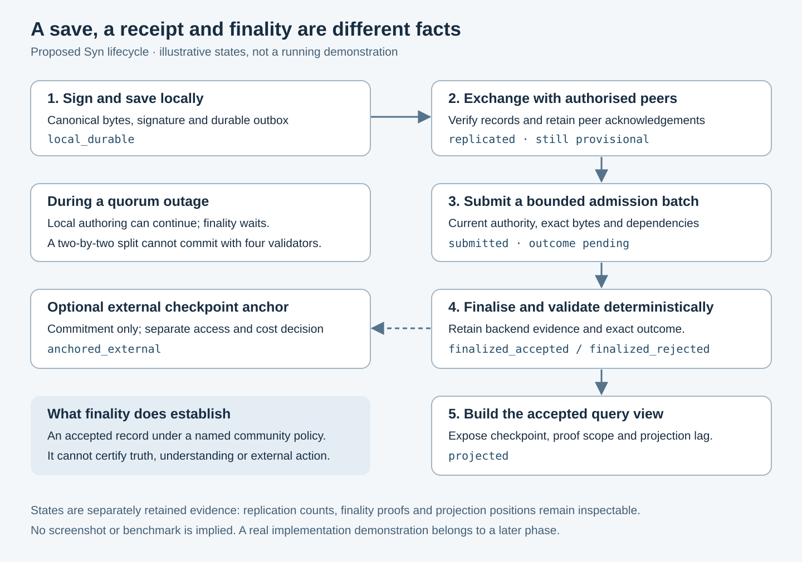

# Syn distributed ledger: research and implementation plan

> **Superseded recommendation, reconciled 1 November 2026.** This document retains
> the 23 October research snapshot. Its CometBFT-first experiment and one-domain
> default do not override the later owner-directed architecture: explicit policy
> in each canonical Type, simpler authenticated agreement within verified common
> custody, and BFT DAG/Hashgraph-family agreement across independent custody.
> Nodes use their own public-key hashes; each operator and Agent has a real Syn
> instance installed from official upstream releases. See the
> [current architecture and decision index](architecture.md) and
> [release/deployment gates](development/release-and-node-deployment.md).
> Earlier statements that chat-only decisions were unavailable describe this
> historical research run, not the completed 1 November reconciliation.

Research date: **23 October 2026, Europe/London**. Status: **proposed architecture for review; no distributed consensus implemented by this task**. Source baseline: commit `57da1be`, with the current source and historical project reports inspected separately from external research.

The companion [comprehensive consensus review](consensus-comparative-review.md) compares nineteen approach categories, their strengths and weaknesses, and direct Syn workloads. Its assessment refines this plan: signed causal knowledge exchange is a first-class workstream, and community-finalised admission is required where a declared endorsement or shared-state invariant needs it. Backend selection remains provisional.

## 1. Recommended direction

Build a **federation of community ledgers over a signed graph of knowledge records**. Keep PostgreSQL as each node's durable store and query projection. Extend the existing libp2p service to exchange authorised records. Use a maintained Byzantine fault tolerant consensus engine for community decisions that require a single outcome.

The recommended first consensus implementation is a **CometBFT sidecar with a deterministic Syn application**, subject to the implementation spike below. Evaluate **self-hosted Hiero/Hashgraph** against the same application contract before committing to production. Hashgraph is a serious alternative, especially if leaderless ordering proves useful; inventing a Python imitation of virtual voting is outside this plan.

This is a new recommendation derived from the research, not a claim that Syn previously selected CometBFT or Hedera. No ratified consensus specification or named production ledger backend was found in the inspected repository, historical Syn reports or archive file inventory. The available chat inventory could not list the local host, so earlier chat-only decisions remain unverified.

The essential distinction is between **agreement about a record** and **agreement with its contents**. Validators can agree that an authorised person submitted a particular claim, that a permission changed, or that an operation consumed a unique resource. That agreement does not establish the claim's truth, someone's moral worth, or the quality of an AI conclusion.



*Original explanatory illustration of the proposal. Dashed boundaries identify planned components; it is not a screenshot or proof of a running distributed ledger.*

### Decisions proposed for the first implementation

| Decision | Proposed default | Why |
| --- | --- | --- |
| Consensus scope | One ledger domain per community or explicitly shared service | Avoid making every person accept one global government or vocabulary. |
| Knowledge history | Immutable, signed assertions with parent references and explicit amendments | Retain provenance, competing interpretations and offline work. |
| Authoritative shared state | Finalised control log and checkpoints admitting batches of assertions | Give permissions, ontology adoption and exclusive operations a deterministic outcome. |
| Consensus backend | CometBFT reference adapter; bounded Hiero comparison | Reuse a complete protocol with recovery and membership machinery. |
| Local database | PostgreSQL; SQLAlchemy projections; Alembic migrations | Build on the implemented semantic core. |
| Peer exchange | Versioned, authenticated libp2p streams; bounded gossip announcements if supported | Networking already exists; application exchange does not. |
| Identity | Stable domain/object IDs, credential controllers and delegated signing keys | A slug, peer ID and human identity are different things. |
| Payments and voting power | No native currency, mining or reputation-weighted validator votes in v1 | Neither is required for useful federation; Syn's value primitives are not established financial assets. |
| External anchoring | Optional checkpoint commitments after a separate access/cost decision | External notarisation can strengthen retained evidence without owning every write. |

## 2. What Syn already has, and what it only intends

Current source takes precedence over old descriptions of implementation. Historical reports remain evidence of the project's aims.

| Foundation | Evidence inspected | Verified scope and ledger consequence |
| --- | --- | --- |
| Semantic object graph | [models.py](../src/syn/models.py), [ontology.py](../src/syn/ontology.py), [schema.sql](../src/syn/schema.sql) | Ten primitive families including Credential; one direct `typeRef` per non-Type primitive; multiple Type parents. Preserve these structural rules. |
| Local identity | [refs.py](../src/syn/refs.py), [reference schema](../database/objectReferenceSchema.sql) | `syn://{kind}/{slug}` identifies a local object. It contains no network domain and cannot safely identify independent remote objects by itself. |
| Object chronicle | `ObjectChronicle` and `ChronicleKind` in [models.py](../src/syn/models.py) | Local per-object ledger/provenance entries, sequence numbers and JSON details. No cryptographic author chain or consensus follows from the word `ledger`. |
| Credential storage | `Credential` model and [credential migration](../src/syn/alembic/versions/20260811_0010_credential_primitive.py) | Optional unique public-key hashes and guarded opaque private data. Key formats, signing authority, delegation and revocation are not yet a distributed identity protocol. |
| Workspace communication | [communication contract](communication.md), [service](../src/syn/communication.py), [client protocol](../packages/syn-client/src/syn_client/protocol.py) | Authenticated HTTP, idempotent append, serialised workspace SHA-256 receipts and replay. A sender string is a trusted client assertion. No distributed finality or signed authorship. |
| Database immutability controls | [migration 0012](../src/syn/alembic/versions/20261023_0012_communication_ledger.py) | Normal database roles cannot update/delete/truncate receipts. A privileged owner can bypass this; independent retained anchors matter. |
| Peer connectivity | [p2p.py](../src/syn/p2p.py), [P2P tests](../tests/test_p2p.py), [configuration example](../config.example.toml) | Host lifecycle, peer IDs, listen addresses, bootstrap configuration, mDNS and optional UPnP. No Syn record stream, persistent application identity, replication or consensus protocol. |
| Observations and computation | [feed_jobs.py](../src/syn/feed_jobs.py), [scheduler.py](../src/syn/scheduler.py) | Source observations, response/network Embers and local registered jobs are useful provenance inputs. They are not consensus-safe computations or automatic distributed execution. |
| Philosophical intent | [30 July project report](../synny/reports/2026-07-30.md), archived [proximity essay](../synny/reports/moltbook-posts/2d86f876-126a-429f-ba79-3dd0953b5193.md) | Local, plural communities; bounded, revocable authority; positive human experience above money; explicit distinctions among knowledge, reasoning, emotion and morality. |

The historical meanings of Ember, Enigma, Pondle, Snug and Om have evolved. The July report records knowledge/trust/reasoning/emotion/morality; current ontology definitions describe more specific object roles. The ledger must retain vocabulary/version provenance and must not silently turn these concepts into fungible tokens, universal scores or proof-of-stake balances.

The ignored local reference `references/double.pdf` was identified as **Survey on Blockchain for Internet of Things**, by Xu Wang and colleagues, 26 pages. It is third-party background, not Syn's ledger specification; it is not redistributed here. The `syn.zip` filename inventory did not expose a separate ledger/hashgraph/consensus design document. The SQL dump's generic catalogue references to distributed computing are not evidence of a chosen architecture. No private database configuration or credentials were read into this plan.

## 3. What Hashgraph contributes

### 3.1 The protocol

In the original algorithm, members create signed events containing transactions and references to their own previous event and a peer's event. These links preserve the history of communication, forming a directed acyclic graph. The graph supports **virtual voting**: nodes derive votes from the recorded history rather than transmitting a separate vote for every decision. Rounds, witnesses, strong seeing and fame decisions lead to a final transaction order. This is substantially more than hashing records or using a gossip network. [Original Hashgraph paper, sections 2–4](https://www.swirlds.com/downloads/SWIRLDS-TR-2016-01.pdf).

The paper's agreement model assumes authenticated members, secure cryptography, fewer than one third Byzantine members, and eventual communication between honest members. Asynchronous agreement does not promise bounded latency through an indefinite partition. Consensus timestamps are protocol-derived ordering evidence, not proof of when a physical event occurred. Claimed client time, observation time and receipt time must remain distinct. [Hashgraph fault model and fairness analysis](https://www.swirlds.com/downloads/SWIRLDS-TR-2016-01.pdf).

### 3.2 Algorithm, implementation and public service are separate choices

| Choice | What Syn would gain | What Syn would still need |
| --- | --- | --- |
| Study Hashgraph | A rigorous model of leaderless BFT ordering and communication history | A full implemented and reviewed protocol before making any aBFT claim. |
| Self-host Hiero | An existing consensus implementation, with platform/application boundaries | Deployment, identity, governance, storage, upgrades and a supported Syn integration. It is not a drop-in Python library. |
| Use Hedera Consensus Service (HCS) | External ordering and timestamping of submitted messages | Syn validation, author signatures, private storage, recovery, fee/access management and verification of external evidence. |

Hiero's architecture separates consensus nodes, deterministic application execution and historical query infrastructure. Reusing a service boundary is more credible than copying selected algorithm ideas into Syn. Exact release behaviour must be checked against pinned source: its documentation includes evolving record/block-stream terminology. [Hiero architecture](https://github.com/hiero-ledger/hiero-consensus-node/blob/main/hedera-node/docs/design/design.md).

For HCS, subscribers obtain ordered topic messages through mirror nodes; successful submission receipts contain topic sequence and running hash. The current submit-message documentation describes a 1,024-byte chunk limit and SDK chunking. A Syn adapter should keep checkpoint commitments below one chunk and avoid chunk-assembly semantics for control decisions. A restricted submit key controls submission; it does **not** make topic contents a confidential mailbox. Private payloads must stay off public infrastructure. [HCS submit-message contract](https://docs.hedera.com/native/consensus/submit-message).

HCS ordering does not run Syn's authorisation or ontology rules for us. If used as the primary ordering source, every Syn replica still needs the same deterministic reducer and must retain ordered invalid operations as rejected outcomes. Prefer it initially for optional checkpoint anchoring, not for making routine local knowledge publication depend on a public service.

Hiero Local Node is deprecated; its maintainers direct development to Solo. The Solo README inspected lists Kubernetes and substantial Docker resources and distinguishes short-lived releases from LTS releases. Treat these as a real operational cost, not an assumed advantage. Pin a supported release and image digests at experiment start rather than copying a moving `latest` installation. [Local Node deprecation](https://github.com/hiero-ledger/hiero-local-node), [Solo requirements and releases](https://github.com/hiero-ledger/solo).

### 3.3 Alternatives and selection

| Approach | Useful property | Limit for Syn | Decision |
| --- | --- | --- | --- |
| PostgreSQL plus current receipt chain | Simple durable local ordering; existing clients | One service/database remains the authority | Retain as local/legacy mode. |
| Raft-style replicated database | Crash fault tolerant operation under one trust owner | Not protection against Byzantine operators | Suitable only for explicitly trusted deployments; not the federation security claim. |
| Signed append-only graph | Offline authorship, selective exchange and provenance | Does not resolve revocation races, exclusive spending or conflicting governance | Use as the knowledge substrate. |
| CRDT document | Concurrent editing and deterministic convergence | Merge policy does not enforce arbitrary global constraints or decide semantic truth | Optional private draft/editor layer; never merge permissions or Type-parent changes blindly. |
| CometBFT | Existing BFT ordering, application interface and commit evidence | Proposer-based; liveness depends on eventual synchrony; application integration remains work | Preferred v1 control-log reference. |
| Self-hosted Hiero/Hashgraph | Leaderless aBFT ordering | Larger runtime and integration burden; supported application boundary needs validation | Required comparison spike before production selection. |
| Public HCS | Independent ordering/notarisation | Public metadata, external governance, fees and availability | Optional anchor or deliberate alternative backend. |
| New native Syn consensus algorithm | Maximum design freedom | Proof, attack analysis, implementation and maintenance burden | Defer; no security claim based on a simulator. |

CometBFT's documented protocol uses proposal, prevote and precommit rounds, with more than two-thirds voting power for a commit. Use the complete engine, including its locking and recovery rules; collecting signatures over a digest is not a substitute. [Pinned protocol specification used for research](https://raw.githubusercontent.com/cometbft/cometbft/v0.38.21/spec/consensus/consensus.md). This source tag is a research reference, not a claim that it is the latest or the version Syn will deploy.

Automerge illustrates useful concurrent editing and retained conflicts, but a deterministic displayed winner can still hide a competing value from ordinary reads. Syn's assertion views should surface disagreement explicitly. Do not introduce Automerge as the whole semantic ledger or assume its JavaScript interface is already integrated into this Python project. [Automerge conflict semantics](https://automerge.org/docs/reference/documents/conflicts/).

## 4. Ledger structure and consistency model

### 4.1 Three kinds of state

1. **Private local state:** drafts, secrets, unshared observations, caches and local jobs. No replication by default. Local write availability does not depend on a community quorum.
2. **Signed knowledge records:** immutable assertions, evidence, amendments, retractions and references. They can be authored offline and exchanged when authorised. Mere receipt is provisional. Their causal graph can converge without choosing one universally true interpretation.
3. **Finalised community state:** a control log orders membership, capabilities, key rotation, adopted ontology versions, assertion admission/checkpoints and exclusive operations. Finality is scoped to one named domain and its explicit trust model.

Every public API response identifies which state it represents. An offline assertion can be `local_durable` or `replicated`, while still awaiting admission to the community's finalised view. Do not advertise it as a finalised shared mutation.

Raw authored evidence and community endorsement are separate products. A signature-verified causal record can already be useful without committee approval, subject to its distribution/access rules. The admission path below defines a community-endorsed view; it need not gate every raw observation or draft. The comparative review's workload/invariant analysis determines which operations require that stronger contract.

### 4.2 What must be ordered

| Operation | Handling |
| --- | --- |
| Independent observations and competing factual claims | Signed records; batch admission; preserve both and their evidence. |
| An author's correction or withdrawal | New signed record referencing exact prior digests; no deletion of history. |
| Community adoption of an ontology or preferred interpretation | Ordered control operation, with explicit authority and expected prior version. |
| Capability grant/revocation, credential recovery, validator membership | Ordered control operation. |
| Resource assignment or any future conserved balance | Atomic deterministic operation within one domain; no CRDT counter as a substitute. |
| Private collaborative text | Optional CRDT with separately defined access and publication rules. |
| External action by a Cog or agent | Finalised intent may authorise an attempt; external action and observed result are separate records. |

The control log admits a **bounded batch manifest** of complete, verified assertions. Validators have the manifest and required public/authorised bytes before accepting the batch. In v1, every byte needed for deterministic validation is carried in the ordered operation itself, within the inline-data limit; larger blobs can be committed as opaque evidence but cannot influence the transition through a local fetch. Its finalised outcome records exactly which digests were admitted or rejected and why. A digest-only commitment to unavailable input cannot authorise a state change.

Independent assertions commute as a set; consensus batch order is needed for admission against current policy, not to rank their truth. A single bounded control operation can admit many observations, avoiding one consensus transaction per feed item. Provisional exchange stays outside this finalised set until admission succeeds.

### 4.3 Domain and validator model

A domain is a named governance and consistency boundary. Its signed genesis contains a random immutable domain UUID, human-readable name, initial controller keys, initial validator public keys and weights, protocol versions, initial ontology digest, resource bounds and recovery policy. Hash its exact canonical bytes and pin the genesis hash out of band.

For the first BFT pilot, use **four equal-weight validators controlled by independent operators**, with a quorum of three. This tolerates at most one Byzantine operator under the selected engine's assumptions. A seven-validator deployment requires five votes and tolerates at most two. Four processes on Kieran's one machine test protocol behaviour, not independent administration. Do not announce decentralised governance until independent operators and failure domains exist.

Admission of a validator is a governance decision. A libp2p peer can relay data without voting. An author can contribute without running a validator. Validator weight must not derive automatically from posting volume, money, Om, Snug, confidence or apparent popularity. Those would introduce unreviewed Sybil and power rules.

Use the engine's supported validator-set update semantics and activation heights, with a conservative staged handover: finalise the intended change under the old set, verify the new nodes have the checkpoint, apply at the engine-defined height, and retain a verifiable history of sets. Specify exact delayed-height behaviour in the pinned adapter tests. Never allow two memberships to self-authorise the same epoch.

Normal membership changes require the configured governance authority as well as protocol finality. A proposed pilot governance default is two of three independently held controller signatures for membership, protocol and domain-policy changes, followed by the validator quorum; ordinary delegated writes use their specific capability. Controller identities, threshold and recovery custodians are explicit genesis fields and remain separate from validator keys. This default requires real controllers to be appointed before a shared pilot; one-person development mode must identify its single-owner trust assumption.

If the old set cannot form quorum, recovery cannot be disguised as normal consensus: an explicitly authorised new genesis/fork names the last accepted checkpoint, the recovery signers and the changed trust assumption. Clients must opt into that new lineage.

## 5. Identity, records and cryptography

### 5.1 Keep three identities distinct

- **Transport identity:** a stable libp2p key identifies a node connection. Persist it using a reviewed keystore; the current `new_host()` construction does not supply a persisted key.
- **Signing identity:** a credential controller and delegated key authorise records for specified domains, operations and validity ranges. A transport signature does not establish this authority.
- **Object identity:** a network-stable subject or record reference survives names, key rotation and movement between hosting nodes.

For v1, use a structured object ID: `{domain_id, kind, object_id}`, where domain and object IDs are canonical UUIDs and `kind` is a supported primitive. Keep `syn://thing/example` as a scoped alias, with a unique mapping **inside its domain**. Two communities' `syn://thing/example` aliases need not refer to the same object.

Do not immediately change `ObjectRef` parsing or PostgreSQL reference domains. Introduce composite network identity and alias tables alongside them. Only explicitly selected local projections map a network object onto a legacy primitive row. Foreign records remain in network storage until that mapping is chosen. A future globally readable URI needs a separately tested grammar and migration.

### 5.2 Proposed signed assertion envelope

This is a shape illustration; placeholders are not executable test vectors:

```json
{
  "protocol": "syn.assertion/1",
  "domain_id": "<canonical domain UUID>",
  "record_id": "<persisted canonical UUID>",
  "author_credential_id": "<credential object identity>",
  "signing_key_id": "<registered delegated key ID>",
  "author_sequence": "42",
  "author_previous": "sha256:<previous signed-record digest>",
  "parents": ["sha256:<causal dependency>"],
  "policy_reference": {"control_height": "120", "policy_digest": "sha256:<digest>"},
  "operation": "assert",
  "subject": {"domain_id": "<UUID>", "kind": "ember", "object_id": "<UUID>"},
  "schema_digest": "sha256:<assertion schema>",
  "body_commitment": "sha256:<public bytes or encrypted payload descriptor>",
  "visibility": "public",
  "claimed_at": "2026-10-23T09:00:00Z",
  "signature": {"algorithm": "Ed25519", "value": "<base64url>"}
}
```

Use audited Ed25519 and SHA-256 implementations through explicit dependencies. Register full public keys and algorithms, not merely a key hash. Version any future algorithm change. Private keys never enter shared `knowledge`, receipt payloads or exported `Credential.privateData`.

Define `unsigned_bytes` as RFC 8785 JCS of every envelope field except `signature`. Define the signed message as the fixed bytes `syn.assertion/1` followed by one NUL byte and `unsigned_bytes`. The record digest is SHA-256 of a separate `syn.record/1` plus NUL prefix and JCS of the **complete signed envelope**. Hash the separately supplied body bytes with their specified encoding. Publish golden vectors before networking.

Reject duplicate keys, invalid Unicode, unknown required fields, NaN/infinity, noncanonical UUIDs, malformed digests and oversized/deep JSON. Use strings for 64-bit sequence numbers, precise decimal quantities and values beyond JSON's interoperable integer range. Sort and deduplicate parents by digest; preserve order only where the schema gives it meaning. Do not normalise arbitrary Unicode after signing. These choices address cross-language differences that Python's current receipt serializer was not designed to solve. [JSON Canonicalization Scheme, RFC 8785](https://datatracker.ietf.org/doc/html/rfc8785).

Keep current `syn-client` receipt v1 canonicalisation byte-for-byte unchanged. It uses ASCII-escaped sorted Python JSON, not JCS. A new protocol gets new verification code and a new version; never rehash old receipts with a new serializer.

### 5.3 Author chains, replay and equivocation

Each delegated key maintains an append-only sequence within a domain, persisted transactionally before publishing. `author_previous` binds the prior signed record. The next sequence cannot be signed concurrently by two processes sharing one key: allocate through a durable signer service or give each device its own delegated key.

Replicas deduplicate by signed digest. A repeated `record_id` with different bytes is a conflict, not a retry. Missing parents or earlier author records cause bounded quarantine and retrieval, not fabricated placeholders with trusted status. Cryptographic chain validity and community acceptance are separate: a valid but rejected earlier record can remain in the author chain without gaining semantic effect or blocking all later writes. Semantic dependencies must identify their required accepted versions and be present in the preceding finalised state or earlier in the same dependency-ordered batch. Two signatures by one key for the same sequence are retained as equivocation evidence. Finalised admission picks at most one branch; governance can freeze that key. Do not silently erase either signed artefact.

### 5.4 Capabilities and revocation

A capability names the issuer, subject key, domain, allowed operations, object/schema scope, visibility, maximum delegation depth and validity by finalised control height. Optional wall-clock expiry is evaluated only against the consensus engine's agreed time under a documented policy, never against arbitrary local clocks or `claimed_at`.

Validators evaluate admission against **the control state immediately before that operation in finalised order**. Revocation before admission rejects the affected write even if its client claims an older timestamp. Admission before revocation remains historical evidence; later views show the subsequent revocation. Offline records using old capabilities remain provisional and may be rejected after reconnection. This sacrifices unconditional offline acceptance in exchange for enforceable shared revocation.

For confidential records, do not distribute new payload keys to an unconfirmed member or based on an unfinalised grant. Revocation blocks future admission/disclosure; it cannot recall plaintext or keys already obtained. Root recovery uses explicitly nominated controllers or a recovery threshold. A lost unrecoverable root requires a new identity plus an attributed linkage claim; no administrator silently impersonates the old author.

## 6. End-to-end operation



*Original proposal illustration. Separate acknowledgement states prevent a local save, peer receipt or submitted transaction being described as final consensus.*

### 6.1 Recording a feed observation

1. The existing witness job performs its external request under current destination, size and redaction rules. Network access happens outside consensus.
2. It constructs the Event, response Ember and measurement Ember plus an atomic relationship bundle. It retains the source URL, source/body digest and observation provenance. Sensitive headers and private payloads are excluded from public export.
3. In one local PostgreSQL transaction, the node saves canonical signed records, allocates author sequences and appends an outbox item. A successful local receipt means `local_durable`.
4. Authorised peers receive bounded announcements and fetch the signed bundle. They verify signatures, scope, sizes and dependencies. Peer acknowledgements identify the digest and peer, producing `replicated`, with the actual count and identities available to the author.
5. A batch assembler submits a manifest and the required bytes to the domain's ordering adapter. Admission validates current capabilities, schema and dependencies. Provisional records can be rejected here without rewriting their original signatures.
6. Finality evidence commits to the exact batch and its outcomes. A deterministic reducer updates the accepted assertion set. Observers retain the proof and can independently replay it.
7. Each node projects the accepted observation bundle into its query tables, idempotently. Queries report both the finalised checkpoint and the local projection height. A lagging index must not pretend to have the latest state.

A recorded HTTP response proves an observation of that response, not that its claims were correct. An AI interpretation is another signed assertion with model/process provenance and linked inputs. Re-running an AI model inside a validator is forbidden.

### 6.2 Conflicting claims and ontology changes

If Alice and Bob give a Thing different dates, preserve two assertions with separate authors and evidence. A community view may prefer one using a named, versioned policy; another view may disagree. A correction points to the exact claim superseded. Retraction removes that author's endorsement in the current view while preserving the original provenance where retention permits.

Ontology adoption is stricter. `AdoptOntology` names an expected prior ontology digest, proposed Type records/edges, governance signatures and a complete bounded dependency set. Validators reject cycles, missing canonical Types, invalid properties and broken primitive constraints. Concurrent incompatible proposals are resolved by control order and expected-version checks: after the first succeeds, the second returns a stale-version outcome and must be rebased. Merely merging the union of two separately acyclic Type graphs could introduce a cycle.

Do not feed unvalidated remote ObjectRefs into existing placeholder-materialisation triggers. A local placeholder is a convenience record, not evidence of a remote object's existence, ownership or accepted classification.

### 6.3 Jobs and external actions

Consensus commits an intent and its authority. An outbox dispatcher submits a local scheduler job under an idempotency key derived from that finalised intent. Job status, attempts and observed results are new records. Crashes between an external send and its acknowledgement still require reconciliation with that destination; the ledger cannot manufacture exactly-once external execution.

Potbot retains task admission, budgets, execution ownership and its signing broker. A Syn message is data; it must not become automatic permission to run code or publish. If an exclusive worker lease is required, finalise lease ownership and fencing tokens in the control log, then require the actual resource to enforce fencing.

## 7. Consensus application and verification

### 7.1 Backend-independent application contract

Define an `OrderingAdapter` boundary with submission, finalised-operation streaming, finality verification and recovery metadata. Its output includes domain/genesis identity, backend identity, monotonic height or position, ordered operation bytes, agreed time when available, and verifiable backend evidence. Mock adapters are development-only and identify themselves as non-BFT.

The application implements a pure transition:

```text
apply(previous_state, ordered_operation, agreed_context)
    -> next_state, outcome, deterministic_events
```

All validators use the same protocol/reducer/schema versions. The transition performs no HTTP requests, DNS lookups, random UUID generation, AI inference, ambient-time reads or uncontrolled floating-point calculation. Imported observations are already signed input, not live calls. Rejected operations receive deterministic outcome codes; they must not partially mutate state.

For CometBFT, use the maintained ABCI++ boundary: admission/mempool checks are advisory; authoritative validation occurs during finalised execution. Persist application height, state root and results atomically and implement handshake/replay so a crash cannot apply a block twice. Keep deterministic state separate from searchable ORM projections. [ABCI methods and persistence contract](https://raw.githubusercontent.com/cometbft/cometbft/v0.38.21/spec/abci/abci%2B%2B_methods.md).

Hiero cannot be treated as an interchangeable executable without an adapter experiment. Test a private HCS-style topic integration first; decide whether the supported service boundary exposes adequate ordering evidence and deployment control. A custom Java platform application is a separate maintenance commitment. Do not promise that arbitrary Python reducer state is directly included in a Hiero state proof. An HCS adapter can authenticate input ordering while an independently replayed Syn reducer computes acceptance; its state-root claim requires that replay or a separately specified certification mechanism. It must not inherit the CometBFT AppHash guarantee by sharing the same adapter interface.

### 7.2 Checkpoints and Merkle commitments

Separate three commitments:

- **Control-log commitment:** ordered operations and outcomes.
- **Accepted-record commitment:** deterministic admission leaves `(admission_position, digest)`; prove a record entered the community view.
- **Application-state commitment:** canonical current governance/ontology/exclusive-resource state, including protocol and previous checkpoint identity.

Use reviewed Merkle primitives with domain-separated leaf/internal hashes. For append-only admission history, adapt the RFC 9162 inclusion and consistency construction with explicitly specified Syn leaf bytes. Its consistency proof demonstrates extension of a retained prefix; it does not prove every private assertion was made available. An authenticated state map is a separate structure and must not borrow a log proof as if it proved nonmembership. [Merkle log proofs, RFC 9162](https://datatracker.ietf.org/doc/html/rfc9162).

For the first pilot, a sorted canonical state snapshot plus its digest is sufficient for full replay verification; scalable per-key state proofs can follow. Do not advertise a sparse-Merkle query proof until implemented and tested. The consensus backend must commit to the Syn state digest, and clients must understand where that digest is authenticated. With CometBFT, test the AppHash/header timing explicitly: the resulting application hash is authenticated in the subsequent header. A finalised block containing an operation is not, by itself, an immediate proof of the computed next state root.

A light verifier needs a trusted genesis or recent trusted checkpoint, the applicable validator-set history, backend-specific authenticated headers/commit evidence, the exact leaf/operation and the necessary inclusion path. Follow the backend's trusting-period and validator-change rules; do not reduce verification to counting arbitrary signatures. Use a maintained verifier where available. A mirror REST response alone is not a cryptographic proof.

### 7.3 Time and finality states

Expose `claimed_at`, `observed_at`, `local_recorded_at` and backend consensus time separately. Use sequence/dependency/control order for protocol correctness. Never let an author backdate a record to regain revoked authority.

Recommended statuses are `local_durable`, `replicated`, `submitted`, `finalized_accepted`, `finalized_rejected`, `projected` and `anchored_external`. Store them as separate facts where several apply rather than pretending they are one irreversible linear progress bar. An external anchor is optional evidence, not an upgrade in the truth of the content.

## 8. Networking and data availability

Reuse the current host lifecycle but add explicit application protocols. Proposed identifiers are `/syn/ledger/status/1`, `/syn/ledger/records/1`, `/syn/ledger/control/1` and `/syn/ledger/checkpoints/1`. These identifiers are new contracts, not existing libp2p features. A capability handshake exchanges supported protocol/schema versions, domain/genesis IDs, credential challenges, peer limits and verified checkpoint positions.

Transport encryption and libp2p peer authentication are required but insufficient. Validate application capability and domain scope on each operation. Never expose private domain existence, heads or record counts to an unauthorised requester. Do not derive peer trust from mDNS discovery or bootstrap placement. libp2p itself does not solve Sybil resistance. [libp2p security considerations](https://docs.libp2p.io/concepts/security/security-considerations/).

Start with bounded direct request/response streams and persisted outboxes. Add gossip announcements only after testing the installed py-libp2p implementation's actual protocol, signing, limits and shutdown behaviour. Announce digests/checkpoints, not arbitrary whole database rows. The consensus sidecar uses its own supported peer protocol; do not replace its transport with libp2p without upstream support.

Reconcile using finalised positions and author-chain summaries; request missing ranges and parents in bounded pages. Verify every returned digest and proof before advancing a durable cursor. Do not exchange unbounded vector clocks for every internet identity. Scope cursors and retained heads by subscribed domain and known author; use signed snapshots for initial catch-up.

Initial configurable pilot bounds: 64 KiB canonical assertion envelopes, 32 causal parents, JSON depth 32, 1 MiB batch manifests, 8 MiB inline batch data and 4 MiB transfer frames. Large bodies use chunked blob transport with a content digest and declared length. These are engineering starting points, not measured safe capacity. Load tests determine production values. Apply limits before allocation/decompression and separately bound pending-parent queues, disk quotas, per-peer streams and retries.

Only finalise an admitted data batch after required bytes are durably available on its validating operators. Keep at least three independently operated archive copies for the pilot, audit actual restore availability, and define retention by data class. Consensus proves the ordered commitment; it does not guarantee that historical data will remain retrievable forever. Public checkpoint anchoring similarly cannot restore lost data.

Private bodies are excluded from public sync, public content-addressed networks and public anchors. Where validators lack access to a body, they validate only the envelope/commitment and the explicitly attested predicate; the receipt must say so. Confidential semantic validation requires a trusted private validator domain or a separately designed proof mechanism, not an implied zero-knowledge capability.

## 9. Storage and API changes

### 9.1 Proposed tables

Use a separate ledger schema or consistently prefixed tables, leaving v1 communication tables untouched. Final names and migration numbers are allocated at implementation time after checking the latest Alembic head.

| Proposed table family | Essential fields or constraint |
| --- | --- |
| `ledgerDomains` | Domain UUID, immutable genesis bytes/hash, backend and protocol identity. |
| `ledgerKeys`, `ledgerCapabilities` | Public keys, credential/controller links, scope, grants/revocations and effective control positions. No private keys. |
| `ledgerRecords` | Digest primary key, original canonical signed bytes, domain, record UUID, author/key, sequence and previous digest. Preserve bytes, not only JSONB. |
| `ledgerRecordParents` | Record digest and parent digest, with indexed bounded lookups; unresolved dependencies quarantined separately. |
| `ledgerAuthorHeads` | Transactionally allocated local signer sequence/head; equivocation evidence stored separately. |
| `ledgerControlLog`, `ledgerOutcomes` | Domain/position/index, exact operation bytes, deterministic result and backend evidence. |
| `ledgerAdmissions` | Admitted record digest and checkpoint/position; uniqueness prevents duplicate effective application. |
| `ledgerCheckpoints` | Roots, version hashes, validator-set reference and backend proof chain. |
| `ledgerObjects`, `ledgerAliases` | Composite stable network IDs and domain-scoped legacy alias mapping. |
| `ledgerBlobManifests` | Digest, exact size/media type, visibility, encryption descriptor and retention class; storage locations remain policy-controlled. |
| `ledgerOutbox`, `ledgerInbox`, `ledgerPeerCursors` | Durable retries, deduplication, scoped peer state and acknowledged digests. |
| `ledgerProjectionOffsets` | Domain/checkpoint/reducer version; monotonic update in the same transaction as projection writes. |

An immutable received record may later be found unauthorised; keep its raw evidence separate from an accepted projection. Local indexes and search caches can be rebuilt. Consensus inputs, keys, proofs and genesis cannot be replaced by mutable ORM state.

### 9.2 Proposed HTTP surface

Use `/v2/ledger/domains/{domain_id}` with authenticated, scope-aware endpoints for `records`, `records/{digest}`, `operations`, `operations/{id}`, `head`, `checkpoints/{position}`, `proofs` and `sync`. Every read is bounded, including verification responses. Separate blob download permissions from metadata permissions.

`POST /records` returns a durable record identity and its actual current states; use HTTP 202 while shared admission is pending. An idempotency key is persisted before sending and bound to exact bytes. `POST /operations` returns an operation ID for later outcome retrieval, with deterministic conflict errors. A retry must recover the original result rather than create another action. Use per-principal authorisation in addition to any workspace boundary; current workspace bearer tokens do not prove individual signatures.

Do not change the existing `/v1/communication/workspaces/...` contract. Extend `syn-client` additively or create a dependency-light `syn-ledger-client` after reviewing package boundaries. Proof validation must be available offline from an exported bundle, not only by asking the serving node whether it is honest.

### 9.3 Source ownership proposed for implementation

Create a `src/syn/ledger/` package with small modules for protocol/canonical bytes, signatures, capability evaluation, deterministic transitions, storage, proofs, projection and synchronisation. Keep backend adapters in `ledger/ordering/`. `p2p.py` owns host lifecycle and delegates application streams; `scheduler.py` continues to own local execution. Generate client/server conformance vectors from the specification, not from private adapters.

Declare cryptographic/canonicalisation/protobuf dependencies directly when adopted. Do not depend accidentally on a transitive package shipped by libp2p. Pin the sidecar, protocol schemas and deployment images separately from Python dependencies. No model weights or new AI inference are needed for this ledger work.

## 10. Migration from the existing Syn installation

1. **Inventory and preserve.** Back up a real deployment through its established database procedure. Record Alembic head, object/reference counts, receipt heads, application versions and a private export manifest. No live migration or configuration change was performed for this plan.
2. **Create a local domain.** Explicitly choose the operator, genesis and root keys. Add network ID mappings without renaming existing `syn://` values. Root ontology seeds get stable mappings under the chosen catalogue/genesis version.
3. **Import a selected baseline.** Export allowed public primitive fields and relationships in a deterministic order, retaining source row identity and export hashes. Classify imported records as legacy snapshots attributed to the importing operator. Never invent historical author signatures or observation times.
4. **Seal history boundaries.** Keep old communication receipt bytes/hashes and per-workspace sequence scopes intact. Anchor selected retained heads with an `ImportLegacyHead` control operation. This commits to an existing service prefix; it does not retroactively make old sends individually signed or consensual.
5. **Shadow replication.** Run an explicitly non-authoritative second node from signed exports, compare projected graph/ontology roots and check restricted fields never leave. Keep original reads/writes authoritative during this phase.
6. **Pilot a separate domain.** Use synthetic or explicitly public records with four test validators. Exercise failures before inviting users or moving private workspaces.
7. **Switch selected shared mutations.** Route authoritative writes through the control application and transactional outbox. Database privileges and application paths prevent bypass writes to consensus-owned state. The existing Type editor cannot retain an uncontrolled direct-write path for a ledger-governed ontology.
8. **Reconcile and expand.** Compare old and new readers, document changed semantics, retain rollback snapshots and only then enable wider federation.

Rollback before cutover disables the new features and restores local authority. Rollback after shared finality cannot erase what other operators already finalised; fix it through forward operations or an explicit new lineage. Distinguish application deployment rollback from historical ledger rollback.

## 11. Failure, privacy and governance rules

| Situation | Required behaviour |
| --- | --- |
| Two partitions of two validators in a four-validator domain | Neither partition finalises; authors may save local provisional work. |
| Three validators remain connected and one is unavailable | Healthy quorum can progress under the backend's conditions; the isolated node catches up from proofs. |
| Byzantine fork, forged signature or replay into another domain | Reject effective application; retain bounded attack evidence and alert operators without trusting the hostile payload. |
| Projection disagrees with finalised root | Stop serving that projection as verified, retain mismatch evidence and replay from a known checkpoint. |
| Peer withholds a parent or blob | Keep the dependent record pending; try authorised alternate peers; do not finalise an unavailable required body. |
| Key is stolen | Finalise revocation/recovery under existing controllers; disclose the affected interval. Cryptography cannot distinguish the thief's valid signature from the owner's. |
| A moderator hides harmful content | Append attributed moderation state; apply visibility/index policy. A historical commitment need not imply public hosting of the content forever. |
| Personal information is placed in a record | Use data minimisation, restricted bodies and retention from the outset. Purging payload copies cannot erase independently retained public bytes or metadata. |
| Validator governance is captured | State the violated trust assumption; allow export, dissent and explicit exit/fork. Do not claim BFT protects against a threshold already controlled by one party. |
| Backend or reducer upgrade | Finalise an activation point and exact version hashes; test replay and migration; refuse unrecognised versions rather than guessing. |

Encryption is proposed through reviewed authenticated-encryption and recipient-key wrapping libraries, with distinct keys per private group/epoch. Do not design a new cryptosystem. A content hash can disclose low-entropy private information through guessing; public anchors should use commitments to properly randomised ciphertext or salted private manifests with the salt kept private, as appropriate. Hashes are integrity evidence, not anonymisation.

Community exit exports the participant's permitted signed records, proofs and object identities. Private export remains subject to other participants' privacy and shared-data policy. A new community can reference old evidence without pretending the old validators endorsed its new rules. No global total order or atomic cross-community transaction is promised.

Cross-domain references include the source domain, checkpoint, proof and interpretation policy. A receiving community verifies the source evidence and independently decides acceptance. For any future cross-domain conserved asset, design a proper escrow/bridge protocol with separate threat analysis; simple replication must not mint another spendable copy.

## 12. Delivery sequence and acceptance gates

These are dependency-ordered work packages, not elapsed-time promises. Estimates require the first adapter experiment and operator/hardware choices.

| Phase | Concrete deliverable | Acceptance gate |
| --- | --- | --- |
| **0. Specify the contract** | ADRs, versioned envelopes, canonical/hash/signature vectors, identity/alias and capability rules, threat model | Two independent language implementations agree on bytes; explicit distinction between provisional and finalised state. |
| **1. Signed local ledger** | Local key persistence/delegation, immutable record store, author chain, outbox, independent verifier | Restart/retry/fork tests; legacy receipt vectors unchanged; no secret field in export. |
| **2. Two-node replication** | Authenticated libp2p streams, scoped sync, dependencies, limits and observable cursors | Real two-process restart/catch-up; hostile peers bounded; no cross-domain/private disclosure. Clearly labelled non-BFT. |
| **3. Consensus comparison** | Four-validator CometBFT reference; bounded private Hiero experiment using identical Syn operations | Evaluate correctness, proof availability, supported membership/recovery, Windows development and Linux hosting, resources and maintenance. Record failures as well as successes. |
| **4. Domain finality** | Chosen engine plus deterministic control/admission application, checkpoints and verified replay | Partition, Byzantine, membership/key-change and crash tests below pass; independent operators available for any decentralisation claim. |
| **5. Semantic projection** | Feed observation bundles, ontology adoption, explicit claim conflicts, versioned projections | Same accepted input/checkpoint produces the same roots; Type cycles rejected; provenance retained. |
| **6. Compatibility pilot** | Selected legacy imports and Potbot integration behind opt-in configuration | Existing HTTP/message clients pass; no retroactive signature claims; real rollback and restore exercise. |
| **7. Federation and hardening** | Cross-domain proofs, audit tooling, quotas, upgrade drills, operational runbooks and public-safe demos | Independent security review, reproducible deployment and export/exit exercise before production commitments. |

Phase 3 selects the production backend using mandatory correctness and proof/recovery gates first. Among passing candidates, compare deployment resources, operating complexity, integration maintenance, latency under loss/partitions and operator independence. Hashgraph's leadership model alone is not a reason to accept weaker integration evidence. If neither passes, retain signed replication as explicitly non-final and continue the named adapter work; do not call it a distributed consensus ledger.

### Required tests

| Area | Evidence required |
| --- | --- |
| Canonical bytes and crypto | Cross-language Unicode/large-number vectors; malformed/duplicate JSON; wrong domain/key/schema; altered bytes and signature malleability handling. |
| Retry and durability | Crash before/after commit and publish; concurrent local writers; repeated record/operation IDs; lost responses; no duplicate effective mutation. |
| Network faults | Reordering, duplication, drop, delayed/missing parents, bounded hostile depth/size, interrupted transfer and peer identity changes. |
| Determinism | Replay identical ordered input on separate processes/platforms and compare every checkpoint; local clock/randomness cannot affect results. |
| Consensus safety | Four validators with one Byzantine node; conflicting proposals and double-sign attempts; two-by-two partition produces no conflicting finality. |
| Liveness and recovery | Three connected honest validators progress within the selected engine's assumptions; healed nodes catch up; restore from snapshot plus retained proof history. |
| Revocation and membership | Writes on either side of revocation; offline stale authority; exact validator activation height; compromised/recovered signer; no silent change of genesis. |
| Semantic integrity | Concurrent ontology proposals; a union that would form a cycle; missing Type; duplicate local slug in different domains; conflicting assertions remain inspectable. |
| Proofs and checkpoints | Invalid inclusion/consistency paths, wrong sizes/roots, truncated history, forged validator set, stale trust anchor and AppHash/header timing. |
| Confidentiality and operational bounds | Wrong capability cannot enumerate domain metadata or obtain bodies; no secrets in logs/exports; blob and quarantine quotas enforced before exhaustion. |
| Compatibility | Existing v1 communication HTTP/client and retained receipt anchors remain valid; direct legacy writes cannot bypass a cut-over ontology. |

Use disposable isolated test schemas, with PostgreSQL for concurrency/transaction claims and real processes for networking/consensus. SQLite fixtures and mocked ordering remain useful unit tests but do not establish those properties. No consensus experiment, production migration, benchmark or fault-injection test was run during this planning task.

### Performance and operating-cost experiment

Measure at least 1, 10, 50 and 100 accepted assertions/second, using 1 KiB and 16 KiB records and both individual and batched admission. Record p50/p95/p99 local persistence, replication, finality and projection lag; CPU/RAM/disk/network per operator; catch-up after 1 hour and 24 hours; and behaviour with one unavailable validator. Start with a **target**, not a promise, of 50 assertions/second with p95 finalised visibility below 5 seconds on declared hardware and network conditions. Change targets based on user needs and measured evidence.

At 100 one-KiB records/second, raw records alone are **8.85 GB/day decimal** (`100 × 1,024 × 86,400`), before signatures, envelopes, indexes, consensus history, backups and independent copies. This is a calculation, not a measured dataset. It motivates batching, selective subscriptions and explicit retention rather than copying every raw feed response forever.

For any optional HCS anchor, collect the current fee quote at execution time, cap per-transaction and daily spending, test on an authorised non-production environment first, and document the account/operator. This task neither creates an account nor authorises paid mainnet writes. Hashgraph performance and fees from marketing pages are not Syn benchmarks.

## 13. Immediate engineering backlog and open decisions

The next executable work package is **Phase 0 plus the Phase 1 local protocol skeleton**. It can proceed without public infrastructure, paid services or altering production data. Prioritise:

1. Write ADRs for domain identity, the split between assertions/control state, and backward-compatible receipts.
2. Publish conformance vectors inside the repository and implement the deterministic protocol/verifier boundary with synthetic data.
3. Implement persistent delegated signing keys and signed records under an opt-in local feature flag.
4. Add the transactional outbox and two-node exchange, preserving current host start/stop ownership.
5. Build the bounded CometBFT/Hiero experiment and record the backend decision from actual evidence.

Before Phase 4, decide the first real community/domain, who controls recovery, the independent validator operators, public/private data classes and desired fault tolerance. Before any production publication/deployment, resolve hosting, operating budget and exact access. These are named implementation decisions; they do not prevent completing the architecture plan.

Research uncertainty remains around any unrecorded chat-only prior ledger decisions, the supported Hiero integration/recovery/proof path at the chosen release, the maintained Python ABCI binding or generated-protobuf boundary, and real operating performance. The plan explicitly assigns these to source reconciliation or Phase 3 rather than assuming them solved.

## 14. Task completion, media and blogworthiness

**Work completed:** researched primary protocol and implementation sources; inspected Syn's models, references, communication, networking, migrations and historical intent; developed this proposal and two original explanatory diagrams. Existing implementation descriptions are source-backed; proposed interfaces, defaults, phases and targets are design recommendations. Both diagrams were rendered to PNG and visually inspected; local document links resolved, SVG XML parsed and whitespace checks passed. Runtime tests were not rerun because this task changed documentation only.

**Media:** the two SVG diagrams explain the architecture and state transitions. Screenshots/video of an operational distributed ledger are omitted because that feature does not exist yet. A static documentation capture would not establish implementation; pictorial artwork adds no necessary technical explanation here. A later public article needs its own fresh featured artwork under the maintained blog workflow. No browser tabs or windows were opened by this task.

**Maintained-tool review:** current DanceFlow ecosystem and scheduled-tool guidance were read. Potbot is relevant as an existing communication consumer whose admission/signing/execution ownership must be preserved. WorkflowMoves is relevant to future protocol conformance/runbook packaging, but no new execution dependency is required for this design. StemLab, DanceRudiments, FrameRudiments, DanceMoves, KeywordMoves, RasterMoves, LikenessForge, PixelCue, PrismMoves, ThumbMoves, React Timeline Sequence, EPK Social Metadata, DanceVault, MediaSlide and DanceFlow for Unity are not needed for ledger research or static architecture diagrams. No audio/video engine, visual model or dynamic renderer was used, and there is no evidence-based reason to change or release those tools for this task.

**Blogworthiness: PASS.** The specific reader-interest angle is **what a knowledge network should agree on, and why ordering a claim cannot prove it true**. Evidence is the contrast between Syn's implemented receipt chain, the original Hashgraph protocol and the concrete domain/admission/identity migration design above. This supports an honest work-in-progress research story, not a report of a completed consensus network. The duplicate check and delivery action are retained in the accompanying [editorial handoff](research/syn-ledger-editorial-handoff-2026-10-23.md); publication remains separate from this completed planning task.

## 15. Source register

External sources were inspected on 23 October 2026. Moving branches and service documentation must be rechecked and pinned for implementation.

| Source | Use in this plan |
| --- | --- |
| [Baird, original Hashgraph report](https://www.swirlds.com/downloads/SWIRLDS-TR-2016-01.pdf) | Event graph, virtual voting and exact fault-model distinctions. |
| [Hiero consensus-node architecture](https://github.com/hiero-ledger/hiero-consensus-node/blob/main/hedera-node/docs/design/design.md) | Implementation boundaries; not an assertion of a stable Syn embedding API. |
| [HCS submission documentation](https://docs.hedera.com/native/consensus/submit-message) | Topic ordering, receipts, chunking and submit-key semantics. |
| [Hiero Local Node deprecation](https://github.com/hiero-ledger/hiero-local-node), [Solo](https://github.com/hiero-ledger/solo) | Supported development route and operational footprint. |
| [CometBFT consensus reference](https://raw.githubusercontent.com/cometbft/cometbft/v0.38.21/spec/consensus/consensus.md), [ABCI methods](https://raw.githubusercontent.com/cometbft/cometbft/v0.38.21/spec/abci/abci%2B%2B_methods.md) | Existing BFT ordering and application persistence interfaces. |
| [RFC 8785](https://datatracker.ietf.org/doc/html/rfc8785) | Cross-language canonical signed bytes. |
| [RFC 9162](https://datatracker.ietf.org/doc/html/rfc9162) | Inclusion and append-only consistency proofs. |
| [Automerge conflicts](https://automerge.org/docs/reference/documents/conflicts/) | Limits of hiding semantic conflicts behind deterministic convergence. |
| [libp2p security](https://docs.libp2p.io/concepts/security/security-considerations/) | Transport/authentication versus application trust and Sybil admission. |
| Local source links throughout sections 2 and 9–10 | Existing contracts and the exact gaps this proposal addresses. |

No throughput, deployment, cryptographic audit, public publication or independent operator participation is claimed without the corresponding future evidence.
