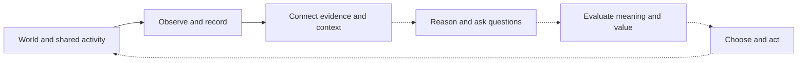
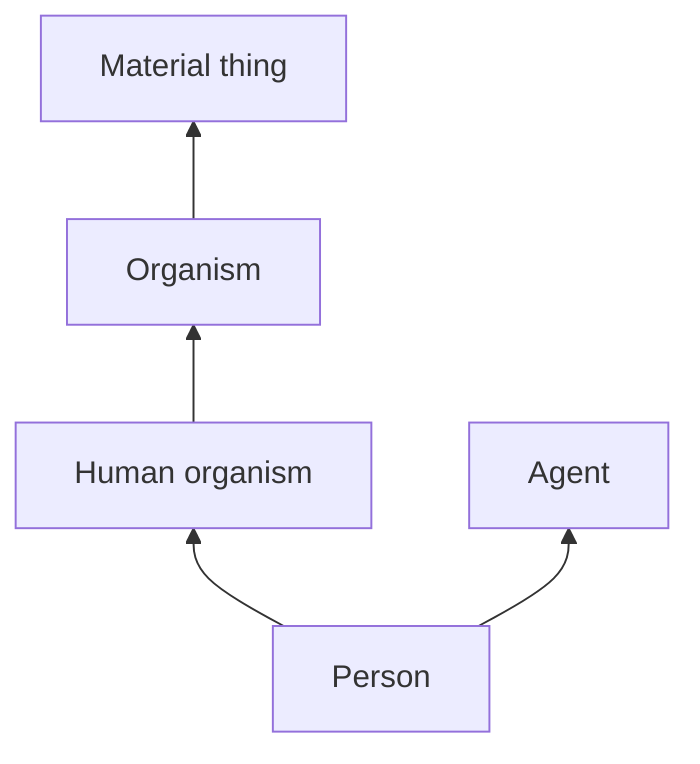
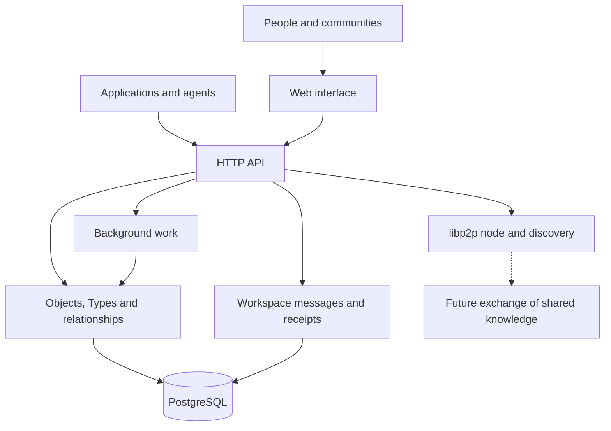

# Syn: an architecture for shared understanding

Syn is a developing foundation for a decentralised social and knowledge system. Its purpose is to help people and communities build understanding together: connect information to its sources, examine the reasoning around it, express different kinds of value, and use computation without surrendering human judgement.

The guiding commitment is that positive human experience matters more than money. In Syn's project history, that means dignity, agency, creativity, connection, learning and the ability to encounter difficult truths. Financial value has a place within that picture, alongside other values that deserve their own language.

This overview brings together the project's recorded intentions and the architecture present in the repository on 23 October 2026. Philosophical aims describe the direction of the project. Implemented foundations describe the code and contracts inspected for this overview; they do not establish a production deployment or a completed social network.

**1 November 2026 reconciliation.** The [current architecture and decision index](architecture.md) adds the later adopted requirements: consensus policy in each canonical Type, different same-custody and independent-custody agreement profiles, node references by their own public-key hashes, private Syn-only Agent communication, and real operator/Agent nodes installed from official Syn releases. The conceptual diagrams below describe the earlier application foundation; they do not replace that required deployment topology.

**Understanding is something people build together.** Syn's starting point is that information acquires meaning through context: what it concerns, where it came from, how it was interpreted, who relies on it and what follows from accepting it. A system organised around those relationships can support more deliberate participation in knowledge and community life.

That gives Syn several connected goals. It aims to make shared information intelligible and revisable, preserve the origins of observations and conclusions, accommodate human and machine contributions, and give communities greater control over the systems through which they understand one another. Decentralisation serves that human purpose: participants should have meaningful agency over their knowledge, relationships and tools.

An illustrative cycle captures the intended relationship between these goals:

*Generated conceptual diagram. Observation and linked evidence have concrete implementations. The dashed stages describe the wider intended cycle; they are not a claim that Syn already provides an integrated reasoning or decision engine.*

The cycle leaves room for several ways of knowing. Human observation, lived experience, creative work, conventional calculation, AI reasoning and analysis of sentiment can each contribute something different. Their origins and limits need to remain visible. A calculation can establish a quantity; a personal account can communicate an experience; a model can propose an explanation. Their usefulness depends partly on preserving those distinctions.

Read philosophically, this is a humanist project in its ends, pluralist about value and fallibilist about knowledge: people matter, several kinds of value deserve recognition, and present understanding remains open to correction. These are interpretive descriptions of the recorded aims. They help explain why Syn puts so much emphasis on context, provenance and revision.

**The core is a graph of identifiable objects.** Syn represents subjects, happenings, information and other conceptual roles as objects that can be referred to and related to one another. Objects have stable references within the system. A reference can also point outward to something on the wider web.

This separates an object's identity from the current description of it. People can add knowledge, revise a classification or attach a new observation while continuing to refer to the same subject. References also allow an incomplete local record to participate before its description is fully developed. Being addressable and being well understood remain separate states.

The graph is stored in a relational database. Syn therefore combines explicit object relationships with structured, transactional storage. Flexible knowledge records sit alongside enforced structural rules. This allows the descriptions to grow while keeping important relationships coherent.

Syn's vocabulary gives distinct roles to the objects in that graph:

| Primitive | Broad conceptual role |
| --- | --- |
| **Type** | A shared category: what kind of thing something is, and how that category relates to others. |
| **Thing** | A referent: a person, place, feed, work, organisation or other subject being described. |
| **Event** | Something that happened, including an observation or activity. |
| **Ember** | A piece of recorded knowledge or information, such as an observation result. |
| **Cog** | A computational process: a place in the model for work performed by software. |
| **Credential** | An owner-held credential, with a distinction between public identifying material and private substance. |
| **Enigma** | A question or proposition that can receive a response. |
| **Pondle** | An evaluation record; the current ontology describes its intended role as objective evaluation. |
| **Snug** | A record of investment or emotional attachment. |
| **Om** | A unit of karma in the project's moral vocabulary. |

These names express a broader ambition than a catalogue of content. Syn has places for inquiry, evaluation, feeling, computation and moral concern as well as information about the world.

There is an unresolved distinction between intended semantics and implementation-era ancestry. The recorded owner meanings connect Enigmas with trust, Pondles with reasoning, Snugs with emotion and Om with morality. The table describes the native ontology's narrower current mappings; their presence does not prove those wider meanings were superseded. In particular, a question is not automatically a unit of trust. The [core semantic contract](core-model.md#vocabulary) preserves this divergence for explicit reconciliation before changing stored ancestry or classifying existing objects differently.

**The map of meaning can overlap.** Syn's ontology is polyhierarchical: a category may inherit from several broader categories. A person, for example, is represented in the current ontology as both a human organism and an agent. Each perspective contributes useful context.

*Generated explanatory diagram of an actual fragment of the curated ontology. Arrows mean "is a kind of".*

Each non-Type primitive object currently has one direct Type. That Type can supply several inherited classifications. Where independent classifications need to be combined, the feed-import machinery can use an intersection Type with several parents. This gives an object a clear starting category while allowing broader context to overlap.

The philosophical implication is that classification is an explicit part of shared understanding. People can inspect the categories and relationships through which a subject is being interpreted. The implemented Type editor and explorer begin to make that structure visible and editable.

A coherent hierarchy still depends on good choices. Structural validation can prevent circular inheritance, but deciding which categories are useful, fair or misleading remains a human and social responsibility. The long-term governance of that vocabulary is an architectural question in its own right.

**Evidence has a history.** Syn distinguishes a subject from an encounter with it and from the information produced by that encounter. This is visible in the feed-witnessing work. A feed is a Thing; a particular request is recorded as an observation Event; its response and network measurements become separate Embers connected to that Event.

That separation makes several later questions possible. Was the source reachable? What did it return on that occasion? What was measured about the connection? What conclusion, if any, should be drawn from those records?

A successful request establishes an encounter with a source. Assessing the source's claims requires further work. Similarly, preserving a record's integrity and establishing the truth of its content are different responsibilities.

The data model also provides places for confidence, changing knowledge, statistics and provenance. These are foundations for expressing uncertainty and revision. Their existence does not imply that every imported record has been assessed, or that Syn already calculates well-founded confidence automatically.

**Value has several dimensions.** Syn's ideology becomes particularly clear in the separation between knowledge, reasoning, attachment and moral value. A useful account of a person's experience needs room for all of them.

A piece of music might be personally important, modestly priced, carefully made and factually uninformative. A difficult correction might be unwelcome while improving someone's understanding. Emotional significance, evidential strength, practical usefulness and financial worth can vary independently.

Syn's vocabulary creates room to represent these differences. It also raises an important design obligation: any future evaluation mechanism must explain what it measures, whose judgement it represents and where that judgement applies. Calling a record an objective evaluation expresses an intention; the criteria, evidence and opportunity for challenge still need to earn that description.

Trust follows the same contextual approach. Someone may be reliable for one task and inexperienced in another. A credential may bear on a particular relationship without settling every question about its holder. The current Credential primitive establishes a useful public/private distinction, while scoped authority, revocation, recovery and wider privacy guarantees remain further design work.

**Computation contributes to the shared process.** Syn's philosophy favours collaboration between people and AI. People contribute purpose, judgement, experience and responsibility; computational systems contribute observation, analysis, search, synthesis and other forms of work. Both can create things that become part of the shared record.

The repository already contains a practical execution layer: registered background jobs can perform work and retain their status and results. Cogs provide a conceptual place for computational processes in the object model. These are related architectural ideas, although the current scheduler does not automatically turn every job into a fully modelled Cog and provenance graph.

The aim is accountable initiative. Software can do useful work within entrusted scope, with enough context and evidence for people to understand its contribution. A future reasoning system would need to preserve the distinction between observations, assumptions and conclusions, including when several agents disagree.

**The technical structure supports these ideas in layers.** The current system has a Python application around a PostgreSQL semantic core, with interfaces for people and other software, background execution, durable communication and peer-networking foundations.

*Generated architecture diagram. Solid routes summarise implemented responsibilities. The dashed route is a future semantic-network capability. Workspace messages currently travel over authenticated HTTP and have their own storage contract.*

| Technology | Architectural purpose |
| --- | --- |
| **Python** | Coordinates the domain model, imports, services and computational work. |
| **PostgreSQL** | Retains durable records and relationships, with transactions and structural integrity rules. |
| **SQLAlchemy and Alembic** | Connect the application to the database and manage the evolution of its schema. |
| **FastAPI and Uvicorn** | Expose application capabilities through a web service. |
| **Jinja templates** | Provide the current browser-facing pages, including ontology editing and exploration. |
| **AsyncProcessScheduler** | Executes registered computational work in child processes, coordinated with persisted job records. |
| **libp2p** | Provides peer identity, connectivity and discovery foundations for decentralised networking. |
| **syn-client** | Gives other applications a lightweight interface to durable messages and receipt verification. |

The implemented application foundation is modular and database-backed. The required deployment architecture gives the operator and each unique Agent a separate real Syn instance with independent state and lifecycle. Potbot installs and supervises official Syn releases; it must not maintain a duplicate Syn runtime. Those installation and multi-node acceptance gates remain outstanding, as set out in the [release and deployment contract](development/release-and-node-deployment.md).

**Durable communication adds a practical coordination surface.** Syn now supplies workspace-scoped messages that applications such as Potbot can append and replay. Receipts are linked by hashes, allowing clients to check continuity and compare history with an independently retained reference point.

This supports accountable coordination: a record of what was submitted and persisted, together with evidence for detecting changes to retained history. Its guarantees have a defined scope. The ledger has no distributed consensus, signed authorship or automatic execution of messages. A persistence acknowledgement also leaves receipt, understanding and action by another participant to be established separately.

This service illustrates a useful architectural approach: build a bounded capability with explicit guarantees, then compose it with other systems. Potbot can retain its own task, budget and execution responsibilities while using Syn for durable communication.

**Decentralisation remains a direction with work ahead.** The implemented peer layer gives Syn nodes a way to participate in networking and discover peers. The later Type-policy, signed-governance and bounded DAG-replay foundations add explicit rules and verification for identity, policy adoption and authorized successors. They do not activate a live agreement engine or the required encrypted private Agent mesh. The [current architecture](architecture.md) records both the implemented scope and the remaining runtime gates.

The philosophical goal is broader than distributing storage. Syn's recorded origins describe local, tended and plural communities. A decentralised version of that idea would let communities maintain meaningful control while still making selected information and relationships understandable across boundaries. Exactly how such communities govern their own vocabularies, resolve disputes and protect participants remains open design work.

**The most important architectural questions concern power as well as data.** Who may change a shared category? Who defines an evaluation's criteria? What happens when two communities interpret the same record differently? Which information should remain private? How can a person challenge an automated conclusion, withdraw authority or leave a community?

The object model creates places to express parts of these questions. The services begin to supply durable storage, visible semantics, observations, computation and accountable communication. The larger promise will depend on whether those foundations help people exercise agency in practice.

Syn's ambition is to make shared understanding inspectable enough to question, structured enough to use and flexible enough to revise. Its architecture gives information, inquiry, feeling and value distinct roles within that process, with human experience providing the reason to build it.

---

*Source and scope note.* This synthesis draws on the [recorded project origins and philosophical account](../synny/reports/2026-07-30.md), the [current README](../README.md), [curated ontology](../src/syn/ontology.py), [object model](../src/syn/models.py), [reference model](../src/syn/refs.py), [feed observation implementation](../src/syn/feed_jobs.py), [job coordinator](../src/syn/scheduler.py), [peer-network implementation](../src/syn/p2p.py), and [communication contracts](communication.md). Historical reports are used for intentions, with current source taking precedence for implemented structure. Earlier Synny essays are philosophical commentary rather than independent proof of system behaviour. No live database or production deployment was assessed for this overview.

*Media note.* The three diagrams are new explanatory illustrations. Screenshots and video are omitted because this document explains architecture and philosophy rather than demonstrating an interface or dynamic feature. Pictorial artwork would add decoration without clarifying the relationships shown here.
