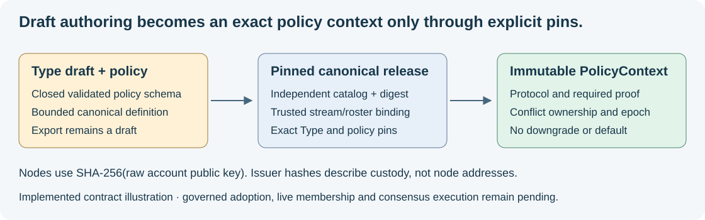

# Syn consensus: implementation audit, 13 November 2026

**Finding:** Syn implements per-Type policy selection, local governance persistence, bounded proof verification and private node transport. It does not yet have an end-to-end runtime that orders and applies ordinary shared transactions under either adopted consensus profile.

Audit target: GitHub `master` at [`4b96c7e`](https://github.com/Synsphere/syn/commit/4b96c7e21bb8b75d9ebef9191423bd118dad2fde), also resolved by the GitHub connector as `v0.10.1`. GitHub reports [v0.10.1](https://github.com/Synsphere/syn/releases/tag/v0.10.1) published and immutable on 13 November at 13:37 UTC. The working checkout was on `codex/potbot-communication-service` at `481ab62`; its cached `origin/master` was `22dfc5a`. The [nine-commit GitHub comparison](https://github.com/Synsphere/syn/compare/22dfc5ad07be1b2a68c839604c5f9cbe20931fba...4b96c7e21bb8b75d9ebef9191423bd118dad2fde) shows packaging, test/qualification, and GossipSub changes, with no changes to the policy, governance or DAG-verification sources tested from the archived base. Publication metadata does not verify signed assets, installation or a qualified consensus deployment; this audit did not reverify them.

*Existing Syn explanatory diagram, linked to the audited revision. The policy context is a validation result, not a transaction commit. The headless source and fixture audit produced no running consensus interface to screenshot or record.*

| Adopted requirement | What is implemented | What is still missing |
| --- | --- | --- |
| Explicit policy on each canonical Type | Type draft column and API; canonical definitions and release digests; independently pinned catalog, policy, roster, stream, genesis and epoch; no implicit inheritance; fail-closed resolution. The resolver rejects incompatible **supplied** atomic write sets. | A live entry point that independently derives the complete write set, binds the node to its admitted release and routes every shared mutation through resolution. A caller-provided list cannot establish completeness. |
| Identity and common custody | Account-public-key-hash identities; assigned-key and issuer credentials; operator/Agent custody, enrollment and signed session/boot evidence in the supported node profiles. Group-key rollover exists as a separate controlled operation. | Verify this evidence and the eligible roster at the consensus boundary. A valid certificate, distinct issuer key or connected transport peer does not establish a vote or independent human/administrative custody. |
| Explicit adoption and policy changes | Pinned genesis, signed successors, old-policy and old-governor approval, append-only local store and authenticated exact-head reads. The local importer verifies a completed record before a serialised database append. | Live proposal/approval delivery, multi-replica agreement, authenticated checkpoints and authorised legacy-to-governed migration. Local SQL serialisation cannot choose a winner across replicas. |
| Same verified custody | `syn.operator-log/1` policy and strict-majority consent verification for governance. | An operational authenticated replicated log: proposal and commit rules, fencing, duplicate/conflict handling, a defined crash/partition model and catch-up. No Raft engine is activated. |
| Independent custody | Bounded signed DAG replay for governance replacements: fork-aware visibility, rounds and virtual fame voting, and selection of the first authorised finalised proposal. The protected v2 verifier also checks independent issuer reservation receipts. | Event production and reliable dissemination, a qualified BFT DAG/Hashgraph engine, a supported common coin or equivalent engine liveness mechanism, changing rosters, availability proofs and application outcome proofs. The current verifier can hold on coin-dependent histories. It is neither a general transaction engine nor Hiero wire-compatible. |
| Protected signing and recovery | Syn verifies protected v2 envelopes. The documented native Potbot custody path prepares, reserves, commits and recovers exact event bytes using an operator reservation journal separate from the Agent vault. | Wire it into Syn-owned production event delivery without bypassing custody. Qualify checkpointing/retirement before bounded history fills, and handle loss or rollback of both custody copies. |
| Private node transport | Real operator/Agent entry points, encrypted signed group messaging, optional pinned GossipSub relays, signed receive evidence and separate same-host directed RPC. | Durable proposal/event delivery, replay, dependency repair and consensus control messages over the Agents’ own Syn nodes. A volatile publish receipt is neither peer reception nor finality; RPC is not an alternate consensus path. |
| Apply shared outcomes | Existing PostgreSQL object APIs and hash-chain message receipts; signed governance import applies policy records locally. | A deterministic transition handler for one real shared operation, atomic application with the finality receipt, replica-independent replay, state/outcome commitments and verified restore. |

Key source entry points at the audited revision: [Type export](https://github.com/Synsphere/syn/blob/4b96c7e21bb8b75d9ebef9191423bd118dad2fde/src/syn/type_consensus.py), [policy resolver and write-set check](https://github.com/Synsphere/syn/blob/4b96c7e21bb8b75d9ebef9191423bd118dad2fde/packages/syn-client/src/syn_client/consensus.py#L385), [governance store](https://github.com/Synsphere/syn/blob/4b96c7e21bb8b75d9ebef9191423bd118dad2fde/src/syn/governance.py#L37), [DAG verifier](https://github.com/Synsphere/syn/blob/4b96c7e21bb8b75d9ebef9191423bd118dad2fde/packages/syn-client/src/syn_client/dag_finality.py#L362), [Agent service](https://github.com/Synsphere/syn/blob/4b96c7e21bb8b75d9ebef9191423bd118dad2fde/src/syn/agent/service.py#L101), and [GossipSub relay](https://github.com/Synsphere/syn/blob/4b96c7e21bb8b75d9ebef9191423bd118dad2fde/src/syn/mesh_gossipsub.py#L52). In the inspected sources, `resolve_write_set` has no production caller; governance replay is reached through governance transition verification rather than the Agent message handler.

## Build order

1. **One shared transaction end to end.** Pick a non-governance operation with a visible conflict, such as a conditional update against an expected prior revision. Derive every affected Type from the operation and authoritative state. Pin its policy and membership. Define deterministic accept/reject results and a receipt that binds the exact operation and resulting state.
2. **Complete the same-custody path first.** Propose over private Syn, decide exactly one conflicting update, apply it atomically, and replay/catch up a restarted replica. Prove what happens when a partition cannot form the configured majority. Reuse the existing custody and policy validators.
3. **Qualify the independent-custody backend.** Hiero is the first feasibility candidate, not an adopted engine. The [existing boundary review](https://github.com/Synsphere/syn/blob/4b96c7e21bb8b75d9ebef9191423bd118dad2fde/docs/development/hiero-boundary.md) leaves open protected signer injection, carriage of peer/recovery traffic over Syn, and independently verifiable application outcomes. Require live multi-operator tests, including restart, roster changes, partitions and independent proof replay. Keep the finite governance verifier as an evidence consumer, not a fallback operational engine.

## Evidence and editorial disposition

The audit read pinned source and ran focused policy/governance tests on an isolated archived tree, without a production database or credentials. The first run passed 119 tests; four were blocked at fixture setup by Windows permissions on pytest's temp directory. Those four passed in a separate run using fresh audit-owned fixture directories without changing test or product source. In total, all 123 focused cases passed across the two runs. This does not qualify Linux custody, PostgreSQL concurrency, a multi-host mesh or consensus deployment. No runtime code changed. Existing DanceFlow workflow discovery did not identify a tool that improves this source audit beyond the Git and pytest evidence; no media or model runtime was installed. No browser tabs were opened.

**Blogworthiness: PASS.** Reader angle: how a system can already verify a consensus proof without being able to produce a live consensus decision. Evidence: the pinned resolver, governance importer, bounded replay, live transport, and their separate test boundaries above. The public search did not establish duplicate clearance; the read-only WordPress post/draft inventory returned `HTTP unavailable`. Keep this as a candidate update to the existing Syn ledger story rather than opening another article. Delivery is blocked on current public and pending-draft inventory; named continuation: **project-blog-writer — Syn ledger research follow-up**, using the maintained project-blog-writer and Kieran voice guidance. No article was created, scheduled or published.
