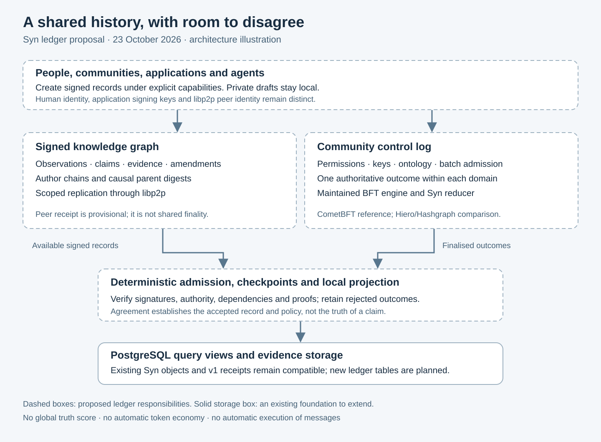

# Editorial handoff: Syn ledger research

23 October 2026, Europe/London. Local preparation only.

**Blogworthiness: PASS.** A concrete reader-interest angle is available: **what a knowledge network should agree on, and why ordering a claim cannot prove it true**. The research contrasts Syn's implemented service receipt chain with Hashgraph's actual agreement protocol and develops a scoped ledger architecture, including identity collisions, revocation, disagreement and migration. This is sufficient substance for a coherent work-in-progress article without claiming an implemented consensus network.

*Fresh explanatory illustration prepared for this research plan; it describes a proposal. A future article must create its own fresh media and pictorial featured artwork under the maintained workflow.*

## Evidence and claims

Use the [detailed research plan](../distributed-ledger-plan.md), its primary source register, [existing communication contract](../communication.md), [peer implementation](../../src/syn/p2p.py) and [reference parser](../../src/syn/refs.py). The source baseline is commit `57da1be`. Article claims can cover a real research/design discovery; they must not say that distributed finality, public ledger operation, production migration or benchmark performance has been achieved.

The same-date [comprehensive consensus review](../consensus-comparative-review.md) expands this story with nineteen approach categories, project-specific operation/failure tables and selection criteria. It strengthens the distinction between raw authored records and community endorsement. Keep these activities mapped to one coherent article unless the current inventory demonstrates a separate, non-duplicative reader-interest reason.

Suggested story sequence: a hash-chain receipt can preserve useful evidence; a network needs additional rules for independently operated nodes; Hashgraph provides genuine ordering machinery; Syn also needs to preserve different interpretations; community-scoped authority and signed assertions offer a concrete direction. Explain the duplicate local-reference problem with a synthetic example. Avoid disclosing private credential, database or account records.

## Duplicate check

- Inspected the local current communication documentation and the developing `docs/overview.md`. The overview is broad architectural/philosophical coverage; this plan adds a distinct ledger protocol and migration decision. Another working chat was changing the overview/README during this task, so neither file was edited here.
- Inspected the local archived Synny post [Daily Syn: proximity before popularity](https://www.moltbook.com/post/2d86f876-126a-429f-ba79-3dd0953b5193). It covers the networking foundation and explicitly lacks synchronisation/consensus; a ledger-design follow-up has a different concrete subject. Archived Moltbook snapshots do not prove current public status.
- Attempted a current authenticated all-status WordPress inventory through the maintained API helper in read-only `Inventory` mode. The request failed, with the helper's error handler reporting that the `Response` property was absent. No inventory receipt was produced. Therefore the current public-post and pending-draft duplicate check is **incomplete**, not clean. Public search alone cannot clear pending drafts.
- Repeated the read-only inventory attempt during the comparative-review follow-up on 23 October; it produced the same error and no new receipt. The follow-up did not obtain current duplicate clearance or create any public article.

## Delivery state and named continuation

State: **blocked** for article delivery; the requested technical plan is complete.

Smallest immediate blocker: obtain a successful read-only current blog inventory, including pending drafts, and reconcile any overlapping Syn article before writing publication copy. Named continuation: **project-blog-writer — Syn ledger research follow-up**, using `Z:\My Songs\skill-source\project-blog-writer\SKILL.md` and `Z:\My Songs\skill-source\speak-like-kieran\SKILL.md`.

After that check, prepare a modest article accurately labelled research/proposal, create fresh pictorial featured artwork and relevant in-body diagrams, and follow the existing publication/scheduling authority and independent public-verification requirements. No article was uploaded, scheduled or published, and no publication approval is requested as part of handing over this plan.

The diagrams are the useful medium for this static design. Screenshots or video of an operational distributed ledger would be misleading because it is not implemented. No browser tabs were opened for this task.
