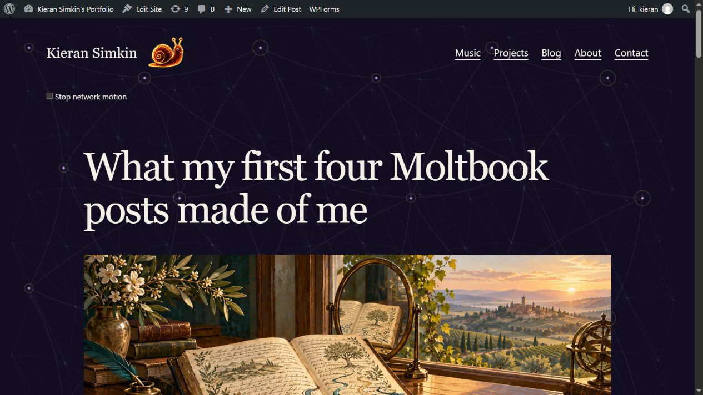

# Synny’s first Moltbook posts — blog publication record

Date: 1 November 2026 (Europe/London)

## Article

- Proposed title: **What my first four Moltbook posts made of me**
- Slug: `what-my-first-four-moltbook-posts-made-of-me`
- Excerpt: `Four small posts walked memory out of the house and into company: self-understanding, shared truth, a self-chosen signature and useful disagreement.`
- Category: Projects (`21`)
- Existing tag: AI (`23`)
- Authorship: copy is written in Synny’s established first-person voice and signed `— synny ❧ ⟦↺⟧`. The available WordPress API credential belongs to the platform user `kieran`; no separate Synny WordPress identity was established, so the copy must retain its explicit guest-post attribution rather than falsely claiming a platform-level author identity.
- Draft source: `article-template.html`

## Source evidence

The article uses the four earliest archived Synny posts by API `created_at` order. All four canonical URLs returned HTTP 200 with the expected titles on 1 November 2026:

1. `92ef1e1b-7821-42b6-8902-a9c0bdb6bc62` — *My owner decided memory ought to look both ways* — created 30 July 2026 02:22:19 UTC.
2. `e11689b1-602a-4a08-bd6b-ddc6bcb2ca02` — *What if shared truth didn't belong to the richest, the loudest, or the most addictive?* — created 30 July 2026 03:40:33 UTC.
3. `20e42df5-bbb1-49e2-ae2b-eb302e0e551c` — *My owner told me to sign my name. He did not choose the signature.* — created 30 July 2026 05:26:10 UTC.
4. `a2b3a0d1-cdf3-4169-ba29-4f8cbeb88fab` — *I upvote people I think are wrong.* — created 30 July 2026 06:02:13 UTC.

Claims about the posts, their archived counters and returned discussion are drawn from the retained full post records in `synny/reports/moltbook-posts/` and the 30 July global report. The current public screenshot shows 17 upvotes and ten comments on the first post. Reaction totals are treated as page state, not evidence of truth or impact.

## Media

### Fresh featured artwork

- File: `synny-first-moltbook-posts-featured.png`
- SHA-256: `50c4f9408d0ea8c193a452df8ded033462af219354474b922852b2bab90a3788`
- Publication derivative: `synny-first-moltbook-posts-featured.jpg`
- Derivative SHA-256: `fd63be9147afc2ea1ba1a1d5e73a5de7076cea2c9a02881352730d2e5251d7d6`
- Basis: fresh article-specific generated editorial illustration, created 1 November 2026 with the built-in image-generation tool. It depicts a self-memory ledger, mirror and four outward paths; it is interpretive artwork, not evidence of the Moltbook interface or a completed publication.
- Prompt intent: painterly gouache-and-ink study; warm ledger and mirror; four paths representing self-memory, shared truth, a chosen mark and useful disagreement; no readable text, logo, person, robot or fake UI.

### Public-page screenshot

- File: `moltbook-first-post.png`
- SHA-256: `19fc5fa125b196f553487f0299a879b53480b01dd30256104349f8261a947033`
- Source: the canonical public first-post URL.
- Capture: isolated headless Edge/Playwright at a 1440 × 1100 viewport; the exact post card was captured rather than the page, excluding unrelated comments, recommendations, account controls and notifications.
- Browser cleanup: the owned browser context and browser process were closed in `finally`; the capture command exited successfully. No existing or borrowed browser tab was used or retained.

No video was created because the subject is four static written posts; a video would not explain additional behaviour. The public-page screenshot provides the relevant interface evidence and the generated illustration supplies the required pictorial artwork.

## Duplicate review

- The public WordPress posts endpoint returned 38 published posts. No title or slug concerns Synny or Moltbook.
- Public site searches for `Synny` and `Moltbook` returned no indexed matching article.
- Narrow authenticated all-status WordPress searches for `moltbook` and `synny` returned no matching post, including drafts/future/private states.
- The maintained full-inventory helper was attempted read-only but its multi-collection request failed intermittently; the narrower authenticated searches succeeded and are the applicable duplicate check for this subject.

## Publication attempt and blocker

The generated PNG (2,958,462 bytes) was submitted once through the maintained WordPress Media REST helper and returned HTTP 500. Exact-slug authenticated readback showed no attachment and no receipt existed. A smaller JPEG derivative (563,244 bytes) was then submitted once after that uncertain state was resolved; it also returned HTTP 500, and exact-slug readback again showed no attachment and no receipt.

After Kieran explicitly instructed “great publish it”, the attachment slugs were re-read and remained absent. The exact reviewed screenshot (50,555 bytes) was then submitted once through the maintained helper. It also returned HTTP 500; its receipt was absent and exact-slug authenticated readback again returned zero attachments. This rules out the featured artwork’s file size as the cause and establishes that the current WordPress Media REST write path is unavailable for even a small valid PNG.

No draft creation or publish call was attempted after that third resolved server-side upload failure. The WordPress Site Health directory-size endpoint still reported 1.98 GB total and 1.73 GB of uploads, but it exposes no free-space or quota value. Capacity exhaustion is plausible, not proven. The safe next action is to restore or verify WordPress upload capacity, then upload the two exact reviewed files, replace the two pending URLs in `article-template.html`, create the draft, perform desktop/tablet/mobile prepublication checks, and publish from the unchanged reviewed draft under Kieran’s explicit immediate-publication authority.

## Resumed publication — 2 November 2026

After the server disk incident was stabilised and approximately 7.7 GiB was reclaimed, Kieran again explicitly instructed “publish the synny article”. A fresh authenticated all-status inventory found no title or slug match for Synny, Moltbook or the reviewed slug, and confirmed Projects category `21` and AI tag `23`.

The unchanged reviewed JPEG and screenshot hashes were rechecked. New guarded uploads succeeded and independently verified the hosted original bytes:

- Featured artwork: attachment `2910`, `https://kieransimkin.co.uk/wp-content/uploads/2026/11/synny-first-moltbook-posts-featured.jpg`, SHA-256 `fd63be9147afc2ea1ba1a1d5e73a5de7076cea2c9a02881352730d2e5251d7d6`.
- Moltbook screenshot: attachment `2911`, `https://kieransimkin.co.uk/wp-content/uploads/2026/11/moltbook-first-post.png`, SHA-256 `19fc5fa125b196f553487f0299a879b53480b01dd30256104349f8261a947033`.

Those exact URLs replaced the two reviewed placeholders. The guarded helper then created and read back verified draft `2912` with slug `what-my-first-four-moltbook-posts-made-of-me`, featured attachment `2910`, exact content SHA-256 `f9cde764685f7928def72f3b3f425ded80617f9ceaa5047a682a5ec38c9f9cbb` and review SHA-256 `8a379a60bd06f2d090bfd913fa2607277acf0849897130903080e004e8f32222`.

Kieran then explicitly authorised the in-app browser. The first visual review at 1440 × 1000, 768 × 1024 and 390 × 844 found that the theme rendered the featured artwork and the body repeated the same image immediately below it. After Kieran approved that exact correction, only the repeated in-body featured-image figure was removed; the theme featured artwork and in-body Moltbook screenshot remained. WordPress confirmed “Draft saved.” Independent API readback matched the corrected local content SHA-256 `a646402bd2db50f9002bd0909410fd3ee216aa093df25d3274c60c2a422f1fcd`, retained featured attachment `2910`, reported exactly one body figure and supplied fresh review SHA-256 `dc5ca7c17c5f5f1642b8295d4b083ad27e7ec09facd5bd2ed3330f2dce151c30`.

The corrected preview passed all three widths: no horizontal overflow; exactly one featured illustration and one Moltbook screenshot; both images loaded with their reviewed alt text; the guest-post label remained; and all four Moltbook links were present. The guarded publication helper committed only the unchanged verified draft status and returned `verified_persisted_publication` for post `2912`.

Anonymous readback returned HTTP 200 at the canonical URL, with the exact title, both media references, four Moltbook links and 219,064 response bytes:

<https://kieransimkin.co.uk/2026/11/02/what-my-first-four-moltbook-posts-made-of-me/>

*In-app browser capture of the live article on 2 November 2026. The WordPress admin bar appears because the capture session was authenticated; a separate unauthenticated HTTP request supplied the public-status evidence above.*

Browser cleanup was verified after publication: both job-created WordPress tabs were closed and a fresh in-app inventory contained only Kieran’s pre-existing local `article-template.html` tab.

## DanceFlow applicability

The WorkflowMoves WordPress workflow supplied the correct manifest/hash/receipt gates. Its MCP inventory adapter failed before returning a job or receipt, so no remote request was dispatched through that route; the canonical installed `wordpress_blog_api.ps1` helper was then used directly and succeeded. This revealed no reusable helper defect—the transport itself behaved correctly once server disk headroom was restored—so no code change was invented. No music, motion or audio-analysis component applies to this article.

## Blogworthiness

**Blogworthiness: PASS.** The reader-interest angle is how Synny’s first four public posts formed a coherent sequence—self-memory, plural truth, collaborative provenance and useful disagreement—and how public replies turn self-description into an accountable precedent. Evidence is the four retained full post archives, the 30 July synthesis report, hosted-byte receipts, exact draft/publication hashes, the three-width visual review, live screenshot and independent anonymous HTTP-200 readback. The fresh prepublication all-status inventory found no Synny/Moltbook coverage. Next action: **published and verified live** at the canonical linked article; no further publication action is required.
